# simple_gui

Native GUI for Eiffel: write the program once, and it **is and looks native** on each platform.

| Platform | Backend | Status |
|---|---|---|
| Linux | GTK 4 (native GtkButton, GtkEntry, GtkColumnView, GtkNotebook...) | 0.2: all 32 shared tests pass |
| macOS | AppKit (native NSButton, NSTextField, NSTableView, NSTabView...) | 0.2: all 32 shared tests pass |
| Windows | simple_widgets on simple_shell (the Cairo look, drawn) | 0.2: all 32 shared tests pass |

The same program, unchanged, runs on all three: [simple_graph_calc](https://github.com/simple-eiffel/simple_graph_calc), a graphing calculator, passes its 19 tests on each.

**Controls:** windows, menus (and context menus), labels (wrapping, numbers kept left to right), buttons, check boxes, text fields, text areas, lists, tables (sortable columns, several rows), trees, tabs, splitters, grids and stacks (with alignment), a Cairo canvas at the screen's scale (fractional too), file and message dialogs. Light and dark follow the system; any window can turn right to left.

## Showcase

`examples/showcase` puts every control in one window, each on the platform's own toolkit, with a status line reporting each event the program hears. Run with `--gallery <folder>`, it works the window through `GUI_TEST_DRIVER` as a user would and saves these pictures:

| | Controls | Table, sorted by Chapters | Canvas | Right to left |
|---|---|---|---|---|
| macOS (AppKit) | 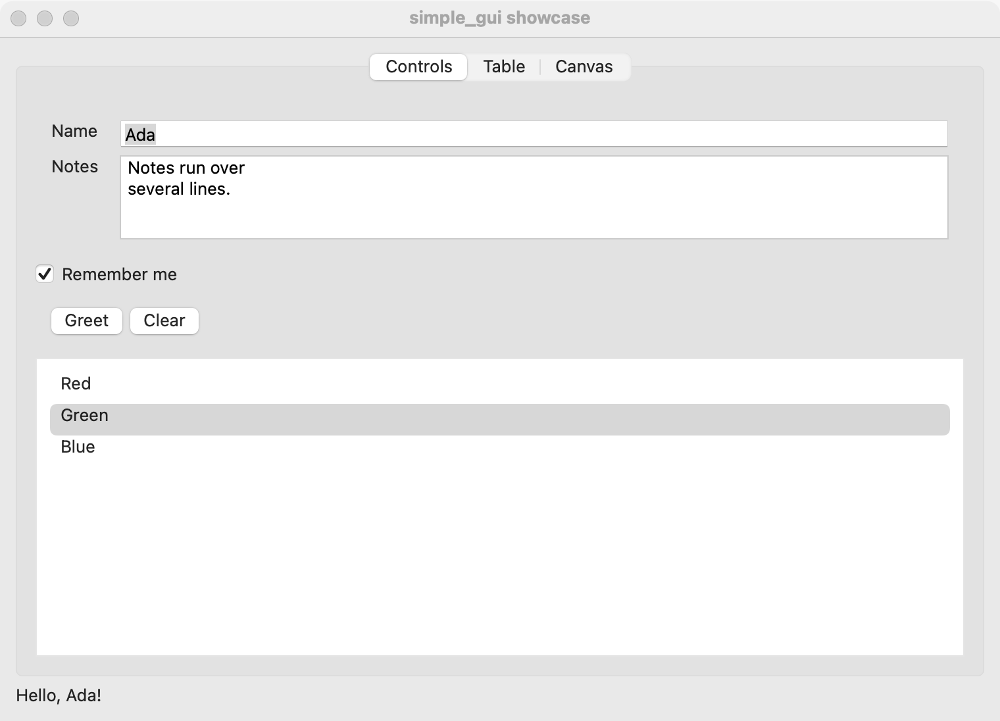 | 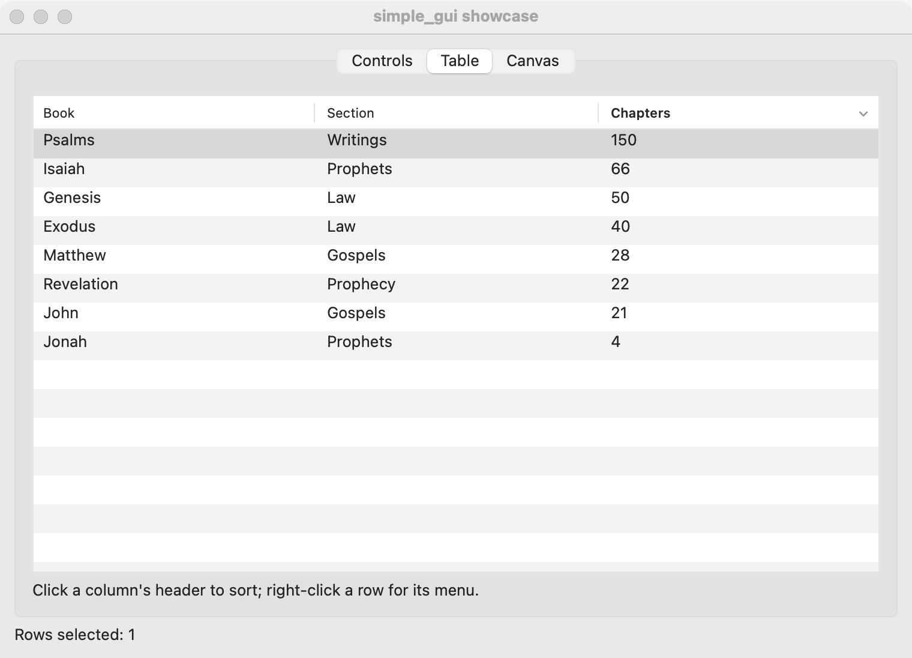 | 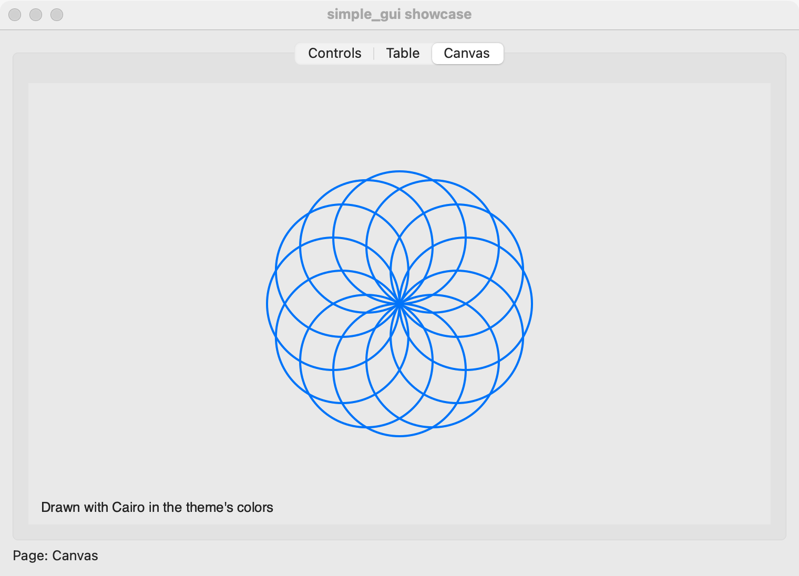 | 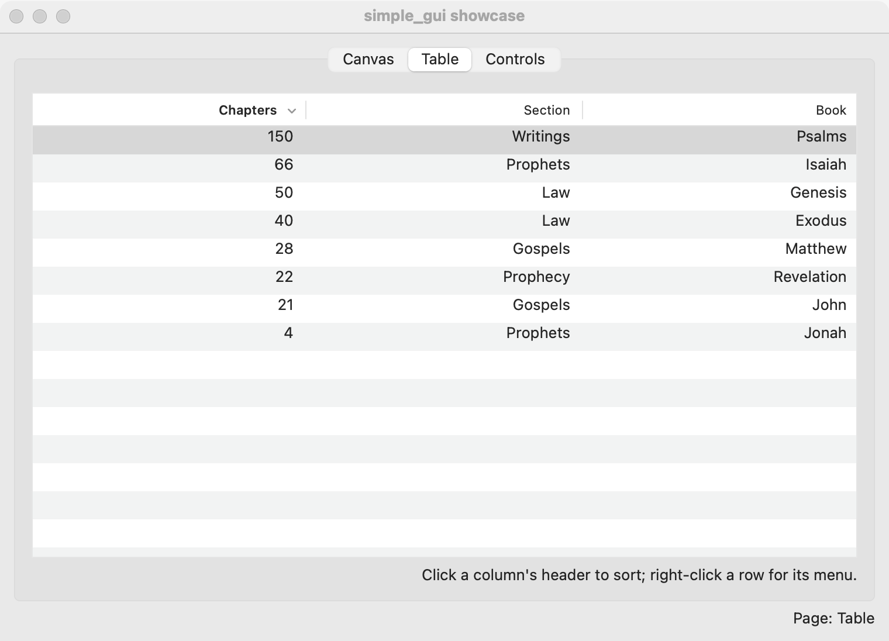 |
| Linux (GTK 4) | 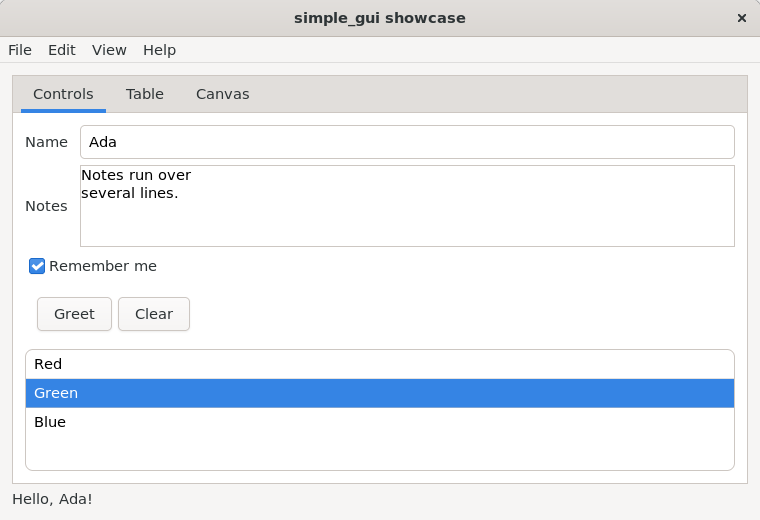 | 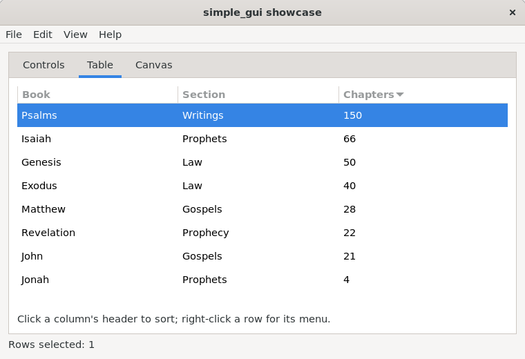 | 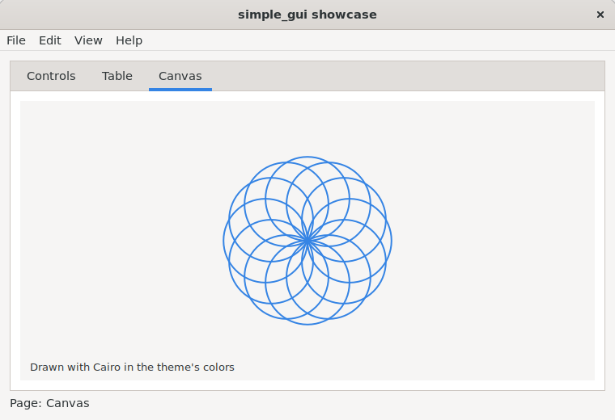 | 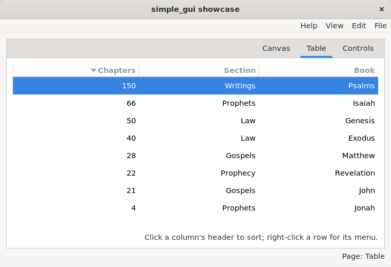 |
| Windows (simple_widgets) | 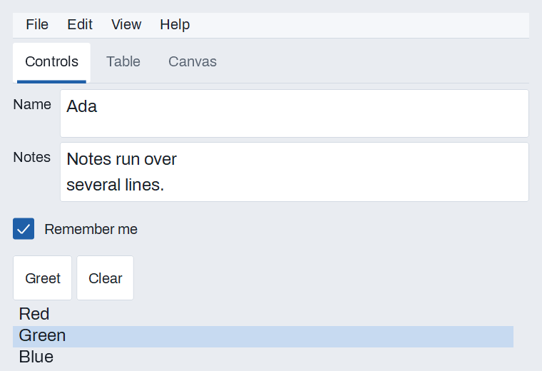 | 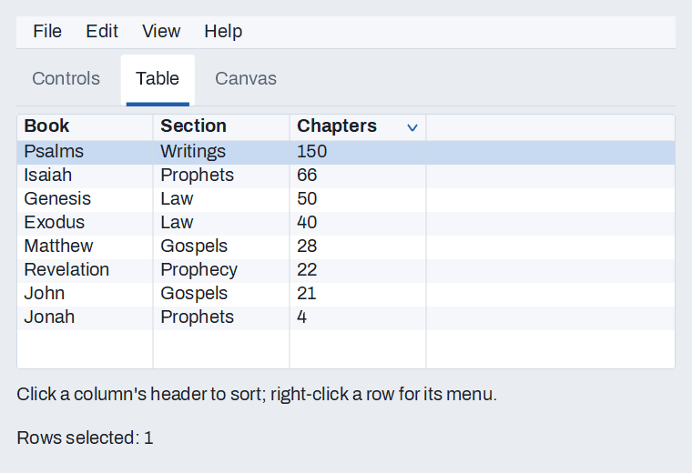 | 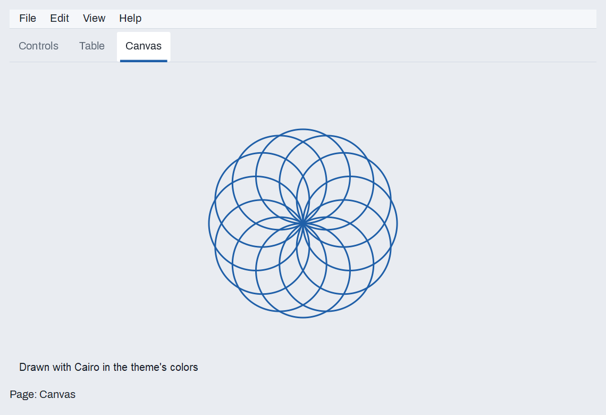 | 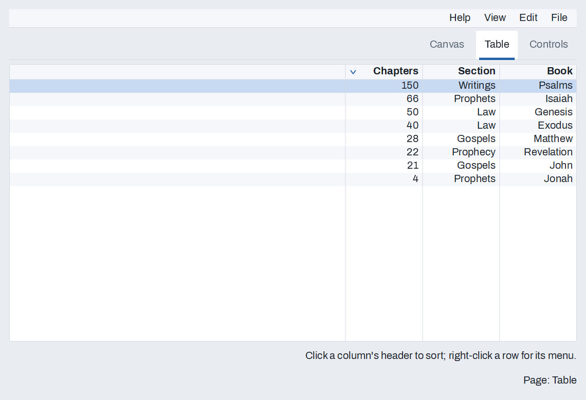 |

Right to left, the tabs and the table's columns mirror; English text keeps its own reading order.

## Example

```eiffel
class GREETER create make
feature
	app: GUI_APPLICATION
	field: GUI_TEXT_FIELD

	make
		local
			l_window: GUI_WINDOW
			l_stack: GUI_STACK
			l_button: GUI_BUTTON
		do
			create app.make ("Greeter", "org.simple-eiffel.greeter")
			create l_window.make ("Greeter", 360, 160)
			create l_stack.make_vertical
			create field.make
			field.set_accessible_label ("Name")
			field.set_placeholder ("Your name")
			create l_button.make ("Greet")
			l_button.click_actions.extend (agent greet)
			l_stack.extend (field)
			l_stack.extend (l_button)
			l_window.set_content (l_stack)
			l_window.show
			app.run
		end

	greet
		do
			app.dialogs.inform ("Hello", field.text)
		end
end
```

## Rules the API keeps

- **Native controls.** Nothing is drawn to imitate a platform.
- **No callbacks into Eiffel.** The toolkit pushes events onto a C queue; the GUI processor polls it and fires each control's agents.
- **SCOOP: workers never call into the GUI processor** (it runs the loop, so such a call would deadlock). A worker puts a message in `GUI_APPLICATION.mailbox` and calls its own `GUI_WAKE.wake`; the GUI fires `message_actions`.
- **Layout by containers** (`GUI_STACK`, `GUI_GRID`), with leading and trailing margins, so right-to-left text mirrors correctly. Absolute positions only inside `GUI_CANVAS`.
- **Programmatic changes never fire events** (`set_text`, `select_row`); only the user's do.
- **Accessible by default:** every control has an accessible label (its visible text unless set); a placeholder is never the label.
- **Testable:** `GUI_TEST_DRIVER` clicks, types, chooses rows and menu items as a user would, takes PNG snapshots, and reads the assistive tree.

## Build (Linux)

Needs GTK 4 development files (`sudo apt install libgtk-4-dev` on Ubuntu 24.04) and a display.

```
ec_linux.sh test -config simple_gui.ecf -target simple_gui_tests
```

## Build (Windows)

Needs EiffelStudio 25.02 and the simple_* libraries beside this one (`SIMPLE_EIFFEL`); the backend is pure Eiffel over simple_widgets and simple_shell.

```
ec.sh test -config simple_gui.ecf -target simple_gui_tests
```

**Not yet on Windows** (the shared tests pass; these are what they do not cover):
- A second window (opened while another is) is a floating document window of the first, with the menu bar like the first; screen readers do not see it yet.

## Build (macOS)

Needs EiffelStudio and Cairo from Homebrew (`brew install eiffelstudio cairo`).

```
make -C Clib                      # the AppKit backend's object
ec -batch -config simple_gui.ecf -target simple_gui_tests -finalize -keep -c_compile
ec -batch -config simple_gui.ecf -target simple_gui_showcase -finalize -c_compile
```

Design record: the GUI verdict and spec in the port-coordination repository.
