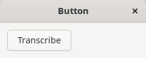
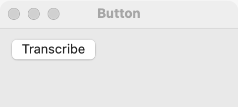
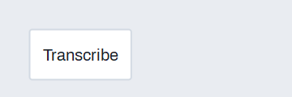

# Button

`GUI_BUTTON` is a push button: the user clicks it to run a command now. Use it for actions such as Save, Search or Close. For an on/off setting, use a [switch](switch.md) or a [check box](check-box.md); for one choice out of several, use a [radio group](radio-group.md) or a [segmented control](segmented.md).

## Example

```eiffel
class BUTTON_DEMO create make
feature
	app: GUI_APPLICATION
	label: GUI_LABEL
	clicks: INTEGER

	make
		local
			l_window: GUI_WINDOW
			l_stack: GUI_STACK
			l_button: GUI_BUTTON
		do
			create app.make ("Button demo", "org.simple-eiffel.button-demo")
			create l_window.make ("Button", 320, 140)
			create l_stack.make_vertical
			create label.make ("Not clicked yet")
			create l_button.make ("Count")
			l_button.set_tooltip ("Add one to the count")
			l_button.click_actions.extend (agent count_click)
			l_stack.extend (l_button)
			l_stack.extend (label)
			l_window.set_content (l_stack)
			l_window.show
			app.run
		end

	count_click
		do
			clicks := clicks + 1
			label.set_text ("Clicked " + clicks.out + " times")
		end
end
```

## Try it

The window shows a **Count** button and the label "Not clicked yet". Each click runs `click_actions`, and the label shows "Clicked 1 times", "Clicked 2 times", and so on. Rest the pointer on the button to see its tooltip.

## API

| Feature | What it does |
|---|---|
| `make (a_text)` | Makes a button with the caption `a_text`. |
| `text` | The caption. |
| `set_text (a_text)` | Changes the caption. Ensures `text` is `a_text`. |
| `click_actions` | Agents run when the user presses the button. |
| `accessible_label` | The caption, unless the program set another with `set_accessible_label`. |
| `icon` | The icon name shown before the caption, or `Void` for none. |
| `set_icon (a_name)` | Shows icon `a_name` before the caption, or alone when the caption is empty. Requires `(create {GUI_ICON}).is_known (a_name)`. |
| `clear_icon` | Removes the icon. Ensures `icon = Void`. |
| `style` | The style now, `Style_normal` to `Style_pill`. |
| `set_style (a_style)` | Sets the style: `Style_normal`, `Style_suggested`, `Style_destructive`, `Style_flat` or `Style_pill`. |
| `is_busy` | Is the spinner showing? |
| `set_busy (a_on)` | `True` shows a spinner and takes no presses; `False` enables the button again. |

Every creation procedure requires `is_gui_thread` and `has_application`; every command requires `is_gui_thread`. To dim the button use `disable`; see [common features](widget.md). Icons, styles, the busy state and badges are described in [Icons and badges](icons-and-badges.md).

**Events:** `click_actions` runs, with no arguments, each time the user presses the button. Code that changes the button (`set_text`, `disable`) fires nothing.

**Accessibility:** the role is `button`, named by its caption. A button whose caption is a symbol (such as "+" or "…") needs `set_accessible_label` with words ("Add row", "More options").

## On each platform

| | Linux (GTK 4) | macOS (AppKit) | Windows (simple_widgets) |
|---|---|---|---|
| Native control | `GtkButton` | `NSButton`, push style | `SW_BUTTON`, drawn |
| Looks or behaves differently | Keeps its natural width, aligned to the start. | Inside a `GUI_TOOLBAR` the button becomes the view of an `NSToolbarItem`, and the item's label follows `set_text`. | In a column it keeps its natural width, aligned to the start; in a row it fills the row's height. |

## Design guidance

- Use a verb for the caption ("Save", "Add row"), not "OK" when a clearer word exists.
- Keep buttons at their natural width. If a stack stretches one, set the [stack](stack.md)'s alignment with `GUI_STACK.set_alignment` or add the button with `extend_aligned`.
- Put the main action last in a row of buttons. In a right-to-left window the row mirrors on its own.
- Dim a button with `disable` when its action cannot run, rather than hiding it, so the layout does not jump.
- Do not use a button to show a state that stays on; that is a [switch](switch.md) or a [check box](check-box.md).

## Gallery

| Linux | macOS | Windows |
|---|---|---|
|  |  |  |
