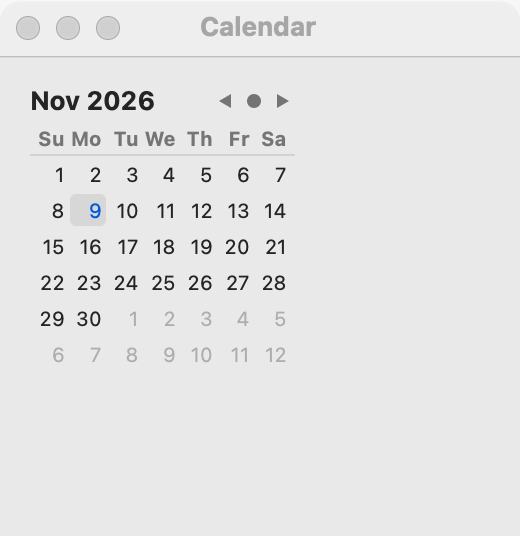

# Calendar

`GUI_CALENDAR` is a month grid where the user picks a day. Use it when the user chooses a date by looking at a month: bookings, schedules, anything where the day of the week matters. When the user already knows the date, a [date picker](date-picker.md) takes less room. `GUI_CALENDAR` inherits from `GUI_DATE_PICKER`, so it has the same features and events.

## Example

```eiffel
class BOOKING create make
feature
	app: GUI_APPLICATION
	shown: GUI_LABEL

	make
		local
			l_window: GUI_WINDOW
			l_stack: GUI_STACK
			l_calendar: GUI_CALENDAR
		do
			create app.make ("Booking", "org.example.booking")
			create l_window.make ("Booking", 320, 300)
			create l_stack.make_vertical
			create shown.make ("Pick a day.")
			create l_calendar.make
			l_calendar.set_accessible_label ("Arrival")
			l_calendar.change_actions.extend (agent on_day)
			l_stack.extend (l_calendar)
			l_stack.extend (shown)
			l_window.set_content (l_stack)
			l_window.show
			app.run
		end

	on_day (a_year, a_month, a_day: INTEGER)
		do
			shown.set_text ("Arriving " + a_year.out + "-" + a_month.out + "-" + a_day.out)
		end
end
```

## Try it

A window opens with this month's grid, today selected, and the line "Pick a day." under it. Click another day and `change_actions` fires: the line shows "Arriving" and the date you picked.

## API

| Feature | What it does |
|---|---|
| `make` | A calendar showing today. Ensures `is_valid_date (year, month, day)`. |
| `year` | The selected year. |
| `month` | The selected month, 1 (January) to 12. |
| `day` | The selected day of the month, 1 to 31. |
| `set_date (a_year, a_month, a_day)` | Selects that date, with no event. Requires `is_valid_date (a_year, a_month, a_day)`. Ensures `year`, `month` and `day` are the new date. |
| `is_valid_date (a_year, a_month, a_day)` | Is this a day of the Gregorian calendar, in the years 1 to 9999? |
| `days_in_month (a_year, a_month)` | How many days that month has (28 to 31). Requires 1 <= `a_month` <= 12. |
| `change_actions` | `GUI_ACTIONS [TUPLE [year, month, day: INTEGER]]`: run when the user commits another date. |

Inherited: `set_accessible_label`, `set_tooltip`, `enable`, `disable` and the rest of the [common features](widget.md).

**Events:** `change_actions` fires with the year, month and day when the user picks a different day. `set_date` never fires it: its postcondition is `change_actions.fire_count = old change_actions.fire_count`.

**Accessibility:** the role is `grid`, and its days are `grid-cell`s. Give the calendar `set_accessible_label` with what the date is for ("Arrival", "Due date"); the month title is not its name.

## On each platform

| | Linux (GTK 4) | macOS (AppKit) | Windows (simple_widgets) |
|---|---|---|---|
| Native control | `GtkCalendar` | `NSDatePicker` in its calendar style, dates only, without a border | `SW_CALENDAR` |
| Looks or behaves differently | — <!-- PROD: confirm --> | — <!-- PROD: confirm --> | Today wears a ring; days outside the month are muted but can be picked. |

## Design guidance

- Place a calendar with `extend`, at its natural size; a month grid does not need the spare room `extend_stretching` would give it.
- Put what the date means in a caption above it, and the same words in `set_accessible_label`.
- Show the chosen date in words somewhere near it (as the example does), so the user can check it without reading the grid.
- Right to left, leave the grid to the toolkit; the program never orders the days itself.
- In a form with several fields, a [date picker](date-picker.md) takes less room, and on Linux it opens a calendar in a popover anyway.

## Gallery

| Linux | macOS | Windows |
|---|---|---|
| <!-- PROD: Linux picture --> |  | <!-- PROD: Windows picture --> |
