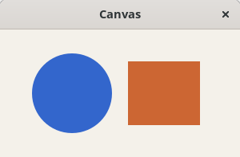
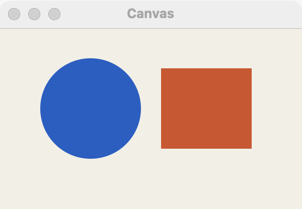
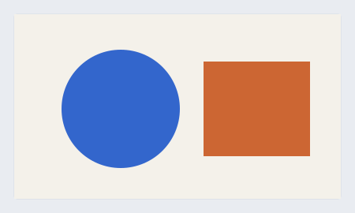

# Canvas

`GUI_CANVAS` is an area the program draws in itself with Cairo, at the screen's own scale, and that reports the pointer and the keys. Use it for charts, graphs, games and anything no control shows. For a picture from a file or PNG bytes, use an [image](image.md); for anything a control already does, use the control, since a drawing is only as accessible as the label you give it.

## Example

```eiffel
class
	DOTS

create
	make

feature {NONE} -- Initialization

	make
		local
			l_window: GUI_WINDOW
		do
			create app.make ("Dots", "org.example.dots")
			create l_window.make ("Dots", 400, 300)
			create canvas.make (400, 300)
			canvas.set_accessible_label ("Drawing")
			canvas.pointer_actions.extend (agent on_pointer)
			canvas.resize_actions.extend (agent (a_width, a_height: INTEGER) do draw end)
			l_window.set_content (canvas)
			l_window.show
			draw
			app.run
		end

feature -- Access

	app: GUI_APPLICATION

	canvas: GUI_CANVAS

	dot_x, dot_y: INTEGER
			-- The last press, in logical pixels.

feature {NONE} -- Drawing

	on_pointer (a_kind, a_x, a_y, a_button, a_modifiers: INTEGER)
		do
			if a_kind = 1 then
				dot_x := a_x
				dot_y := a_y
				draw
			end
		end

	draw
			-- Draw a finished image at device scale and present it.
		local
			l_image: CAIRO_SURFACE
			l_cr: CAIRO_CONTEXT
			l_scale: REAL_64
		do
			if canvas.pixel_width > 0 and canvas.pixel_height > 0 then
				l_scale := canvas.scale
				create l_image.make (canvas.pixel_width, canvas.pixel_height)
				create l_cr.make (l_image)
				l_cr.set_color_hex (app.system_color (app.Color_window_background)).paint.do_nothing
				l_cr.set_color_hex (app.system_color (app.Color_accent)).do_nothing
				l_cr.arc (dot_x * l_scale, dot_y * l_scale, 8.0 * l_scale, 0.0, 2.0 * {DOUBLE_MATH}.pi).fill.do_nothing
				l_cr.destroy
				canvas.present (l_image)
				l_image.destroy
			end
		end

end
```

## Try it

A window opens filled with the window's background color and a dot in the accent color at the top left. Press anywhere on the canvas: `pointer_actions` fire with kind 1 (press) and the logical position, the program redraws, and the dot moves there. Resize the window: `resize_actions` fire with the new size and the program draws again at that size. Switch the system between light and dark and the next drawing follows it, since the colors come from `system_color`.

## How a program draws

The canvas never asks the program to paint. The program draws a finished image whenever it wants the picture to change, and calls `present`:

1. Make a `CAIRO_SURFACE` of `pixel_width` by `pixel_height`: device pixels, the canvas's logical size times `scale`.
2. Draw on it with a `CAIRO_CONTEXT`, multiplying every logical coordinate, line width and font size by `scale` (**the scale rule**). A 2-pixel line is `set_line_width (2.0 * scale)`; 13-point text is `set_font_size (13.0 * scale)`.
3. `present` the image. The canvas copies it or keeps its own reference, so the program may destroy its surface afterward.

Draw after the window's `show`, in `resize_actions`, in `GUI_APPLICATION.appearance_changed_actions` if the drawing uses theme colors, and whenever the program's data changes. Before the canvas has a size, `pixel_width` or `pixel_height` can be 0: skip the drawing then, as the example does.

## API

| Feature | What it does |
|---|---|
| `make (a_width, a_height)` | A canvas asking for `a_width` by `a_height` logical pixels. Needs the application; `a_width > 0` and `a_height > 0`. |
| `present (a_image)` | Show the finished image `a_image`, a `CAIRO_SURFACE`. `a_image.is_valid` must hold. Make it `pixel_width` by `pixel_height`. |
| `scale` | Device pixels per logical pixel, fractional where the platform is (1.0, 1.25, 2.0...). Always above 0. |
| `pixel_width`, `pixel_height` | The image size `present` wants: `width` and `height` times `scale`, rounded. |
| `width`, `height` | The canvas's size in logical pixels. |
| `scale_factor` | `scale` rounded up, at least 1. Superseded by `scale`; kept for older programs. |
| `pointer_actions` | Agents run with `[kind, x, y, button, modifiers]` for the pointer. |
| `key_actions` | Agents run with `[key_code, character, modifiers]` for a key press. |
| `resize_actions` | Agents run with `[width, height]`, in logical pixels, when the canvas's size changes. |

The rest are the [common features](widget.md).

**Events:**
- `pointer_actions`: `kind` is 1 for a press, 2 for a release, 3 for motion. `x` and `y` are logical pixels from the canvas's top left (multiply by `scale` to draw there). `button` 1 is the primary button. `modifiers` adds 1 for Shift, 2 for Control, 4 for Alt (Option), 8 for Super (Command on macOS).
- `key_actions`: `key_code` is the GDK key value on every platform: letters and digits as their characters, the arrows 0xFF51 (left), 0xFF52 (up), 0xFF53 (right) and 0xFF54 (down), Return 0xFF0D (keypad Enter too). `character` is the character the key types, or 0 for a key that types none. A click gives the canvas the keyboard focus.
- `resize_actions`: the new logical size.
- `present` fires nothing.

**Accessibility:** the role is `img`. A canvas has no visible text, so give it `set_accessible_label` ("Sales by month") and, for a chart, `set_accessible_description` with what it shows. Anything the user can do with the pointer should also be possible with the keys or a control.

## On each platform

| | Linux (GTK 4) | macOS (AppKit) | Windows (simple_widgets) |
|---|---|---|---|
| Native control | `GtkDrawingArea`, which paints the image at 1/`scale` | an `NSView` that draws the image, tagged sRGB, over the window background | `SW_CANVAS`, which shows the image 1:1 |
| `scale` | the surface's scale, fractional under Wayland's fractional scaling | the window's backing scale (1.0 or 2.0) | the canvas's device scale |
| Motion (`kind` 3) | every move over the canvas, with `button` 0 | only while a button is held, with that button | every move over the canvas, with `button` 0 |
| Looks or behaves differently | Hears every mouse button: primary, middle and secondary. | While the user drags a window edge, the last picture stays at its own size, anchored at the top left, and one resize event arrives when the drag ends. The asked-for size is a preference: the canvas gives way first, so the window keeps its size. | Only the primary button's presses and releases are reported. Keys that type nothing report only the arrows, Home, End, Page Up, Page Down, Delete and F1 to F12. |

## Design guidance

- Follow the scale rule everywhere: image size from `pixel_width` and `pixel_height`, and every coordinate, line width and font size times `scale`. Otherwise the drawing is blurred or the wrong size on a high-resolution screen.
- Put the canvas in a stack with `extend_stretching`, or alone as the content, so it takes the room it is given; redraw in `resize_actions`.
- Draw in the theme's colors with `app.system_color`, and redraw in `appearance_changed_actions`, so the canvas matches light and dark.
- Absolute positions are fine inside a canvas and nowhere else. Text you draw does not mirror for right to left: place it yourself.
- Do not build controls out of drawing. Screen readers see the canvas as one picture, named by its label.

## Gallery

| Linux | macOS | Windows |
|---|---|---|
|  |  |  |
