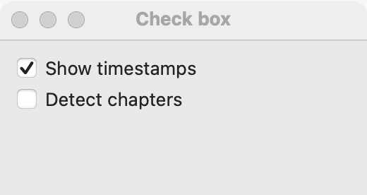

# Check box

`GUI_CHECK_BOX` is a box with a caption that the user checks or clears. Use a check box for a choice that is applied later (when the user presses OK or Save) or for one option in a list of options. For a setting that takes effect the moment it is flipped, use a [switch](switch.md). For one choice out of several, use a [radio group](radio-group.md).

## Example

```eiffel
class CHECK_BOX_DEMO create make
feature
	app: GUI_APPLICATION
	label: GUI_LABEL

	make
		local
			l_window: GUI_WINDOW
			l_stack: GUI_STACK
			l_box: GUI_CHECK_BOX
		do
			create app.make ("Check box demo", "org.simple-eiffel.check-box-demo")
			create l_window.make ("Check box", 320, 140)
			create l_stack.make_vertical
			create label.make ("Timestamps are off")
			create l_box.make ("Add timestamps to the transcript")
			l_box.toggle_actions.extend (agent show_state)
			l_stack.extend (l_box)
			l_stack.extend (label)
			l_window.set_content (l_stack)
			l_window.show
			app.run
		end

	show_state (a_checked: BOOLEAN)
		do
			if a_checked then
				label.set_text ("Timestamps are on")
			else
				label.set_text ("Timestamps are off")
			end
		end
end
```

## Try it

The window shows a cleared check box and the label "Timestamps are off". Click the box (or its caption): `toggle_actions` runs with `True`, and the label says "Timestamps are on". Click again and it runs with `False`.

## API

| Feature | What it does |
|---|---|
| `make (a_text)` | Makes a cleared check box with the caption `a_text`. Ensures `not is_checked`. |
| `text` | The caption. |
| `set_text (a_text)` | Changes the caption. |
| `is_checked` | Is the box checked? |
| `set_checked (a_on)` | Checks (`True`) or clears (`False`) the box, without an event. Ensures `is_checked = a_on`. |
| `toggle_actions` | Agents run when the user checks or clears the box, with `checked: BOOLEAN`. |
| `accessible_label` | The caption, unless the program set another. |

Every creation procedure requires `is_gui_thread` and `has_application`; every command requires `is_gui_thread`. See also [common features](widget.md).

**Events:** `toggle_actions` runs with the new state each time the user clicks the box. `set_checked` never fires `toggle_actions`; its contract ensures `toggle_actions.fire_count = old toggle_actions.fire_count`.

**Accessibility:** the role is `checkbox`, named by its caption. A screen reader reads the caption and whether the box is checked.

## On each platform

| | Linux (GTK 4) | macOS (AppKit) | Windows (simple_widgets) |
|---|---|---|---|
| Native control | `GtkCheckButton`, aligned to the start | `NSButton`, check box style | `SW_CHECK_BOX`, drawn |
| Looks or behaves differently | — | — | — <!-- PROD: confirm --> |

## Design guidance

- Write the caption as the "on" state ("Add timestamps"), not as a question or a negative ("Don't add timestamps").
- Put check boxes in a vertical stack, one per line.
- Use a check box when the change waits for OK or Save, or when several options can be on together. Use a [switch](switch.md) when the change happens at once.
- The caption is the accessible name, so you rarely need `set_accessible_label`.
- Do not use a check box to run a command; use a [button](button.md).

## Gallery

| Linux | macOS | Windows |
|---|---|---|
| <!-- PROD: Linux picture --> |  | <!-- PROD: Windows picture --> |
