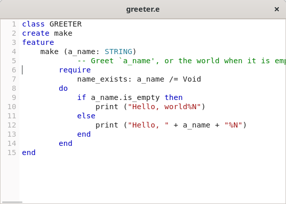
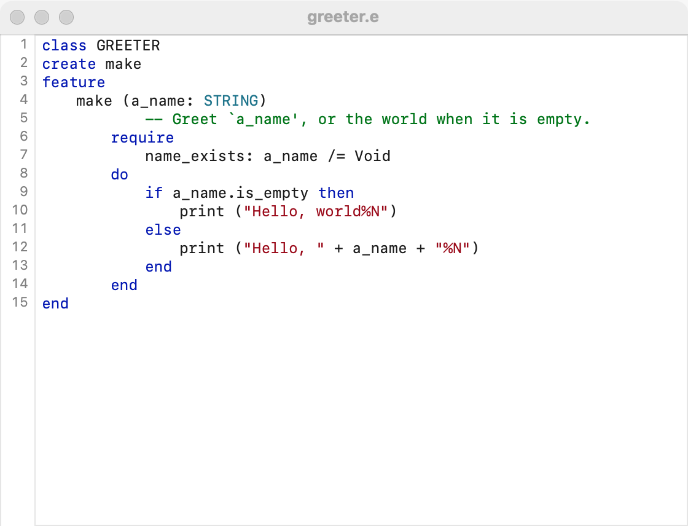
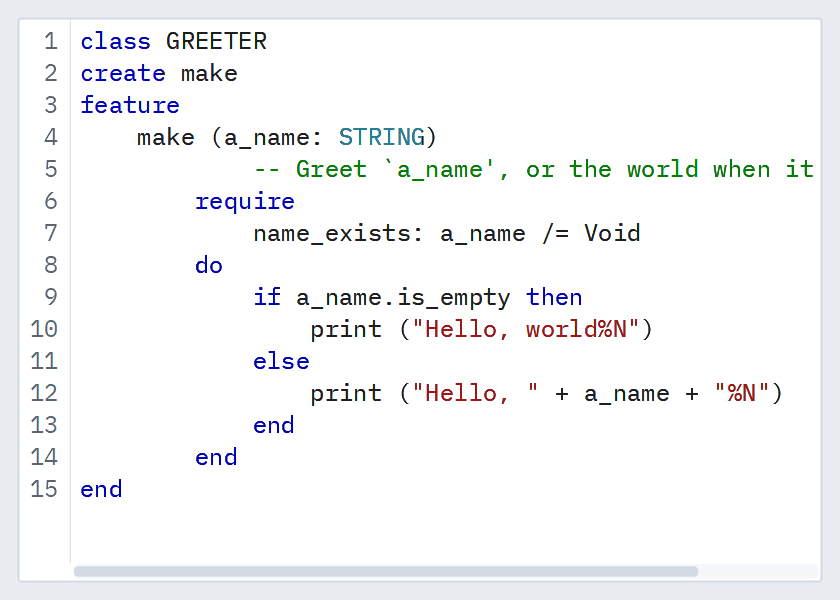

# Code editor

`GUI_CODE_EDITOR` is a [rich text area](rich-text-area.md) made for source code: a gutter of line numbers, a monospace font, no wrapping, auto-indent, syntax coloring and find and replace. Coloring comes from simple rules (keywords, line comments, delimited runs such as strings), from an agent of your own, or from a syntax object such as one built on simple_tree_sitter. It recolors only the lines an edit touched, so large files stay quick.

## Example

```eiffel
class
	SOURCE_VIEWER

create
	make

feature {NONE} -- Initialization

	make
		local
			l_window: GUI_WINDOW
			l_stack: GUI_STACK
		do
			create app.make ("Source", "org.example.source")
			create l_window.make ("greeter.e", 560, 360)
			create l_stack.make_vertical
			create status.make ("Line 1, column 1")
			create editor.make
			editor.set_accessible_label ("Source")
				-- rules first: each one recolors the whole text
			editor.add_keywords (<<"class", "create", "feature", "do", "end", "if", "then", "else">>, {GUI_CODE_EDITOR}.Style_keyword)
			editor.add_keywords (<<"STRING", "INTEGER", "BOOLEAN">>, {GUI_CODE_EDITOR}.Style_type)
			editor.add_line_comment ("--", {GUI_CODE_EDITOR}.Style_comment)
			editor.add_delimited ("%"", "%"", {GUI_CODE_EDITOR}.Style_string)
			editor.set_text ("class GREETER%Nfeature%N%Tgreet do print (%"Hello%") end%Nend%N")
			editor.caret_actions.extend (agent (a_line, a_column: INTEGER)
				do
					status.set_text ("Line " + a_line.out + ", column " + a_column.out)
				end)
			l_stack.extend_stretching (editor)
			l_stack.extend (status)
			l_window.set_content (l_stack)
			l_window.show
			app.run
		end

feature -- Access

	app: GUI_APPLICATION

	editor: GUI_CODE_EDITOR

	status: GUI_LABEL

end
```

## Try it

The window shows a short class with line numbers in the gutter. `class`, `feature`, `do` and `end` are in the keyword color, `"Hello"` in the string color. Click inside line 3: the label reads "Line 3, column …". Press Return at the end of line 3: the new line starts with the same tab. Select lines 2 to 4 and press Tab: they move one stop right; Shift+Tab moves them back. Type `-- note` at the end of a line: it turns the comment color as you type. Switch the system to dark mode: the colors change to the dark set.

## API

| Feature | What it does |
|---|---|
| `make` | An empty, editable code editor with line numbers shown and tabs four wide. Needs the application. |
| `text`, `set_text (a_text)` | The text; `set_text` replaces it, colors it, and fires nothing. |
| `add_keywords (a_words, a_style)` | Color each of `a_words`, as a whole word, in `a_style`. |
| `add_line_comment (a_prefix, a_style)` | From `a_prefix` to the end of the line. |
| `add_delimited (an_open, a_close, a_style)` | From `an_open` to `a_close`, across lines (strings, block comments); a `a_close` of `""` ends at the line's end. |
| `set_case_sensitive (a_on)`, `is_case_sensitive` | Whether keywords match case; on by default. |
| `set_highlighter (a_function)` | Color by your own agent instead of the rules: it gets a line and the state it starts in, and answers the line's spans and the state the next line starts in. Void returns to the rules. |
| `set_syntax (a_syntax)`, `syntax` | Color by a `GUI_EDITOR_SYNTAX` object, which hears every edit and answers with spans and folds. Void returns to the rules or the agent. |
| `Style_plain` … `Style_operator`, `style_color (a_style)` | The styles (plain, keyword, type, string, comment, number, operator; 7 to 10 add function, constant, variable and tag) and the theme's color for each, light or dark. |
| `set_line_numbers_shown (a_on)`, `is_line_numbers_shown` | The gutter of line numbers; shown by default. |
| `set_tab_width (a_width)`, `tab_width` | The tab stop, in characters, from 1 to 16; four until set. |
| `set_indent_with_spaces (a_on)`, `is_indent_with_spaces` | Whether Tab inserts spaces to the next stop instead of a tab. |
| `line_count`, `line_text (n)` | How many lines; line `n`'s text without its line break. |
| `caret_line`, `caret_column` | The caret's place, lines and columns from 1. |
| `go_to_line (n)` | The caret at the start of line `n` (`1 <= n <= line_count`), scrolled into view. Fires nothing. |
| `set_bracket_matching (a_on)`, `is_bracket_matching` | Show the bracket at the caret with its partner, tinted; on by default. Brackets in strings and comments are passed over. |
| `has_bracket_pair`, `bracket_first`, `bracket_second` | Is a pair shown, and where its two brackets start. |
| `go_to_matching_bracket` | The caret to the partner of the bracket it is at; again, back. The key is Control+Shift+\ (Command+Shift+\ on macOS). The tint is a decoration: no change, no undo step. |
| `find_next (a_text, a_case_sensitive, a_whole_word)`, `find_previous (…)` | Select the next match after the selection (or the previous one before it), wrapping round; False when there is none. |
| `replace_selection (a_text)` | Replace the selected text. |
| `replace_all (a_text, a_with, a_case_sensitive, a_whole_word)` | Replace every match; answers how many. One undo step. |
| `caret_actions` | Agents run with the line and column when the user moves the caret, for a status bar. |

Everything a [rich text area](rich-text-area.md) has works here too (`change_actions`, `select_range`, `selection_start`, `set_read_only`), and the rest are the [common features](widget.md).

**Events:** `change_actions` fire after each edit the user makes; `caret_actions` when the user moves the caret. `set_text`, the coloring features, `go_to_line` and the find and replace features never fire them.

**Accessibility:** the role is `text-box`. Give it `set_accessible_label` naming the file or what it holds. Screen readers read the text and the caret's line; the colors are a help to sighted readers only, so do not let color alone carry meaning.

## On each platform

| | Linux (GTK 4) | macOS (AppKit) | Windows (simple_widgets) |
|---|---|---|---|
| Native control | `GtkTextView`, monospace and unwrapped, with a `GtkDrawingArea` gutter | `SGACodeView`, an `NSTextView` in a scroll view, with an `NSRulerView` gutter | `GUI_SW_CODE_AREA`, an `SW_TEXT_BOX` in the fixed-pitch role that lays out and colors only the lines in view |
| Looks or behaves differently | — | Smart quotes, smart dashes, text replacement and spelling correction are off, as code needs (a text view has them on). | Colors are drawn as marks over the lines in view, so very large texts load and scroll quickly. |

## Design guidance

- Add the rules before `set_text`: each `add_*` call recolors the whole text.
- Let it take the window's room: add it with `extend_stretching`, or make it the window's content.
- Show the caret's line and column in a status bar from `caret_actions`.
- Put Find, Find Next and Replace in an Edit [menu](menus.md) with the platform's shortcuts, and a Go to Line command that calls `go_to_line`.
- For a language with a tree-sitter grammar, use a syntax object rather than rules: it colors by the parse, not by the words.

## Gallery

| Linux | macOS | Windows |
|---|---|---|
|  |  |  |
