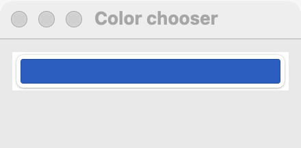

# Color chooser

`GUI_COLOR_CHOOSER` is a button showing a color swatch; clicking it opens the platform's color picker. Use it to let the user pick a color, such as a highlight or a pen color. When only a few named colors make sense, offer them in a [dropdown](dropdown.md) or a [radio group](radio-group.md) instead.

## Example

```eiffel
class COLOR_CHOOSER_DEMO create make
feature
	app: GUI_APPLICATION
	label: GUI_LABEL

	make
		local
			l_window: GUI_WINDOW
			l_stack: GUI_STACK
			l_chooser: GUI_COLOR_CHOOSER
		do
			create app.make ("Color chooser demo", "org.simple-eiffel.color-chooser-demo")
			create l_window.make ("Color chooser", 320, 140)
			create l_stack.make_vertical
			create l_chooser.make
			l_chooser.set_color (0x3366CC)
			l_chooser.set_accessible_label ("Highlight color")
			create label.make ("Color: #3366CC")
			l_chooser.change_actions.extend (agent show_color)
			l_stack.extend (l_chooser)
			l_stack.extend (label)
			l_window.set_content (l_stack)
			l_window.show
			app.run
		end

	show_color (a_color: NATURAL_32)
		do
			label.set_text ("Color: #" + a_color.to_hex_string.substring (3, 8))
		end
end
```

## Try it

The window shows a swatch button in blue (0x3366CC) and the label "Color: #3366CC". Click the swatch: the platform's color picker opens. Choose red: `change_actions` run with the new color and the label shows "Color: #FF0000".

## API

| Feature | What it does |
|---|---|
| `make` | Makes a chooser holding black. Ensures `color = 0`. |
| `color` | The color as 0xRRGGBB in sRGB. Always `color <= 0xFFFFFF`. |
| `set_color (a_color)` | Holds `a_color`, without a change event. Requires `a_color <= 0xFFFFFF`; ensures `color = a_color`. |
| `change_actions` | Agents run when the user chooses another color, with `color: NATURAL_32`. |

Every creation procedure requires `is_gui_thread` and `has_application`; every command requires `is_gui_thread`. See also [common features](widget.md).

Colors are 0xRRGGBB in sRGB, with no alpha: red is `0xFF0000`, white `0xFFFFFF`.

**Events:** `change_actions` run with the new color when the user commits a different color in the picker. `set_color` never fires `change_actions`; its contract ensures `change_actions.fire_count = old change_actions.fire_count`.

**Accessibility:** the role is `button`, and its value reads as `#RRGGBB`. Give it `set_accessible_label` naming what the color is for ("Highlight color").

## On each platform

| | Linux (GTK 4) | macOS (AppKit) | Windows (simple_widgets) |
|---|---|---|---|
| Native control | `GtkColorDialogButton`, opening a `GtkColorDialog` | `NSColorWell`, opening the shared color panel | A swatch button opening simple_widgets' color picker in the window's sheet |
| Looks or behaves differently | Aligned to the start. | The color panel is shared by the whole application. An event fires each time the well's color changes to a new value. | The picker is waited for; one event fires if the color changed. |

## Design guidance

- Put a [label](label.md) before the chooser and give the chooser `set_accessible_label` with the same words.
- Keep it at its natural size; it is a small swatch.
- Apply the new color in `change_actions` so the user sees the effect at once.
- Store colors as 0xRRGGBB `NATURAL_32` values and pass them back with `set_color` when you restore settings.
- Do not rely on color alone to carry meaning elsewhere in your program; the user may have picked one that is hard to tell apart.

## Gallery

| Linux | macOS | Windows |
|---|---|---|
| <!-- PROD: Linux picture --> |  | <!-- PROD: Windows picture --> |
