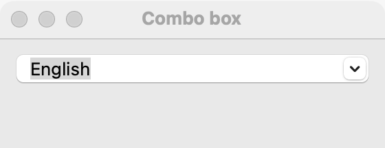

# Combo box

`GUI_COMBO_BOX` is a text box with a list of suggested options: the user types any text or picks one from the list. Pick a combo box when the user may also type a value that is not in the list, such as a font size or a server name. When the value must be one of the list, use a [dropdown](dropdown.md) (4 or more choices, or little room), a [radio group](radio-group.md) (2 to 5 choices that should all be visible) or a [segmented control](segmented.md) (2 to 5 short choices that switch a view).

## Example

```eiffel
class COMBO_BOX_DEMO create make
feature
	app: GUI_APPLICATION
	combo: GUI_COMBO_BOX
	label: GUI_LABEL

	make
		local
			l_window: GUI_WINDOW
			l_stack: GUI_STACK
		do
			create app.make ("Combo box demo", "org.simple-eiffel.combo-box-demo")
			create l_window.make ("Combo box", 360, 160)
			create l_stack.make_vertical
			create combo.make
			combo.set_accessible_label ("Font size")
			combo.extend ("10")
			combo.extend ("12")
			combo.extend ("14")
			combo.set_text ("12")
			create label.make ("Font size: 12")
			combo.change_actions.extend (agent show_size)
			l_stack.extend (combo)
			l_stack.extend (label)
			l_window.set_content (l_stack)
			l_window.show
			app.run
		end

	show_size
		do
			label.set_text ({STRING_32} "Font size: " + combo.text)
		end
end
```

## Try it

The window shows a combo box holding "12" and the label "Font size: 12". Open its list and pick "14": `change_actions` run and the label shows "Font size: 14". Type "13" and press Return (or move to another control): the label shows "Font size: 13". Pressing Return again without changing the text does not fire on macOS.

## API

| Feature | What it does |
|---|---|
| `make` | Makes an empty combo box with no options. Ensures `text.is_empty` and `count = 0`. |
| `text` | The text in the box. |
| `set_text (a_text)` | Shows `a_text`, without a change event. Ensures `text` is `a_text`. |
| `extend (an_option)` | Adds an option to the end of the list. Ensures `count = old count + 1`. |
| `count` | How many options the list has. |
| `i_th (i)` | The text of option `i`. Requires `1 <= i and i <= count`. |
| `wipe_out` | Removes every option. The text stays. Ensures `count = 0`. |
| `change_actions` | Agents run when the user commits a different text. |

Every creation procedure requires `is_gui_thread` and `has_application`; every command requires `is_gui_thread`. See also [common features](widget.md).

**Events:** the user commits the text with Return, by leaving the box, or by picking an option. A commit that changes the text fires `change_actions`, with no arguments; read `text` for the new value. `set_text` never fires `change_actions`; its contract ensures `change_actions.fire_count = old change_actions.fire_count`.

**Accessibility:** the role is `combo-box`. Give it `set_accessible_label`; it has no visible text that names it.

## On each platform

| | Linux (GTK 4) | macOS (AppKit) | Windows (simple_widgets) |
|---|---|---|---|
| Native control | `GtkEntry`, read as a combo box, whose arrow opens a popover of the options | `NSComboBox`, completing typed text from the options | `SW_COMBO`, editable |
| Looks or behaves differently | About 12 characters wide by default. | — | — |

## Design guidance

- Use a combo box only when typed values are allowed. If they are not, a [dropdown](dropdown.md) stops the user entering something the program cannot use.
- Check the committed `text` in your agent: it can be anything the user typed.
- Put a [label](label.md) before it and give it `set_accessible_label` with the same words.
- Keep the options short and few (a dozen or so); for long lists, use a [search field](search-field.md) over a list.
- Do not run work on each keystroke; the combo box reports only commits.

## Gallery

| Linux | macOS | Windows |
|---|---|---|
| <!-- PROD: Linux picture --> |  | <!-- PROD: Windows picture --> |
