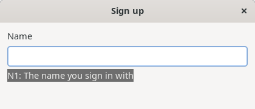
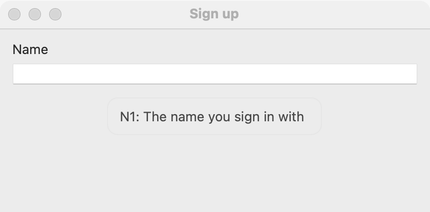
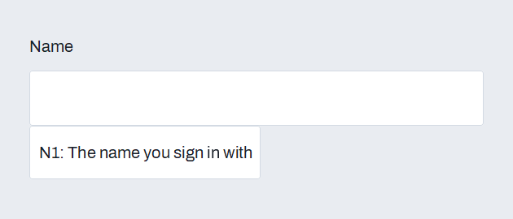

# Context help

The user presses F1 (or Command+? on macOS) to ask for help about whatever has the keyboard focus. Give widgets a help topic, and answer in `help_actions`: open your help page at that topic, show a panel, or start a tour. With no answer set, a widget's [reference pill](reference-pills.md) tip shows beside it, so an application with pills has useful F1 help for free. This is EiffelStudio's `EV_HELP_CONTEXT`, cross-platform.

## Example

```eiffel
class FORM create make
feature
	app: GUI_APPLICATION

	make
		local
			l_window: GUI_WINDOW
			l_form: GUI_STACK
			l_name, l_email: GUI_TEXT_FIELD
		do
			create app.make ("Form", "org.example.form")
			create l_window.make ("Sign up", 420, 200)
			create l_form.make_vertical
			create l_name.make
			create l_email.make
			l_form.set_help_topic ("sign-up")
			l_email.set_help_topic ("sign-up#email")
			l_form.extend (l_name)
			l_form.extend (l_email)
			app.help_actions.extend (agent show_help)
			l_window.set_content (l_form)
			l_window.show
			app.run
		end

	show_help (a_topic: STRING_32; a_widget: detachable GUI_WIDGET)
		do
			print ("Help on " + a_topic.to_string_8 + "%N")   -- open the help page at the topic
		end
end
```

## Try it

Click in the email field and press F1: the program prints "Help on sign-up#email". Click in the name field and press F1: the field has no topic of its own, so the form's topic answers: "Help on sign-up".

## API

| Feature | What it does |
|---|---|
| `GUI_WIDGET.set_help_topic (a_topic)`, `help_topic` | What F1 asks about at this widget: any text your program understands (a page name, a URL, an anchor). Empty: ask the parent. |
| `GUI_APPLICATION.help_actions` | `GUI_ACTIONS [TUPLE [topic: STRING_32; widget: detachable GUI_WIDGET]]`: run when the user asks for help, with the nearest topic up from the focused widget and the widget that has it. Both are empty and Void when no widget up the chain has a topic, or when the user asked about the window itself (macOS's Help menu). |

**The default answer.** When `help_actions` is empty, F1 shows the tip of the nearest [reference pill](reference-pills.md) up from the focused widget, in a small note under that widget for a few seconds. Without a pill, nothing happens.

## On each platform

| | Linux (GTK 4) | macOS (AppKit) | Windows (simple_widgets) |
|---|---|---|---|
| The keys | F1 (and the Help key, where a keyboard has one) | F1 (fn and F1 on laptops) and Command+? | F1 |
| The default tip | A small note in the window's overlay under the widget | A transient popover at the widget | A popover under the widget; never over a dialog |

## Design guidance

- Put topics on containers (a form, a panel) and only on fields that need their own page; F1 walks up to the nearest one.
- Keep topics stable: they are your help's addresses, so a rename breaks them.
- Give every window a help topic on its content, so F1 always lands somewhere.

## Gallery

| Linux | macOS | Windows |
|---|---|---|
|  |  |  |
