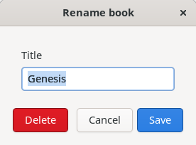
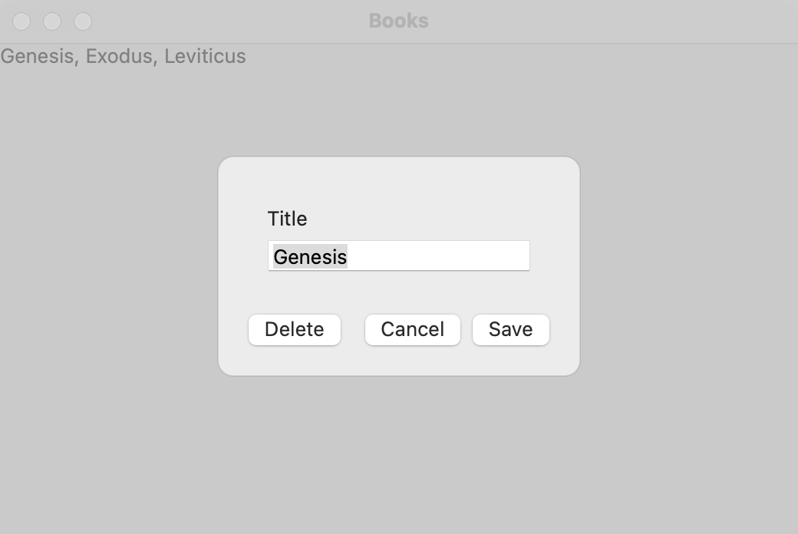
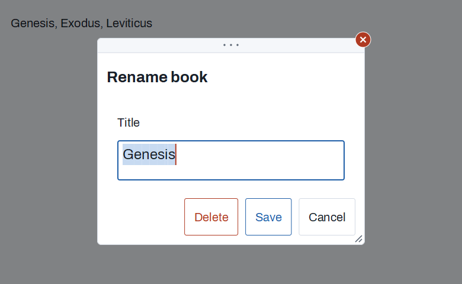

# Custom dialog

`GUI_DIALOG` is a modal dialog with any content you give it (a small form, a "delete?" question with details, a popup editor) and buttons whose order and keys follow the platform. For the ready-made dialogs (open, save, a message, a yes-or-no question, one line of text, a font), use [dialogs](dialogs.md); for a panel that points at a control and closes when the user looks away, use a [popover](popover.md).

## Example

```eiffel
class BOOKS create make
feature
	app: GUI_APPLICATION
	window: GUI_WINDOW
	title_field: GUI_TEXT_FIELD

	make
		local
			l_rename: GUI_BUTTON
		do
			create app.make ("Books", "org.example.books")
			create window.make ("Books", 480, 300)
			create l_rename.make ({STRING_32} "Rename%/8230/")
			l_rename.click_actions.extend (agent rename)
			window.set_content (l_rename)
			window.show
			app.run
		end

	rename
		local
			l_dialog: GUI_DIALOG
			l_form: GUI_STACK
			l_save: INTEGER
		do
			create l_dialog.make ("Rename book")
			create l_form.make_vertical
			create title_field.make
			title_field.set_text ("Genesis")
			title_field.set_accessible_label ("Title")
			l_form.extend (create {GUI_LABEL}.make ("Title"))
			l_form.extend (title_field)
			l_dialog.set_content (l_form)
			l_dialog.add_button ("Delete", l_dialog.Role_destructive).do_nothing
			l_dialog.add_button ("Cancel", l_dialog.Role_cancel).do_nothing
			l_save := l_dialog.add_button ("Save", l_dialog.Role_default)
			l_dialog.set_can_close (agent (n: INTEGER; a_save: INTEGER): BOOLEAN
				do
					Result := n /= a_save or else not title_field.text.is_empty
				end (?, l_save))
			if l_dialog.run_modal (window) = l_save then
				print ("Renamed to " + title_field.text.to_string_8 + "%N")
			end
		end
end
```

## Try it

Press **Rename…**. The dialog opens over the window (a sheet on macOS and Windows) with the title field and three buttons: **Delete** apart at the leading end, then **Cancel** and **Save**. Clear the field and press Return: nothing happens, because `can_close` says no while the title is empty. Type a title and press Return: the dialog closes and the program prints the new title. Open it again and press Escape: it closes as Cancel.

## API

| Feature | What it does |
|---|---|
| `make (a_title)` | A dialog titled `a_title`, not shown, with no buttons. |
| `set_content (a_widget)` | Its content: any widget, usually a stack or a grid. Requires no content yet. |
| `add_button (a_text, a_role): INTEGER` | A button; answers its number (from 1). Roles: `Role_default` (Return presses it; at most one), `Role_cancel` (Escape and the close box press it; at most one), `Role_destructive` (the platform's warning style; never pressed by Return), `Role_other`. |
| `button_count`, `button_text (n)`, `button_role (n)`, `default_button`, `cancel_button` | The buttons. |
| `set_button_enabled (n, a_on)` | Lets button `n` be pressed, or not. Return does nothing while the default is off. |
| `set_can_close (a_check)` | A `FUNCTION [INTEGER, BOOLEAN]` asked with the button before the user's close; False keeps the dialog open. Cancel is asked too. |
| `run_modal (a_parent): INTEGER` | Shows the dialog and waits until a button closes it; answers that button. The application's events run meanwhile. With a Void parent, every window waits. |
| `present (a_parent)` | Shows the dialog and returns at once; `response_actions` run when a button closes it. |
| `response_actions` | `GUI_ACTIONS [TUPLE [button: INTEGER]]`: run when the user's button (or key) closed the dialog. |
| `close_with (n)` | Closes it as button `n`, without asking `can_close` or running `response_actions`. |
| `is_shown`, `last_button` | Is it up? The button it last closed with (0 before any). |

**Events:** `response_actions` fire when the user closes the dialog with a button, Return (the default), Escape or the close box (Cancel), and only after `can_close` agreed. Without a cancel button, Escape and the close box do nothing: the dialog closes only by an answer. `close_with` fires nothing.

**Keys:** Return presses the default button, never a destructive one, so a dialog whose only action is destructive has no Return key. Return in a multi-line text area stays in the text.

**Accessibility:** the dialog is a `dialog` named by its title. Focus goes to the first control in the content and comes back to where it was when the dialog closes.

## On each platform

| | Linux (GTK 4) | macOS (AppKit) | Windows (simple_widgets) |
|---|---|---|---|
| Native control | A modal `GtkWindow`, transient for the parent, the buttons at its foot (`suggested-action`, `destructive-action`) | A sheet on the parent window (an `NSPanel`); with no parent, an app-modal panel | A centered sheet drawn in the parent window over a dimmed backdrop, like the drawn message boxes |
| Button order | Destructive apart at the start, then the others, Cancel, the default last | The same | Right-aligned: destructive, the default, the others, Cancel ("OK  Cancel") |
| Looks or behaves differently | A modal window blocks every window of the application. | A sheet blocks only its parent. | With no parent, the sheet shows on the application's main window. The parent's close button presses Cancel while the dialog is up. |

## Design guidance

- Name the default button with the verb it does ("Save", "Rename"), not "OK", and make it the safe choice.
- Give every dialog a Cancel unless an answer is truly required.
- Check the form in `can_close` and show what is wrong beside the field, rather than closing and complaining afterward.
- Keep a dialog small; a task with several steps belongs in a [wizard](wizard.md).

## Gallery

| Linux | macOS | Windows |
|---|---|---|
|  |  |  |
