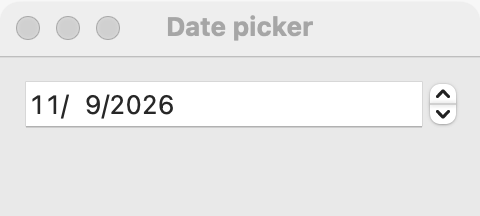

# Date picker

`GUI_DATE_PICKER` is a calendar date that the user types or steps, in the Gregorian calendar. Use it when the user knows the date and wants to enter it in little room. To pick a day by looking at a month, use a [calendar](calendar.md), which has the same features and events. For a time of day, use a [time picker](time-picker.md).

## Example

```eiffel
class DUE_DATE create make
feature
	app: GUI_APPLICATION
	shown: GUI_LABEL

	make
		local
			l_window: GUI_WINDOW
			l_stack: GUI_STACK
			l_picker: GUI_DATE_PICKER
		do
			create app.make ("Due date", "org.example.due-date")
			create l_window.make ("Due date", 320, 140)
			create l_stack.make_vertical
			create shown.make ("Pick a date.")
			create l_picker.make
			l_picker.set_accessible_label ("Due date")
			l_picker.set_date (2026, 12, 25)
			l_picker.change_actions.extend (agent on_date)
			l_stack.extend (l_picker)
			l_stack.extend (shown)
			l_window.set_content (l_stack)
			l_window.show
			app.run
		end

	on_date (a_year, a_month, a_day: INTEGER)
		do
			shown.set_text ("Due " + a_year.out + "-" + a_month.out + "-" + a_day.out)
		end
end
```

## Try it

A window opens with a date picker showing December 25, 2026, and the line "Pick a date." under it. `set_date` fires no event, so the line stays the same at first. Change the date (type it, step it, or pick a day, depending on the platform) and `change_actions` fires: the line shows the new date, for example "Due 2026-12-31".

## API

| Feature | What it does |
|---|---|
| `make` | A picker showing today. Ensures `is_valid_date (year, month, day)`. |
| `year` | The year shown. |
| `month` | The month shown, 1 (January) to 12. |
| `day` | The day of the month, 1 to 31. |
| `set_date (a_year, a_month, a_day)` | Shows that date, with no event. Requires `is_valid_date (a_year, a_month, a_day)`. Ensures `year`, `month` and `day` are the new date. |
| `is_valid_date (a_year, a_month, a_day)` | Is this a day of the Gregorian calendar, in the years 1 to 9999? February 29 counts only in leap years. |
| `days_in_month (a_year, a_month)` | How many days that month has (28 to 31). Requires 1 <= `a_month` <= 12. |
| `change_actions` | `GUI_ACTIONS [TUPLE [year, month, day: INTEGER]]`: run when the user commits another date. |

Inherited: `set_accessible_label`, `set_tooltip`, `enable`, `disable` and the rest of the [common features](widget.md).

**Events:** `change_actions` fires with the year, month and day when the user commits a different date. `set_date` never fires it: its postcondition is `change_actions.fire_count = old change_actions.fire_count`.

**Accessibility:** the role is `spin-button`, and a screen reader reads the value as ISO 8601 (2026-12-25). <!-- PROD: confirm the role on GTK, where the picker is a GtkMenuButton --> The picker shows no text of its own that could name it, so give it `set_accessible_label` ("Due date", "Birthday").

## On each platform

| | Linux (GTK 4) | macOS (AppKit) | Windows (simple_widgets) |
|---|---|---|---|
| Native control | A `GtkMenuButton` labeled with the date (YYYY-MM-DD), opening a `GtkCalendar` in a popover | `NSDatePicker`, text field and stepper style, year, month and day | `SW_DATE_PICKER`: a date field with a calendar glyph that opens an `SW_CALENDAR` popover |
| Looks or behaves differently | The user picks a day in the popover; the popover closes and the event fires. | The user types or steps each part; the date follows the local time zone. | Typing is read in the locale's field order (US by default); an impossible date is tinted as invalid. |

## Design guidance

- Put the picker at its natural width, next to or under a label that says what the date is for. In a form, use a [grid](grid.md) with the caption in column 1.
- Give it an accessible label even when a visible caption sits beside it: the caption is a separate widget.
- Check dates from the program with `is_valid_date` before `set_date`. simple_gui has its own check: AppKit would roll February 29, 2027 forward to March 1.
- Read `year`, `month` and `day` whenever you need them; you don't have to keep a copy from the event.
- Use a [calendar](calendar.md) when the day of the week or the shape of the month matters to the choice (bookings, schedules).

## Gallery

| Linux | macOS | Windows |
|---|---|---|
| <!-- PROD: Linux picture --> |  | <!-- PROD: Windows picture --> |
