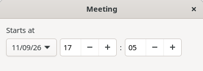
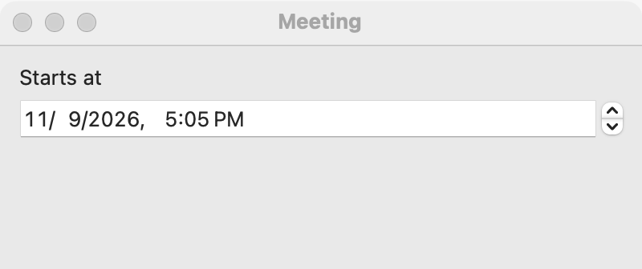
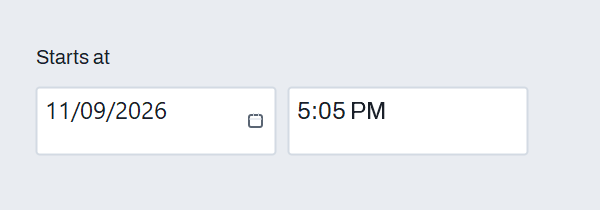

# Date and time picker

`GUI_DATE_TIME_PICKER` is a [date picker](date-picker.md) that also holds a time of day: the user sets a date, an hour and a minute in one control. Use it for a moment: an appointment, a deadline with a time, the start of a recording. For a date alone use a [date picker](date-picker.md), for a time alone a [time picker](time-picker.md), and for a day chosen by looking at a month a [calendar](calendar.md). For a whole month with no day, use a [month picker](month-picker.md).

## Example

```eiffel
class MEETING_TIME create make
feature
	app: GUI_APPLICATION
	start: GUI_DATE_TIME_PICKER
	shown: GUI_LABEL

	make
		local
			l_window: GUI_WINDOW
			l_stack: GUI_STACK
		do
			create app.make ("Date and time demo", "org.simple-eiffel.date-time-demo")
			create l_window.make ("Meeting", 400, 140)
			create l_stack.make_vertical
			create start.make
			start.set_accessible_label ("Starts at")
			start.set_date_time (2026, 12, 24, 9, 30)
			start.change_actions.extend (agent on_change)
			create shown.make ("Starts 2026-12-24 at 9:30")
			l_stack.extend (start)
			l_stack.extend (shown)
			l_window.set_content (l_stack)
			l_window.show
			app.run
		end

	on_change (a_year, a_month, a_day: INTEGER)
		do
			shown.set_text ({STRING_32} "Starts " + a_year.out + "-" + a_month.out + "-" + a_day.out
				+ " at " + start.hour.out + ":" + start.minute.out)
		end
end
```

## Try it

The window shows a date and a time, 2026-12-24 and 09:30 (`set_date_time` fired nothing; a new picker would show the current moment), and the line "Starts 2026-12-24 at 9:30". Change the hour, or pick another day: `change_actions` runs, and the agent reads `hour` and `minute` from the picker for the time.

## API

The picker has every feature of the [date picker](date-picker.md) (`year`, `month`, `day`, `set_date`, `is_valid_date`, `days_in_month`, `change_actions`) and adds:

| Feature | What it does |
|---|---|
| `make` | A picker showing the current date and time. |
| `hour` | The hour, 0 to 23. |
| `minute` | The minute, 0 to 59. |
| `set_date_time (a_year, a_month, a_day, a_hour, a_minute)` | Shows that date and time, without an event. Requires `is_gui_thread`, `is_valid_date (a_year, a_month, a_day)`, `0 <= a_hour <= 23` and `0 <= a_minute <= 59`. Ensures all five read back as given and `change_actions.fire_count = old change_actions.fire_count`. |

`set_date`, inherited from the date picker, changes the date and keeps the time.

**Events:** `change_actions` is the date picker's: `GUI_ACTIONS [TUPLE [year, month, day: INTEGER]]`. It runs when the user commits a new date or a new time. Its arguments are the date only, so read `hour` and `minute` from the picker in your agent. `set_date_time` and `set_date` never fire it.

**Accessibility:** give the picker `set_accessible_label` ("Starts at"). On Linux the parts have their own labels: "Date", "Hour" and "Minute".

## On each platform

| | Linux (GTK 4) | macOS (AppKit) | Windows (simple_widgets) |
|---|---|---|---|
| Native control | A box with a menu button for the date (opening a `GtkCalendar`), then hour and minute `GtkSpinButton`s that wrap | An `NSDatePicker` showing year, month, day, hour and minute | An `SW_DATE_PICKER` and an `SW_TIME_PICKER` in a row |
| Looks or behaves differently | The date shows in the locale's short format. The hour and minute show two digits. | The user types or steps each part. | The parts are the date picker and the time picker of those names. |

## Design guidance

- Use it when date and time belong together. Do not use two separate pickers whose values the user must keep consistent.
- Read `year`, `month`, `day`, `hour` and `minute` when you need them; do not keep your own copy from the event.
- Give it an accessible label even when a visible caption sits beside it.
- The picker holds a local date and time with no time zone. Store the zone yourself when others will read the value elsewhere.
- Check dates from the program with `is_valid_date` before `set_date_time`; the precondition requires it.

## Gallery

| Linux | macOS | Windows |
|---|---|---|
|  |  |  |
