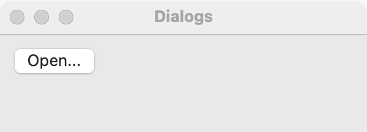

# Dialogs

`GUI_DIALOGS` asks the user something in a native dialog and returns the answer: a file, a folder, OK or Cancel, Yes, No or Cancel, a line of text, a font. It also shows messages and the About window. Use a dialog when the program cannot go on without the answer; for something the user can ignore, use a [status bar](status-bar.md) line, and for a panel of details next to a control, use a [popover](popover.md).

## Example

```eiffel
class
	OPENER

create
	make

feature {NONE} -- Initialization

	make
		local
			l_window: GUI_WINDOW
			l_stack: GUI_STACK
			l_open: GUI_BUTTON
		do
			create app.make ("Opener", "org.example.opener")
			create l_window.make ("Opener", 420, 140)
			create l_stack.make_vertical
			create l_open.make ("Open...")
			create chosen.make ("No file chosen.")
			l_open.click_actions.extend (agent open)
			l_stack.extend (l_open)
			l_stack.extend (chosen)
			l_window.set_content (l_stack)
			l_window.show
			app.run
		end

feature -- Access

	app: GUI_APPLICATION

	chosen: GUI_LABEL

feature {NONE} -- Events

	open
		do
			if attached app.dialogs.open_file ("Open a note", <<"txt", "md">>) as al_path then
				chosen.set_text (al_path.name)
			else
				chosen.set_text ("Canceled.")
			end
		end

end
```

## Try it

Click **Open...**. The platform's Open dialog appears, showing only `.txt` and `.md` files. Choose one: `open_file` returns its path and the label shows it. Press Cancel instead: `open_file` returns Void and the label reads "Canceled." Until the dialog closes, `open` waits at the `open_file` call.

## Each dialog

Every dialog is `app.dialogs.<feature>`.

**`open_file (a_title, a_extensions)`**: a file to open, or Void. `a_extensions` such as `<<"txt", "md">>`; an empty array accepts any file.

```eiffel
if attached app.dialogs.open_file ("Open a note", <<"txt", "md">>) as al_path then
	load (al_path)
end
```

**`save_file (a_title, a_extensions)`**: a file to save to, or Void.

```eiffel
if attached app.dialogs.save_file ("Save the note", <<"txt">>) as al_path then
	save (al_path)
end
```

**`save_file_named (a_title, a_extensions, a_suggested_name)`**: a file to save to, with `a_suggested_name` filled in first, or Void.

```eiffel
if attached app.dialogs.save_file_named ("Save the note", <<"txt">>, "notes.txt") as al_path then
	save (al_path)
end
```

**`choose_folder (a_title)`**: a folder, or Void.

```eiffel
if attached app.dialogs.choose_folder ("Choose a folder for exports") as al_folder then
	export_folder := al_folder
end
```

**`inform (a_title, a_text)`**: a message with one OK button.

```eiffel
app.dialogs.inform ("Saved", "Your note is saved.")
```

**`confirm (a_title, a_text)`**: True if the user chose OK, False for Cancel.

```eiffel
if app.dialogs.confirm ("Delete the note?", "This cannot be undone.") then
	delete_note
end
```

**`ask (a_title, a_text)`**: a three-way question. The answer is `Answer_yes` (1), `Answer_no` (2) or `Answer_cancel` (0).

```eiffel
l_answer := app.dialogs.ask ("Save changes?", "Your changes are lost if you don't save them.")
if l_answer = app.dialogs.Answer_yes then
	save_and_close
elseif l_answer = app.dialogs.Answer_no then
	window.close
end
```

**`ask_text (a_title, a_prompt, an_initial)`**: one line of text, starting from `an_initial`, or Void when canceled.

```eiffel
if attached app.dialogs.ask_text ("Rename", "New name:", note_name) as al_name then
	note_name := al_name
end
```

**`confirm_with_check (a_title, a_text, a_check_text)`**: OK or Cancel, with a check box such as "Don't ask again". The answer is a `TUPLE [ok, checked: BOOLEAN]`; the program keeps the check box's choice itself.

```eiffel
l_reply := app.dialogs.confirm_with_check ("Delete the note?", "This cannot be undone.", "Don't ask again")
if l_reply.checked then
	ask_before_deleting := False
end
if l_reply.ok then
	delete_note
end
```

**`choose_font (a_title, an_initial)`**: a `GUI_FONT_CHOICE`, starting from `an_initial` (or the system font when Void), or Void when canceled.

```eiffel
if attached app.dialogs.choose_font ("Font", create {GUI_FONT_CHOICE}.make ("Helvetica", 13, False, False)) as al_font then
	status.set_text (al_font.family + " " + al_font.size.out)
end
```

**`show_about (a_name, a_version, a_copyright, a_comments)`**: the platform's About window for this program. Call it from the agent of a `Role_about` menu item (see [menus](menus.md)).

```eiffel
app.dialogs.show_about ("Notes", "1.0", "Copyright 2026 Example", "A small note keeper.")
```

## API

| Feature | What it does |
|---|---|
| `open_file (a_title, a_extensions)` | A file the user chose to open, as a `PATH`, or Void. |
| `save_file (a_title, a_extensions)` | A file the user chose to save to, or Void. |
| `save_file_named (a_title, a_extensions, a_suggested_name)` | As `save_file`, offering `a_suggested_name` first. |
| `choose_folder (a_title)` | A folder the user chose, or Void. |
| `inform (a_title, a_text)` | A message with one OK button. |
| `confirm (a_title, a_text)` | Did the user choose OK over Cancel? |
| `ask (a_title, a_text)` | `Answer_yes`, `Answer_no` or `Answer_cancel`; never anything else. |
| `ask_text (a_title, a_prompt, an_initial)` | One line of text, or Void when canceled. |
| `confirm_with_check (a_title, a_text, a_check_text)` | `[ok, checked]`: OK or Cancel, and the check box's state. |
| `choose_font (a_title, an_initial)` | A font, or Void when canceled. `an_initial` may be Void. |
| `show_about (a_name, a_version, a_copyright, a_comments)` | The platform's About window. |
| `Answer_cancel`, `Answer_yes`, `Answer_no` | 0, 1 and 2. |

Every feature must be called on the GUI processor (`is_gui_thread`).

**`GUI_FONT_CHOICE`**

| Feature | What it does |
|---|---|
| `make (a_family, a_size, a_bold, an_italic)` | A font: a family such as "Helvetica Neue", a size in points (`a_size > 0`), bold and italic. |
| `family` | The family's name. |
| `size` | The size in points, a `REAL_64`, always above 0. |
| `is_bold`, `is_italic` | Bold? Italic? |

**Synchronous and modal:** each dialog runs a nested event loop until the user answers, and the call returns the answer. The dialog is modal to the program's first open window. While it is open, no other agent runs on the GUI processor; other processors keep running, since the dialog's call into the toolkit is blocking.

**Events:** dialogs fire no events; the answer is the result.

**Accessibility:** each dialog is the platform's own, so screen readers know it. Write `a_title` as a short question or statement, and `a_text` as one or two plain sentences that say what happens next.

## On each platform

| | Linux (GTK 4) | macOS (AppKit) | Windows (simple_widgets) |
|---|---|---|---|
| `open_file`, `save_file`, `save_file_named`, `choose_folder` | `GtkFileDialog`; extensions become a file filter (`*.txt`) | `NSOpenPanel` and `NSSavePanel`, with the title as the panel's message; extensions become content types. `choose_folder` can make a new folder. | simple_widgets' drawn file dialog, starting in the current folder; the title is not shown <!-- PROD: confirm --> |
| `inform`, `confirm` | `GtkAlertDialog` with OK, or Cancel and OK | `NSAlert` with OK, or OK and Cancel | simple_widgets' drawn dialog |
| `ask` | `GtkAlertDialog` with Cancel, No and Yes; Yes is the default, Escape cancels | `NSAlert` with Yes, No and Cancel. Return is Yes, Escape is Cancel and Command-D is No. | a drawn dialog with Yes, No and Cancel |
| `ask_text` | a modal window with the prompt, a `GtkEntry`, Cancel and OK | `NSAlert` with a text field | a drawn sheet with the title, the prompt, an `SW_TEXT_BOX`, OK and Cancel |
| `confirm_with_check` | a modal window with the text, a `GtkCheckButton`, Cancel and OK | `NSAlert` with its suppression check box | a drawn sheet with the title, the text, an `SW_CHECK_BOX`, OK and Cancel |
| `choose_font` | `GtkFontDialog` | `NSFontPanel`, run modal, with OK and Cancel added below it | a drawn sheet with the installed families (from GDI), a size from 6 to 96, bold and italic |
| `show_about` | `GtkAboutDialog`, modal: `show_about` waits until it closes. | the standard About panel. It is not modal: `show_about` returns at once. | a drawn sheet with the name, version, comments, copyright and OK; `show_about` waits for OK. |
| Modality | modal to the first window | modal to the application | modal to the first window. With no window open, a dialog returns at once with Void, False or `Answer_cancel`. |

## Design guidance

- Open a window before asking anything: each dialog is modal to the program's first open window.
- Always handle Void and Cancel. Cancel means "do nothing": leave the program as it was.
- Name the buttons' effect in the text. `confirm` and `ask` have fixed buttons (OK, Cancel; Yes, No, Cancel), so ask a question they answer: "Save changes before closing?"
- Use `ask` when closing a window with unsaved work, from its `close_requested_actions` (see [window](window.md)).
- Do not ask from a worker processor. Workers send a message to the GUI through the mailbox, and the GUI asks.
- For a choice the user makes often, prefer a control in the window (a [dropdown](dropdown.md), a [color chooser](color-chooser.md)) to a dialog each time.

## Gallery

| Linux | macOS | Windows |
|---|---|---|
| <!-- PROD: Linux picture --> |  | <!-- PROD: Windows picture --> |
