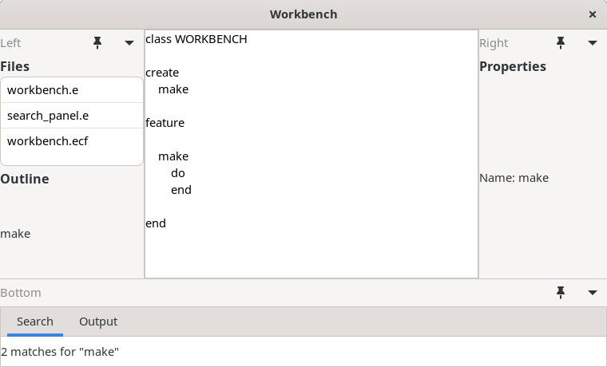
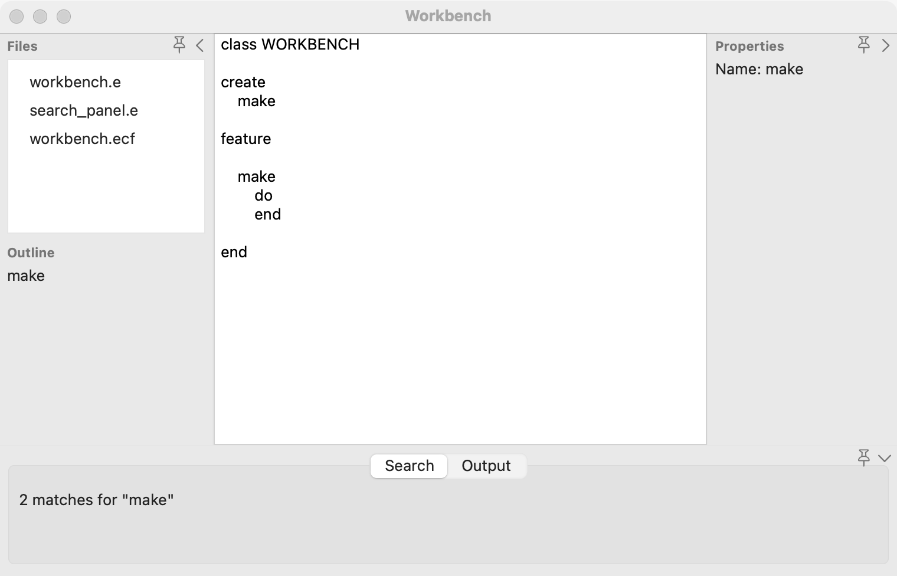
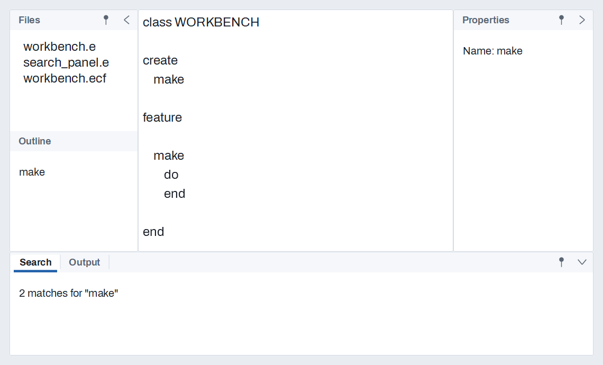

# Docking

`GUI_DOCK` holds a center document with tool panels (`GUI_DOCK_PANEL`) docked around it on four sides, as EiffelStudio's and Visual Studio's workbenches do. Each side shows its panels stacked or as tabs, and its edge drags to resize it. A side can collapse to a strip of its panels' names, or auto-hide so a panel slides out over the document when wanted. Panels float in windows of their own and move between sides by drag. The whole arrangement is saved and restored as text. For two panes and nothing more, use a [splitter](splitter.md); for pages one at a time, use [tabs](tabs.md).

## Example

```eiffel
class WORKBENCH create make
feature
	app: GUI_APPLICATION
	dock: GUI_DOCK
	files, outline, search, properties: GUI_DOCK_PANEL

	make
		local
			l_window: GUI_WINDOW
		do
			create app.make ("Workbench", "org.example.workbench")
			create l_window.make ("Workbench", 1000, 680)
			create dock.make (create {GUI_TEXT_AREA}.make)
			create files.make ("files", "Files", create {GUI_LABEL}.make ("Every file in the project"))
			create outline.make ("outline", "Outline", create {GUI_LABEL}.make ("The document's headings"))
			create search.make ("search", "Search", create {GUI_LABEL}.make ("Search results"))
			create properties.make ("props", "Properties", create {GUI_LABEL}.make ("The selection's properties"))
			properties.set_short_title ("Props")
			properties.set_description ("The selected object's properties")
			properties.set_pill ("P1")
			dock.add_panel (files, dock.Side_left)
			dock.add_panel (outline, dock.Side_left)
			dock.add_panel (search, dock.Side_bottom)
			dock.add_panel (properties, dock.Side_right)
			dock.set_tabbed (dock.Side_bottom, True)
			dock.set_side_size (dock.Side_left, 230)
			dock.layout_actions.extend (agent save)
			l_window.set_content (dock)
			if attached layout_file as al_path and then dock.load_layout (al_path) then
				-- the user's last arrangement
			end
			l_window.show
			app.run
		end

	save
		do
			if attached layout_file as al_path then
				dock.save_layout (al_path)
			end
		end

	layout_file: detachable PATH
		once
			create Result.make_from_string ("workbench.layout")
		end
end
```

## Try it

The window shows a text area in the middle with Files and Outline stacked on the left, Search along the bottom, and Properties on the right.
- **Resize:** drag the edge between a side and the document; the document always keeps 120 units each way. `layout_actions` runs, and the example saves the layout.
- **Collapse:** press a side's chevron and it folds to a strip naming its panels; press a name and the side opens again at the size it had, showing that panel.
- **Auto-hide:** press a side's pin and it stands as a strip; rest on a name (or press it) and that panel slides out over the document without moving anything; it slides back when the pointer leaves it.
- **Float:** double-click a panel's title or tab and it moves into a window of its own; close that window and the panel goes back to its place.
- **Maximize:** double-click the document's frame (or press the primary modifier with Shift and F12) and every side folds away; do it again and they come back as they were.
- **Move:** drag a panel's title or tab to another side, or between two panels.

Quit and run it again: `load_layout` puts everything back where you left it.

## API

| Feature | What it does |
|---|---|
| `make (a_center)` | A dock around `a_center`, with no panels. Requires `a_center.parent = Void`. |
| `Side_left`, `Side_right`, `Side_top`, `Side_bottom` | The four sides, 1 to 4. Top and bottom span the width; left and right sit between them. |
| `add_panel (a_panel, a_side)` | Docks `a_panel` last on `a_side`. Requires it to be in no dock, its key unique here. |
| `move_panel (a_panel, a_side)`, `put_panel (a_panel, a_side, a_position)` | Moves a panel to the end of a side, or to a place on it (from 1). Its index in `panels` does not change. |
| `remove_panel (a_panel)` | Takes it out; the panels after it in `panels` move up one. |
| `panels`, `panels_on (a_side)`, `panel_by_key (a_key)`, `index_of (a_panel)` | Every panel in the order added; a side's in its order; by key; the index. |
| `set_tabbed (a_side, on)`, `is_tabbed`, `activate_panel (a_panel)`, `active_panel (a_side)` | Tabs (one panel at a time) or stacked along the side's long axis. |
| `set_side_size (a_side, a_size)`, `side_size (a_side)` | The side's depth in logical units, as far as the document's minimum allows. |
| `collapse_side`, `expand_side`, `is_collapsed` | Fold a side to its strip, or open it at the size it had. `expand_side` also turns auto-hide off. |
| `set_auto_hide (a_side, on)`, `is_auto_hide` | The side stands as its strip; its panels slide out over the document. |
| `float_panel`, `redock_panel`, `is_floating` (on the panel) | A window of its own, keeping its side and place for redocking. |
| `floating_frame (a_panel)`, `set_floating_frame (a_panel, x, y, w, h)` | The floating window's frame, logical units relative to the dock's window. |
| `maximize_center`, `restore_center`, `is_center_maximized` | Every side folds away and comes back as it was; floating panels stay floating. |
| `layout`, `restore_layout (a_text): BOOLEAN` | The arrangement as text, read back all or nothing (False, and nothing changed, when it names a panel this dock lacks). |
| `save_layout (a_path)`, `load_layout (a_path): BOOLEAN` | The same, to and from a file. |
| `layout_actions` | `GUI_ACTIONS [TUPLE]`: run after the user changed the layout. |

`GUI_DOCK_PANEL`:

| Feature | What it does |
|---|---|
| `make (a_key, a_title, a_content)` | A panel known by `a_key` (no tab or line break), titled `a_title`, showing `a_content`. |
| `key`, `title`, `set_title`, `content`, `dock`, `side` | Its identity, title, content, dock and side (0 while in none). |
| `show`, `hide`, `is_visible` | Hidden panels keep their place. |
| `set_short_title`, `short_title`, `tab_text` | What its tab and strip name show (`tab_text`: the short title, else the title). |
| `set_description`, `description` | Its accessible description, and its pill's tip. |
| `set_tab_tooltip`, `tab_tooltip`, `tab_tip` | The tooltip on its tab and strip name (`tab_tip`: the tooltip, else the description). |
| `set_pill (a_code)`, `pill_code` | A [reference pill](reference-pills.md) on its title bar and tab, shown with the window's other pills. |

Every creation procedure and command requires `is_gui_thread`.

**Events:** `layout_actions` runs after each of the user's changes: an edge dragged, a side collapsed, expanded, pinned or unpinned, a tab chosen, a panel floated, docked again or moved, the document maximized or restored. Code that changes the layout fires nothing, so restoring a layout at start-up does not save it straight back.

**Accessibility:** each panel's content keeps its own roles. A panel's `description` is its accessible description; give every panel a description that says what it shows, and a title a screen reader can announce alone.

## On each platform

| | Linux (GTK 4) | macOS (AppKit) | Windows (simple_widgets) |
|---|---|---|---|
| Native control | Nested `GtkPaned` around the document; a `GtkNotebook` for a tabbed side, an even box for a stacked one; an overlay for slid-out panels; a `GtkWindow` for a floating panel | `SGADock`, a view that lays out its four sides itself; `NSTabView` for a tabbed side; an `NSPanel` for a floating panel | `SW_DOCK_HOST` with west, east, north and south zones, tabs, strips, slide-out and floating windows |
| Looks or behaves differently | Wayland lets no program place a window, so a floating window's position is not restored there (its size is). Dragging panels with the mouse is still to come; panels move from code. | Command takes Ctrl's place in the shortcut, and F12 needs fn on Apple keyboards. Tabs cannot hold a pill, so a tabbed panel's pill shows at the tab view's corner while its tab is selected. | A slid-out panel goes back on a press outside it or a second press on its name. |

## Design guidance

- Keep the document in the middle and the tools around it: lists and trees on the left, properties on the right, output and search results along the bottom.
- Give every panel a short, stable key and save the layout from `layout_actions`; restore it before showing the window.
- Prefer tabs for a side with many panels and stacking for two or three that are read together.
- Use auto-hide for panels people glance at (output, history) and keep the ones they work in pinned.
- Do not put essential commands only inside a panel the user can hide; keep them in the menus too.

## Gallery

| Linux | macOS | Windows |
|---|---|---|
|  |  |  |
