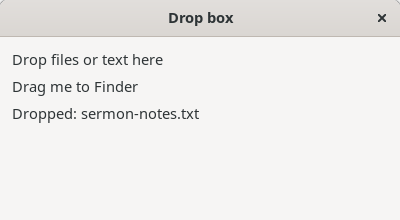
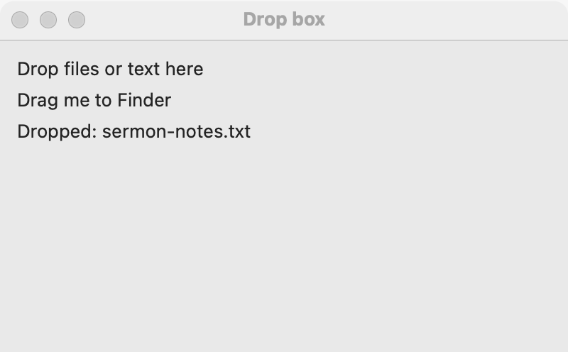
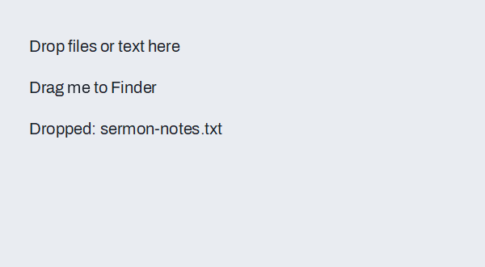

# Drag and drop between programs

A widget can take files and text that the user drags in from other programs (a file from the file manager, a selection from a browser), and can offer text and files for the user to drag out to other programs. Use it for "drop a file here to open it", "drop a verse here", and "drag this row's file to the desktop". For objects that move between widgets inside your own program, use [pick and drop](pick-and-drop.md); to reorder a list or tree, see [Reordering](reordering.md). For a file chosen with a dialog, see the [file field](file-field.md).

## Example

```eiffel
class DROP_BOX create make
feature
	app: GUI_APPLICATION
	box: GUI_LABEL
	source: GUI_LABEL
	status: GUI_LABEL

	make
		local
			l_window: GUI_WINDOW
			l_stack: GUI_STACK
		do
			create app.make ("Drop box demo", "org.simple-eiffel.drop-box-demo")
			create l_window.make ("Drop box", 400, 220)
			create l_stack.make_vertical
			create box.make ("Drop files or text here")
			box.set_accessible_label ("Drop box")
			box.file_drop_actions.extend (agent on_files)
			box.text_drop_actions.extend (agent on_text)
			create source.make ("Drag me to another program")
			source.set_drag_out (create {GUI_DRAG_DATA}.make_text ("Romans 8:28"))
			source.drag_out_ended_actions.extend (agent on_drag_ended)
			create status.make ("Waiting.")
			l_stack.extend (box)
			l_stack.extend (source)
			l_stack.extend (status)
			l_window.set_content (l_stack)
			l_window.show
			app.run
		end

	on_files (a_paths: ARRAYED_LIST [PATH])
		do
			status.set_text ({STRING_32} "Files dropped: " + a_paths.count.out + ", first " + a_paths.first.name)
		end

	on_text (a_text: STRING_32)
		do
			status.set_text ({STRING_32} "Text dropped: " + a_text)
		end

	on_drag_ended (a_how: INTEGER)
		do
			if a_how = source.Drag_copied then
				status.set_text ("Copied by the other program.")
			else
				status.set_text ("The other program did not take it.")
			end
		end
end
```

## Try it

The window shows a drop box, a source label and the line "Waiting." Drag a file from the file manager onto the drop box: `file_drop_actions` runs with the list of paths and the line says how many files, and the first one. Drag some selected text from another program onto the box: `text_drop_actions` runs and the line shows the text. Now drag the source label out of the window and release it over a text editor: the editor receives "Romans 8:28", `drag_out_ended_actions` runs with `Drag_copied`, and the line says so. Release it where nothing takes it: `Drag_refused`.

## API

**Taking drops from other programs (`GUI_WIDGET`)**

| Feature | What it does |
|---|---|
| `file_drop_actions` | `GUI_TARGET_ACTIONS [TUPLE [paths: ARRAYED_LIST [PATH]]]`: run with the files the user dropped, in order. The first agent added makes the widget take file drops. |
| `text_drop_actions` | `GUI_TARGET_ACTIONS [TUPLE [text: STRING_32]]`: run with the text the user dropped. The first agent added makes the widget take text drops. |
| `takes_files`, `takes_text` | Does the widget take files, or text, from other programs? True once an agent is added. |

**Giving data to other programs (`GUI_WIDGET`)**

| Feature | What it does |
|---|---|
| `set_drag_out (a_data)` | Lets the user drag `a_data` out of this widget into other programs. `Void` ends dragging out. Requires `is_gui_thread`. Ensures `drag_out = a_data`. |
| `drag_out` | The data now offered, or `Void`. |
| `drag_out_ended_actions` | `GUI_ACTIONS [TUPLE [how: INTEGER]]`: run when a drag out of this widget ends in another program. |
| `Drag_refused`, `Drag_copied`, `Drag_moved` | The values of `how`: 0, 1 and 2. Drags out offer a copy only, so `how` is `Drag_copied` or `Drag_refused`; `Drag_moved` is kept for a later move option. |

**What is dragged out (`GUI_DRAG_DATA`)**

| Feature | What it does |
|---|---|
| `make (a_text, a_paths)` | Text and file paths together. Requires that the text is not empty or there is at least one path. |
| `make_text (a_text)` | Text alone. Requires a non-empty `a_text`. Ensures `text` is `a_text` and `paths.is_empty`. |
| `make_files (a_paths)` | Files alone. Requires at least one path. Ensures `text.is_empty`. |
| `text` | The text dragged out (empty: none). |
| `paths` | The files dragged out, as an `ARRAYED_LIST [PATH]` (empty: none). |
| `joined_paths` | The paths one to a line, as the platforms take them. |

Every setter requires `is_gui_thread`. Inherited: the [common features](widget.md).

**Events:** `file_drop_actions` runs when the user drops one or more files on the widget, and `text_drop_actions` when the user drops text. A widget that takes only files ignores a text drop, one that takes only text ignores files, and one that takes neither ignores both. `drag_out_ended_actions` runs when a drag from the widget ends in another program, with `Drag_copied` when a program took it and `Drag_refused` when none did. It does not run for a drag that ended on one of your own widgets, or when the widget has no data. Setting a drag out (`set_drag_out`) or adding agents fires nothing.

**Keep the drag data current.** Every platform wants the data in hand at the moment a drag starts, and the toolkit never calls back into your program to ask. So the program calls `set_drag_out` again whenever what could be dragged changes: on a list, set it again when the selection changes.

```eiffel
	on_selection (a_row: INTEGER)
		do
			if a_row > 0 then
				list.set_drag_out (create {GUI_DRAG_DATA}.make_text (list.i_th (a_row)))
			else
				list.set_drag_out (Void)
			end
		end
```

**A widget that is both.** A widget may be a [pick and drop](pick-and-drop.md) source and a drag-out source at once. Inside your program the pebble wins: your own targets take the pebble. In another program, the drag-out data is what lands.

**Accessibility:** dragging is a pointer gesture, so give the user another way to do the same job: a **Choose...** button (the [file field](file-field.md) has one), a menu item, or a paste. Give a drop box an accessible label that says what it takes ("Drop box for transcripts").

## On each platform

| | Linux (GTK 4) | macOS (AppKit) | Windows (simple_widgets) |
|---|---|---|---|
| Dropping in | A `GtkDropTarget` takes a file list or a string, and lights while the drag is over a widget that takes it | Each window's content view is the dragging destination; it finds the widget under the pointer that takes the kind of drop, and lights it | Files come through simple_shell's drop; text from other programs arrives through OLE (simple_shell 1.40.0) |
| Dragging out | One `GtkDragSource` serves picks and drags out; it offers a copy of the data as a file list and a string | An `NSDraggingSession` carries the text and the files (as file URLs), and offers a copy only | OLE `DoDragDrop` with `CF_UNICODETEXT` and `CF_HDROP`, a copy only |
| Looks or behaves differently | When the widget is also a pick source, the drag carries the data, and your own targets take the pebble while the pick is on. | An editable text field takes dragged text by itself. When the widget is both a pick source and a drag-out source, any of your own targets lights at first, and one that turns out not to take the pebble gets a cancel after the drop. | The same OLE target that takes text from other programs serves the window's widgets. |

## Design guidance

- Make the drop area obvious: a labeled box or a whole pane, with words that say what it takes ("Drop a transcript here").
- Take drops in addition to a dialog, not instead of one. Many users never drag.
- Check each dropped file in your action (its type, its size). `PATH` values come from another program, so treat them as input from outside.
- A drop box that takes files only should not also add `text_drop_actions` unless text means something to it.
- Drag out data the other program can use: plain text, or real files. A drag out that offers a list's row text lets the user drop it into an editor; offering the file's path as a file lets them drop it in the file manager.
- Use `drag_out_ended_actions` to tell the user it worked ("Copied"), or to retry. A refused drop is normal, since the user may release over a window that takes nothing.

## Gallery

| Linux | macOS | Windows |
|---|---|---|
|  |  |  |
