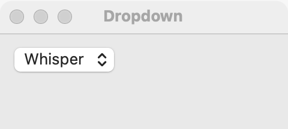

# Dropdown

`GUI_DROPDOWN` is a button that shows the chosen text and opens a menu of the other choices. Pick a dropdown for 4 or more choices, or when there is little room. For 2 to 5 choices that should all be visible at once, use a [radio group](radio-group.md); for 2 to 5 short choices that switch a view, use a [segmented control](segmented.md); when the user may also type a value that is not in the list, use a [combo box](combo-box.md).

## Example

```eiffel
class DROPDOWN_DEMO create make
feature
	app: GUI_APPLICATION
	dropdown: GUI_DROPDOWN
	label: GUI_LABEL

	make
		local
			l_window: GUI_WINDOW
			l_stack: GUI_STACK
		do
			create app.make ("Dropdown demo", "org.simple-eiffel.dropdown-demo")
			create l_window.make ("Dropdown", 360, 160)
			create l_stack.make_vertical
			create dropdown.make
			dropdown.set_accessible_label ("Language")
			dropdown.extend ("English")
			dropdown.extend ("French")
			dropdown.extend ("German")
			dropdown.extend ("Hebrew")
			create label.make ("Language: English")
			dropdown.selection_actions.extend (agent show_choice)
			l_stack.extend (dropdown)
			l_stack.extend (label)
			l_window.set_content (l_stack)
			l_window.show
			app.run
		end

	show_choice (a_row: INTEGER)
		do
			label.set_text ({STRING_32} "Language: " + dropdown.i_th (a_row))
		end
end
```

## Try it

The window shows a dropdown reading "English" (the first `extend` selected it, without an event) and the label "Language: English". Open it and choose "German": `selection_actions` run with 3 and the label shows "Language: German". Choose "German" again: nothing fires, because the selection did not change.

## API

| Feature | What it does |
|---|---|
| `make` | Makes an empty dropdown. Ensures `count = 0` and `selected_index = 0`. |
| `extend (a_text)` | Adds a choice at the end. The first one added becomes the selection, without an event. Duplicate texts are allowed. Ensures `count = old count + 1`. |
| `count` | How many choices there are. |
| `i_th (i)` | The text of choice `i`. Requires `1 <= i and i <= count`. |
| `selected_index` | The selected choice, 1-based, or 0 when the dropdown is empty. |
| `selected_text` | The selected choice's text, or empty when nothing is selected. |
| `select_row (i)` | Selects choice `i`, without an event. Requires `1 <= i and i <= count`; ensures `selected_index = i`. |
| `wipe_out` | Removes every choice. Ensures `count = 0` and `selected_index = 0`. |
| `selection_actions` | Agents run when the user chooses another choice, with `row: INTEGER`. |

Every creation procedure requires `is_gui_thread` and `has_application`; every command requires `is_gui_thread`. See also [common features](widget.md).

**Events:** `selection_actions` run with the 1-based row each time the user chooses a different choice. Choosing the one already selected is not a choice and fires nothing. `extend` and `select_row` never fire `selection_actions`; their contracts ensure `selection_actions.fire_count = old selection_actions.fire_count`.

**Accessibility:** the role is `combo-box`. Give it `set_accessible_label` naming what is chosen ("Language").

## On each platform

| | Linux (GTK 4) | macOS (AppKit) | Windows (simple_widgets) |
|---|---|---|---|
| Native control | `GtkDropDown` over a `GtkStringList` | `NSPopUpButton` | `SW_COMBO`, read-only, so a click anywhere opens the menu |
| Looks or behaves differently | Keeps its natural width, aligned to the start. | Duplicate texts are kept (items are added through the button's menu). | In a column it is as wide as the column. |

## Design guidance

- Choose by count and room: a dropdown for 4 or more choices or a tight space; a [radio group](radio-group.md) for 2 to 5 that should be seen together; a [segmented control](segmented.md) for 2 to 5 short ones that switch a view; a [combo box](combo-box.md) when typing a new value is allowed.
- Put a [label](label.md) before it and give it `set_accessible_label` with the same words.
- Keep it at its natural width rather than stretching it across the window.
- Order the choices so the user can find one: alphabetically, by size, or most used first.
- Do not use a dropdown for commands (that is a [menu button](menu-button.md)) or for on/off (that is a [switch](switch.md) or [check box](check-box.md)).

## Gallery

| Linux | macOS | Windows |
|---|---|---|
| <!-- PROD: Linux picture --> |  | <!-- PROD: Windows picture --> |
