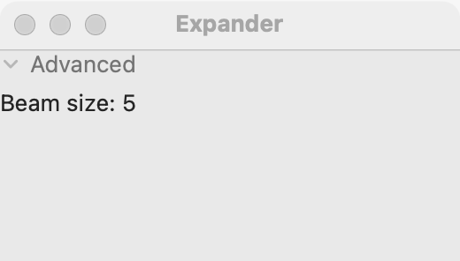

# Expander

`GUI_EXPANDER` is a title the user clicks to show or hide one widget below it. A new expander is collapsed. Use it for advanced or rarely used options that most users never need to see. For a section that is always visible, use a [group box](group-box.md); for one setting the user turns on or off, use a [check box](check-box.md) or a [switch](switch.md).

## Example

```eiffel
class FIND_OPTIONS create make
feature
	app: GUI_APPLICATION
	shown: GUI_LABEL

	make
		local
			l_window: GUI_WINDOW
			l_stack, l_options: GUI_STACK
			l_more: GUI_EXPANDER
		do
			create app.make ("Find", "org.example.find")
			create l_window.make ("Find", 340, 220)
			create l_stack.make_vertical
			create shown.make ("Options are hidden.")
			create l_more.make ("Advanced")
			create l_options.make_vertical
			l_options.extend (create {GUI_CHECK_BOX}.make ("Match case"))
			l_options.extend (create {GUI_CHECK_BOX}.make ("Whole words"))
			l_more.set_content (l_options)
			l_more.toggle_actions.extend (agent on_toggle)
			l_stack.extend (l_more)
			l_stack.extend (shown)
			l_window.set_content (l_stack)
			l_window.show
			app.run
		end

	on_toggle (a_expanded: BOOLEAN)
		do
			if a_expanded then shown.set_text ("Options are shown.") else shown.set_text ("Options are hidden.") end
		end
end
```

## Try it

A window opens with a collapsed expander titled "Advanced" and the line "Options are hidden." Click the title or its triangle: the two check boxes appear below it, `toggle_actions` fires with `True`, and the line says "Options are shown." Click again to hide them.

## API

| Feature | What it does |
|---|---|
| `make (a_title)` | An empty, collapsed expander titled `a_title`. Ensures `title` is `a_title` and `not is_expanded`. |
| `title` | The title the user clicks. |
| `set_title (a_title)` | Changes the title. Ensures `title` is `a_title`. |
| `set_content (a_widget)` | Puts `a_widget` inside. Requires `content = Void` (one widget, once), `a_widget.parent = Void` and `a_widget /= Current`. Ensures `content = a_widget`. |
| `content` | The widget inside, once set. |
| `is_expanded` | Is the content shown? |
| `expand` | Shows the content, with no event. Ensures `is_expanded`. |
| `collapse` | Hides the content, with no event. Ensures `not is_expanded`. |
| `toggle_actions` | `GUI_ACTIONS [TUPLE [is_expanded: BOOLEAN]]`: run when the user shows or hides the content. |

Inherited: `set_accessible_label`, `set_tooltip` and the rest of the [common features](widget.md).

**Events:** `toggle_actions` fires with the new state each time the user clicks. `expand` and `collapse` never fire it: their postconditions are `toggle_actions.fire_count = old toggle_actions.fire_count`.

**Accessibility:** the role is `button`, named by its title: `accessible_label` is the title unless you set one. The content is under it in the accessibility tree. Choose a title that says what is inside ("Advanced", "Proxy settings").

## On each platform

| | Linux (GTK 4) | macOS (AppKit) | Windows (simple_widgets) |
|---|---|---|---|
| Native control | `GtkExpander` | A disclosure triangle (`NSButton`) and a borderless title button, with the content below; AppKit has no single control for this | `GUI_SW_EXPANDER`, drawn |
| Looks or behaves differently | — <!-- PROD: confirm --> | A click on the title works as well as a click on the triangle. The triangle carries the accessible name. Collapsed, the content takes no room. | — <!-- PROD: confirm --> |

## Design guidance

- Place the expander with `extend`, so it takes only the room its content needs, and put anything below it in the same stack: it moves down when the content opens.
- Put a [stack](stack.md) or [grid](grid.md) inside, since an expander holds one widget.
- Hide only what most users can skip. Never hide a setting the user must change to finish the task.
- Use `expand` to open it from code (for example, to show an option that has an error); it fires no event.
- Right to left, the title and triangle follow the base direction like any other widget.

## Gallery

| Linux | macOS | Windows |
|---|---|---|
| <!-- PROD: Linux picture --> |  | <!-- PROD: Windows picture --> |
