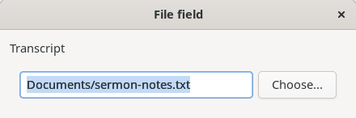
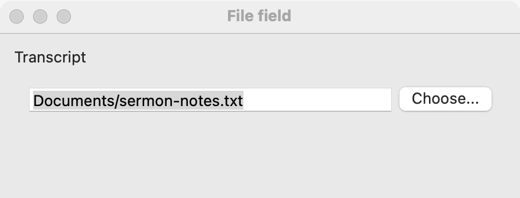
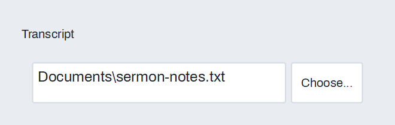

# File field

`GUI_FILE_FIELD` is a row with a text field showing a path and a **Choose...** button that opens the platform's file or folder dialog. The user may choose a path or type one. Use it in a form or settings window for a file to open, a place to save to, or a folder. To ask for a file at one moment, with no field to keep, call the [dialogs](dialogs.md) directly; to show a path the user clicks apart, use a [path control](path-control.md).

## Example

```eiffel
class TRANSCRIPT_FILE create make
feature
	app: GUI_APPLICATION
	transcript: GUI_FILE_FIELD
	status: GUI_LABEL

	make
		local
			l_window: GUI_WINDOW
			l_stack: GUI_STACK
		do
			create app.make ("File field demo", "org.simple-eiffel.file-field-demo")
			create l_window.make ("File field", 440, 140)
			create l_stack.make_vertical
			create transcript.make_open ("Transcript", <<"txt", "md">>)
			transcript.change_actions.extend (agent on_change)
			create status.make ("No file chosen.")
			l_stack.extend (transcript)
			l_stack.extend (status)
			l_window.set_content (l_stack)
			l_window.show
			app.run
		end

	on_change
		do
			if attached transcript.path as al_path then
				status.set_text ({STRING_32} "Chosen: " + al_path.name)
			else
				status.set_text ("No file chosen.")
			end
		end
end
```

## Try it

The window shows an empty field with a **Choose...** button beside it, and the line "No file chosen." Press **Choose...**: the platform's Open dialog appears, showing only `.txt` and `.md` files, and the program waits until it closes. Choose a file: its path fills the field, `change_actions` runs, and the line shows the path. Cancel the dialog instead: nothing changes and nothing fires. Type into the field: `change_actions` runs after each edit.

## API

| Feature | What it does |
|---|---|
| `make_open (a_title, a_extensions)` | Makes a field for a file to open. `a_extensions` such as `<<"txt", "md">>`; an empty array accepts any file. Requires `is_gui_thread` and `has_application`. |
| `make_save (a_title, a_extensions)` | Makes a field for a file to save to; the dialog offers the file name already in the field. Same requirements. |
| `make_folder (a_title)` | Makes a field for a folder. Same requirements. |
| `title` | The dialog's title; also the field's accessible label. |
| `path` | The path in the field, or `Void` when the field is empty. |
| `set_path (a_path)` | Shows `a_path` (`Void` for empty), without a change event. Requires `is_gui_thread`. Ensures `change_actions.fire_count = old change_actions.fire_count`. |
| `choose` | Opens the dialog as the button does; a chosen path fills the field and runs `change_actions`. Requires `is_gui_thread`. |
| `is_save`, `is_folder` | Which kind of field this is. Both are false for a field made with `make_open`. |
| `field` | The `GUI_TEXT_FIELD` that shows the path. |
| `choose_button` | The `GUI_BUTTON` captioned "Choose...". |
| `change_actions` | `GUI_ACTIONS [TUPLE]`: run when the user chooses a path or edits the field. |

The field is a horizontal [stack](stack.md) (a `GUI_STACK`), so `show`, `hide`, `disable` and the rest of the [common features](widget.md) work on the whole row. To disable only the typing or only the button, use `field` or `choose_button`.

**Events:** `change_actions` runs, with no arguments, when the user chooses a path in the dialog and when the user edits the text. Read `path` in the agent. Cancelling the dialog fires nothing. `set_path` never fires it. `choose` called from the program is the same as the button: a chosen path runs `change_actions`.

**Accessibility:** the text field's accessible label is `title`, and the button's is "Choose " followed by `title`, so give a short noun as the title ("Transcript", "Output folder"). The roles are those of a [text field](text-field.md) and a [button](button.md).

## On each platform

| | Linux (GTK 4) | macOS (AppKit) | Windows (simple_widgets) |
|---|---|---|---|
| Native control | A `GtkEntry` and a `GtkButton` in a row | An `NSTextField` and an `NSButton` in a row | An `SW_TEXT_BOX` and an `SW_BUTTON` in a row |
| Looks or behaves differently | The dialog is a `GtkFileDialog`. | The dialog is an `NSOpenPanel` or `NSSavePanel`. | The dialog is simple_widgets' drawn file dialog. |

The field itself is shared Eiffel code over the text field, the button and the [dialogs](dialogs.md), so it behaves the same on every platform; only the controls and the dialog are the platform's own.

## Design guidance

- Put a [label](label.md) before the row, or use a short `title` and let the accessible labels carry it. Keep the row stretching: add it with `GUI_STACK.extend_stretching` so the path has room.
- Use `make_save` for an output file, so the dialog offers the name already in the field. Use `make_folder` for a place, not a file.
- Show a saved setting with `set_path`, which fires nothing, so the program does not hear itself.
- Check that the path exists, or can be written, where you use it. The user may type anything into the field. A [validator](validation-and-suggestions.md) on `field` can show the problem under the row.
- The field does not take dropped files by itself. To accept them, add an action to `field.file_drop_actions` that calls `set_path`; see [Drag and drop between programs](drag-and-drop-between-programs.md).

## Gallery

| Linux | macOS | Windows |
|---|---|---|
|  |  |  |
