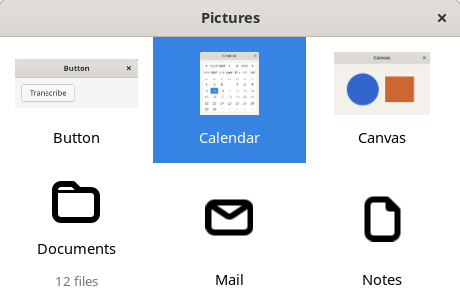
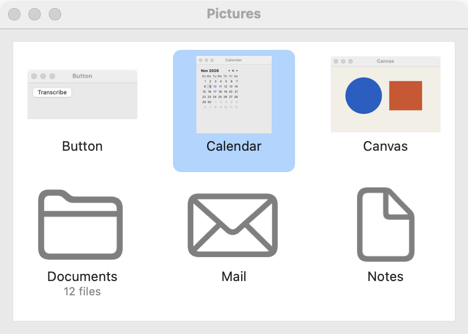
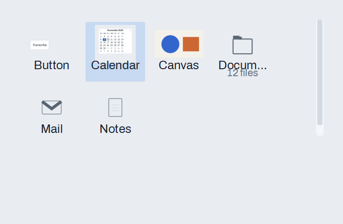

# Grid view

`GUI_GRID_VIEW` shows items as cells in a grid: a picture or an icon over a title, with an optional subtitle, as file browsers and photo libraries do. The grid fills its width with as many columns as fit and scrolls down. Pictures load off the GUI thread, so a folder of photos never freezes the window. For rows of text, use a [list](list.md) or a [table](table.md).

## Example

```eiffel
class PICTURES create make
feature
	app: GUI_APPLICATION
	grid: GUI_GRID_VIEW

	make
		local
			l_window: GUI_WINDOW
			l_stack: GUI_STACK
			l_search: GUI_SEARCH_FIELD
		do
			create app.make ("Pictures", "org.example.pictures")
			create l_window.make ("Pictures", 460, 340)
			create grid.make
			grid.extend_picture ("Harbor", create {PATH}.make_from_string ("photos/harbor.jpg"))
			grid.extend_picture ("Lighthouse", create {PATH}.make_from_string ("photos/lighthouse.jpg"))
			grid.extend_icon ("Documents", "folder")
			grid.set_item_subtitle (3, "12 files")
			grid.set_multiple_selection (True)
			grid.selection_actions.extend (agent (i: INTEGER) do print ("Selected " + i.out + "%N") end)
			grid.activate_actions.extend (agent (i: INTEGER) do print ("Open " + grid.item_title (i) + "%N") end)
			create l_search.make
			l_search.change_actions.extend (agent do grid.set_filter (l_search.text) end)
			create l_stack.make_vertical
			l_stack.extend (l_search)
			l_stack.extend (grid)
			l_window.set_content (l_stack)
			l_window.show
			app.run
		end
end
```

## Try it

The window shows Harbor and Lighthouse, then a folder icon titled Documents with "12 files" under it. The photos appear as they finish loading. Until then, their cells keep their place. Click **Lighthouse**: it is highlighted and the program prints "Selected 2". Hold Command (Ctrl on Linux and Windows) and click **Documents** to select both. Double-click **Harbor**, or select it and press Return, and the program prints "Open Harbor". The arrow keys move through the grid in both directions, and Home and End go to the ends. Type "light" in the search field: only Lighthouse shows, still item 2.

## API

| Feature | What it does |
|---|---|
| `make` | An empty grid. Ensures `count = 0`. |
| `extend (a_title)` | An item at the end with no picture. |
| `extend_picture (a_title, a_path)` | An item showing the image at `a_path`, scaled to fit the cell in proportion and loaded off the GUI thread. |
| `extend_icon (a_title, a_name)` | An item showing an icon from `GUI_ICON`. Requires a known name. See [Icons and badges](icons-and-badges.md). |
| `set_item_subtitle (i, a_text)` | A dimmer second line under item `i`'s title (empty: none). |
| `remove_item (i)`, `wipe_out` | Takes item `i` out, so the items after it move up one, or takes them all out. No event. |
| `count`, `item_title (i)` | How many items, and their titles. |
| `set_item_size (a_width, a_height)` | The cell's size, 120 by 120 until set. Requires both to be at least 32. |
| `set_spacing (n)` | The gap between cells. |
| `set_multiple_selection (a_on)`, `is_multiple_selection` | Lets the user select several items, with Command or Ctrl and Shift. |
| `select_item (i)`, `clear_selection` | Selects only item `i`, or nothing. No event. |
| `selected_index`, `selected_items` | The first selected item (0 for none), and every selected item in order. |
| `scroll_to_item (i)` | Scrolls until item `i` shows. |
| `set_filter (a_text)`, `filter_text`, `shown_count` | Shows only the items whose title or subtitle holds `a_text`, ignoring case. Items keep their numbers. |
| `selection_actions` | `GUI_ACTIONS [TUPLE [index: INTEGER]]`: run when the user changes the selection, with the first selected item (0 for none). |
| `activate_actions` | `GUI_ACTIONS [TUPLE [index: INTEGER]]`: run when the user opens an item. |

Every command requires `is_gui_thread`.

**Events:** `selection_actions` fires when the user clicks, Command-clicks or moves the selection with the keys. `activate_actions` fires on a double click, or Return on the selected item. `select_item`, `clear_selection`, `set_filter` and `remove_item` fire nothing. If the filter hides a selected item, it is deselected quietly.

**Accessibility:** the grid reads as a list of its items, each named by its title and subtitle. The arrow keys move in two dimensions, and Return opens. Give icons and pictures meaningful titles, since they are what a screen reader says.

## On each platform

| | Linux (GTK 4) | macOS (AppKit) | Windows (simple_widgets) |
|---|---|---|---|
| Native control | A `GtkGridView` over a list model, each cell a `GtkPicture` or `GtkImage` over labels; a `GtkFilterListModel` for the filter | An `NSCollectionView` in a flow layout, each cell an image over a title and a subtitle | `SW_GRID_VIEW`, a drawn grid |
| Looks or behaves differently | — | Icons are SF Symbols; a picture that can't be read shows a warning triangle. | — |

## Design guidance

- Use a grid when the pictures are what people recognize: photos, documents with thumbnails, app icons. Use a list when they read names.
- Keep titles short, about 20 characters, since longer ones are cut to the cell's width. Put details in the subtitle.
- Size cells for the pictures: 120 by 120 suits icons and thumbnails, and 200 by 160 suits photos.
- Pair a large grid with a search field and `set_filter`.

## Gallery

| Linux | macOS | Windows |
|---|---|---|
|  |  |  |
