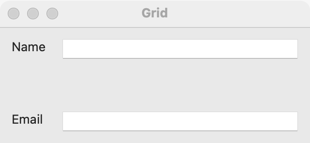

# Grid

`GUI_GRID` lays out widgets in rows and columns, so they line up in both directions. Use it for forms (captions in one column, fields in the next), keypads and settings panes. For a single row or column, a [stack](stack.md) is simpler. To show rows of data, use a [table](table.md), not a grid of labels.

## Example

```eiffel
class SIGN_UP create make
feature
	app: GUI_APPLICATION
	name, email: GUI_TEXT_FIELD
	shown: GUI_LABEL

	make
		local
			l_window: GUI_WINDOW
			l_grid: GUI_GRID
			l_save: GUI_BUTTON
		do
			create app.make ("Sign up", "org.example.sign-up")
			create l_window.make ("Sign up", 400, 180)
			create l_grid.make
			create name.make
			name.set_accessible_label ("Name")
			create email.make
			email.set_accessible_label ("Email")
			create shown.make ("")
			create l_save.make ("Save")
			l_save.click_actions.extend (agent save)
			l_grid.put (create {GUI_LABEL}.make ("Name"), 1, 1)
			l_grid.put (name, 1, 2)
			l_grid.put (create {GUI_LABEL}.make ("Email"), 2, 1)
			l_grid.put (email, 2, 2)
			l_grid.put (l_save, 3, 2)
			l_grid.put_spanning (shown, 4, 1, 1, 2)
			l_grid.set_stretching_column (2)
			l_window.set_content (l_grid)
			l_window.show
			app.run
		end

	save
		do
			shown.set_text ({STRING_32} "Saved " + name.text + ", " + email.text)
		end
end
```

## Try it

A window opens with two captions, "Name" and "Email", in the first column and a text field beside each. The fields take the spare width, because column 2 stretches. Under them is a **Save** button in column 2, and an empty line that spans both columns. Fill in the fields and press **Save**: the line shows what you typed.

## API

| Feature | What it does |
|---|---|
| `make` | An empty grid with a row gap of 6 and a column gap of 12 logical pixels. Ensures `count = 0`. |
| `put (a_widget, a_row, a_column)` | Places `a_widget` in one cell. Rows and columns are 1-based: requires `a_row >= 1` and `a_column >= 1`, `a_widget.parent = Void` and `a_widget /= Current`. Ensures `a_widget.parent = Current`. |
| `put_spanning (a_widget, a_row, a_column, a_rows, a_columns)` | Places `a_widget` over `a_rows` by `a_columns` cells, starting at (`a_row`, `a_column`). Also requires `a_rows >= 1` and `a_columns >= 1`. Ensures `count = old count + 1`. |
| `set_stretching_column (a_column)` | Column `a_column` takes the spare width; 0 means none. Requires `a_column >= 0`. |
| `stretching_column` | The column that takes the spare width, or 0. |
| `set_homogeneous_columns (a_on)` | When on, all columns have the same width, and they share the grid's spare width equally. |
| `has_homogeneous_columns` | Do all columns have the same width? |
| `set_spacing (a_row_gap, a_column_gap)` | The gaps between rows and between columns, in logical pixels. Requires both >= 0. |
| `row_spacing`, `column_spacing` | The gaps now. |
| `children`, `count`, `has (a_widget)` | The widgets in the grid (from `GUI_CONTAINER`). |

Inherited: `set_base_direction`, `show`, `hide` and the rest of the [common features](widget.md).

**Events:** none. A grid only places widgets.

**Accessibility:** the role is `generic`. `describe_accessibility` skips it, and a screen reader goes straight to the cells. A caption in the next cell does not name a field for a screen reader, so give each field `set_accessible_label` with the caption's words, as the example does.

**Layout is always by containers.** There are no absolute positions outside a [canvas](canvas.md). A grid sizes each column to its widest cell and each row to its tallest, so a longer translation or a larger font still lines up.

**Columns and stretching.** Columns take their natural widths, and the spare width is left at the end. `set_stretching_column` gives the spare width to one column; `set_homogeneous_columns (True)` makes all columns equal and shares the spare width among them. A plain grid keeps its columns at their natural width.

**Margins and spacing.** A grid keeps a margin of 12 logical pixels on its leading, trailing, top and bottom sides on every platform, as a stack does. On Windows the margin is padding on the grid, scaled with the desktop; on Linux it is widget margins. A grid's `x`, `y`, `width` and `height` leave the margin out. The gaps between cells are `row_spacing` and `column_spacing` (6 and 12 by default).

**Right to left.** Column 1 is the leading column: on the left in a left-to-right window, on the right under `Direction_right_to_left`. Put captions in column 1 and they stay before their fields in either direction.

## On each platform

| | Linux (GTK 4) | macOS (AppKit) | Windows (simple_widgets) |
|---|---|---|---|
| Native control | `GtkGrid` | `NSGridView` in a view that holds the margins | `SW_GRID` |
| Looks or behaves differently | A stretching column's widgets are set to expand horizontally. | A label in a grid keeps its whole width (a caption is not cut short). A change of direction puts the grid back in its view so it mirrors. | Homogeneous columns share the spare width, as on GTK. |

## Design guidance

- Use a grid for any form with more than one field: captions in column 1, fields in column 2, and `set_stretching_column (2)` so the fields grow with the window.
- Give every field `set_accessible_label`, even when a caption sits beside it.
- Use `put_spanning` for a widget that belongs to the whole form, such as a message line or a row of buttons in a nested [stack](stack.md).
- Use `set_homogeneous_columns (True)` for keypads and button grids, where every column should be the same width.
- Never leave gaps to fake positions. Empty cells are fine; positions you compute are not.

## Gallery

| Linux | macOS | Windows |
|---|---|---|
| <!-- PROD: Linux picture --> |  | <!-- PROD: Windows picture --> |
