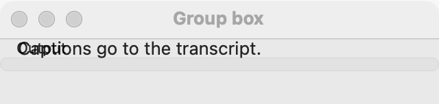

# Group box

`GUI_GROUP_BOX` is a titled frame around one widget, which shows that the controls inside belong together. Use it to split a settings pane into named sections. When the section is optional and may stay hidden, use an [expander](expander.md); when sections are large enough to need their own page, use [tabs](tabs.md).

## Example

```eiffel
class EXPORT_SETTINGS create make
feature
	app: GUI_APPLICATION
	shown: GUI_LABEL

	make
		local
			l_window: GUI_WINDOW
			l_stack, l_inside: GUI_STACK
			l_box: GUI_GROUP_BOX
			l_numbers: GUI_CHECK_BOX
		do
			create app.make ("Export", "org.example.export")
			create l_window.make ("Export", 340, 200)
			create l_stack.make_vertical
			create l_box.make ("Output")
			create l_inside.make_vertical
			create shown.make ("Line numbers are off.")
			create l_numbers.make ("Line numbers")
			l_numbers.toggle_actions.extend (agent on_numbers)
			l_inside.extend (l_numbers)
			l_inside.extend (create {GUI_CHECK_BOX}.make ("Page breaks"))
			l_box.set_content (l_inside)
			l_stack.extend (l_box)
			l_stack.extend (shown)
			l_window.set_content (l_stack)
			l_window.show
			app.run
		end

	on_numbers (a_checked: BOOLEAN)
		do
			if a_checked then shown.set_text ("Line numbers are on.") else shown.set_text ("Line numbers are off.") end
		end
end
```

## Try it

A window opens with a frame titled "Output" holding two check boxes, and the line "Line numbers are off." under it. Check **Line numbers**: the check box's `toggle_actions` fires and the line says "Line numbers are on." The group box itself has no events; it only frames.

## API

| Feature | What it does |
|---|---|
| `make (a_title)` | An empty group box titled `a_title`. Ensures `title` is `a_title` and `content = Void`. |
| `title` | The title on the frame. |
| `set_title (a_title)` | Changes the title. Ensures `title` is `a_title`. |
| `set_content (a_widget)` | Puts `a_widget` inside. Requires `content = Void` (one widget, once), `a_widget.parent = Void` and `a_widget /= Current`. Ensures `content = a_widget`. |
| `content` | The widget inside, once set. |

Inherited: `set_accessible_label`, `set_base_direction` and the rest of the [common features](widget.md).

**Events:** none. The controls inside have their own.

**Accessibility:** the role is `group`, named by its title: `accessible_label` is the title unless you set one. The content is under the group, so a screen reader announces "Output" before the check boxes. Choose titles that make sense read aloud before each control.

## On each platform

| | Linux (GTK 4) | macOS (AppKit) | Windows (simple_widgets) |
|---|---|---|---|
| Native control | `GtkFrame` with the title as its label | `NSBox` with its title at the top | `SW_GROUP`: a hairline frame with the title set into its top edge |
| Looks or behaves differently | The frame is given the title as its accessible label, since GTK's frame title is a separate label. | The content sits inside the box's own margins (8 pixels) plus 4 more on each side. | The content is a padded column. |

## Design guidance

- Put a [stack](stack.md) or [grid](grid.md) inside, since a group box holds one widget.
- Use short titles that name the section ("Output", "Proxy"), not sentences.
- Do not nest group boxes; a frame inside a frame wastes room and reads poorly. Use a caption or a [separator](separator.md) inside instead.
- Do not put a single control in a group box; give that control a clear text of its own.
- When the title changes with the language, call `set_title`; the accessible label follows it.

## Gallery

| Linux | macOS | Windows |
|---|---|---|
| <!-- PROD: Linux picture --> |  | <!-- PROD: Windows picture --> |
