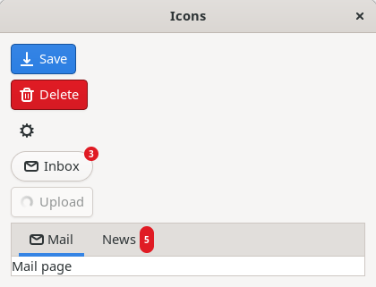
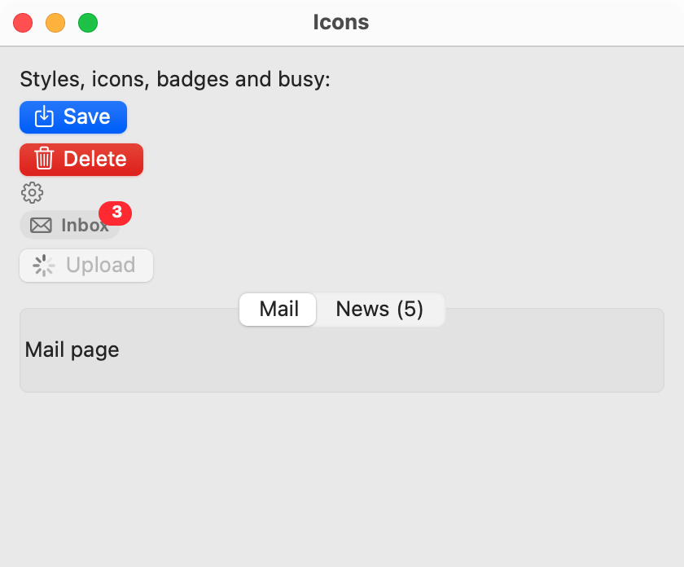
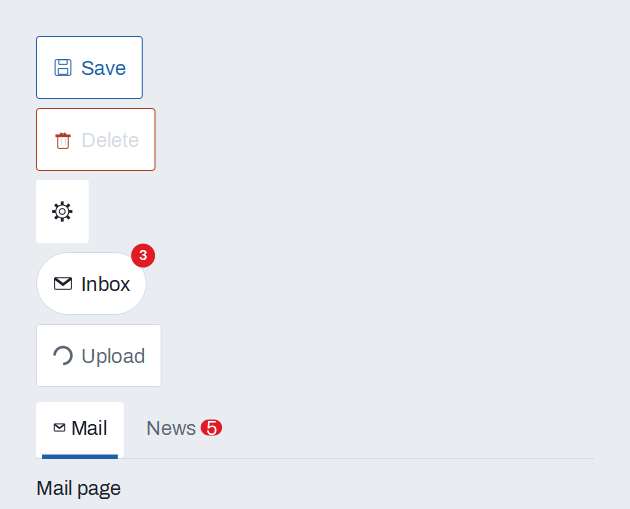

# Icons and badges

simple_gui has one list of icon names, `GUI_ICON`, that every platform draws in its own way. You name an icon ("delete", "settings") and get the platform's own picture of it. Icons go on [buttons](button.md), menu items and tabs. A badge is a small red bubble, with a short text or none, that marks something as new or counted; it goes on any widget, and on a tab. A button can also have a style (suggested, destructive, flat or pill) and a busy state that shows a spinner.

Use an icon to make a command quicker to find, never to replace its words everywhere: an icon-only button needs an accessible label. Use a badge for a count or a "new" mark, not for a message; for a message use an [info bar](info-bar.md) or a [toast](toasts-and-notifications.md).

## Example

```eiffel
class ICONS_DEMO create make
feature
	app: GUI_APPLICATION
	upload: GUI_BUTTON
	inbox: GUI_BUTTON

	make
		local
			l_window: GUI_WINDOW
			l_stack: GUI_STACK
			l_save, l_delete, l_settings: GUI_BUTTON
			l_tabs: GUI_TABS
			l_menu: GUI_MENU
		do
			create app.make ("Icons demo", "org.simple-eiffel.icons-demo")
			create l_window.make ("Icons", 420, 320)
			create l_stack.make_vertical
			create l_save.make ("Save")
			l_save.set_style (l_save.Style_suggested)
			l_save.set_icon ("save")
			create l_delete.make ("Delete")
			l_delete.set_style (l_delete.Style_destructive)
			l_delete.set_icon ("delete")
			create l_settings.make ("")
			l_settings.set_style (l_settings.Style_flat)
			l_settings.set_icon ("settings")
			l_settings.set_accessible_label ("Settings")
			create inbox.make ("Inbox")
			inbox.set_style (inbox.Style_pill)
			inbox.set_icon ("mail")
			inbox.set_badge ("3")
			inbox.click_actions.extend (agent mark_read)
			create upload.make ("Upload")
			upload.set_icon ("upload")
			upload.click_actions.extend (agent start_upload)
			create l_tabs.make
			l_tabs.extend (create {GUI_LABEL}.make ("Mail page"), "Mail")
			l_tabs.extend (create {GUI_LABEL}.make ("News page"), "News")
			l_tabs.set_page_icon (1, "mail")
			l_tabs.set_page_badge (2, "5")
			l_stack.extend (l_save)
			l_stack.extend (l_delete)
			l_stack.extend (l_settings)
			l_stack.extend (inbox)
			l_stack.extend (upload)
			l_stack.extend_stretching (l_tabs)
			l_window.set_content (l_stack)
			l_menu := app.menu.add_menu ("File")
			l_menu.add_item ("Print...", "primary+P", agent do end)
			l_menu.set_item_icon (l_menu.last_item_id, "print")
			l_window.show
			app.run
		end

	mark_read
		do
			inbox.clear_badge
		end

	start_upload
		do
			upload.set_busy (True)
			app.after (3000, agent finish_upload).do_nothing
		end

	finish_upload
		do
			upload.set_busy (False)
		end
end
```

## Try it

A window opens with four buttons and two tabs. **Save** has the suggested style and a save icon, **Delete** the destructive style and a trash icon, and the flat button has only a gear icon. **Inbox** is a pill with a mail icon and the badge "3"; pressing it clears the badge. Press **Upload**: a spinner replaces its icon, the button is dimmed and takes no presses for 3 seconds (3000 milliseconds), then it comes back with its upload icon. The **Mail** tab has a mail icon and the **News** tab the badge "5". The **File** menu holds **Print...** with a print icon, where the platform shows menu icons.

## The icon names

`GUI_ICON.names` lists the 47 names, and `GUI_ICON.is_known (a_name)` tells whether a name is one of them. Every icon setter requires `is_known`. The right-hand column is the Adwaita symbolic icon that GTK draws for the name.

| Name | Group | Adwaita symbolic icon (Linux) |
|---|---|---|
| `add` | Actions | `list-add-symbolic` |
| `remove` | Actions | `list-remove-symbolic` |
| `close` | Actions | `window-close-symbolic` |
| `check` | Actions | `object-select-symbolic` |
| `chevron-right` | Directions | `go-next-symbolic` |
| `chevron-left` | Directions | `go-previous-symbolic` |
| `chevron-up` | Directions | `go-up-symbolic` |
| `chevron-down` | Directions | `go-down-symbolic` |
| `back` | Directions | `go-previous-symbolic` |
| `forward` | Directions | `go-next-symbolic` |
| `search` | Files and editing | `system-search-symbolic` |
| `settings` | Files and editing | `emblem-system-symbolic` |
| `delete` | Files and editing | `user-trash-symbolic` |
| `edit` | Files and editing | `document-edit-symbolic` |
| `folder` | Files and editing | `folder-symbolic` |
| `document` | Files and editing | `text-x-generic-symbolic` |
| `open` | Files and editing | `document-open-symbolic` |
| `save` | Files and editing | `document-save-symbolic` |
| `copy` | Files and editing | `edit-copy-symbolic` |
| `cut` | Files and editing | `edit-cut-symbolic` |
| `paste` | Files and editing | `edit-paste-symbolic` |
| `undo` | Files and editing | `edit-undo-symbolic` |
| `redo` | Files and editing | `edit-redo-symbolic` |
| `refresh` | Files and editing | `view-refresh-symbolic` |
| `play` | Media and menus | `media-playback-start-symbolic` |
| `pause` | Media and menus | `media-playback-pause-symbolic` |
| `stop` | Media and menus | `media-playback-stop-symbolic` |
| `more` | Media and menus | `view-more-horizontal-symbolic` |
| `menu` | Media and menus | `open-menu-symbolic` |
| `info` | Status | `dialog-information-symbolic` |
| `warning` | Status | `dialog-warning-symbolic` |
| `error` | Status | `dialog-error-symbolic` |
| `help` | Status | `help-browser-symbolic` |
| `star` | Things | `starred-symbolic` |
| `picture` | Things | `image-x-generic-symbolic` |
| `home` | Things | `go-home-symbolic` |
| `user` | Things | `avatar-default-symbolic` |
| `mail` | Things | `mail-unread-symbolic` |
| `calendar` | Things | `x-office-calendar-symbolic` |
| `clock` | Things | `preferences-system-time-symbolic` |
| `lock` | Things | `changes-prevent-symbolic` |
| `bell` | Things | `preferences-system-notifications-symbolic` |
| `download` | Transfer and lists | `folder-download-symbolic` |
| `upload` | Transfer and lists | `send-to-symbolic` |
| `print` | Transfer and lists | `document-print-symbolic` |
| `filter` | Transfer and lists | `sg-filter-symbolic` (a funnel simple_gui writes to the user's cache folder, since Adwaita has none) |
| `sort` | Transfer and lists | `view-sort-ascending-symbolic` |

`back` and `forward` draw the same pictures as `chevron-left` and `chevron-right` on GTK. The groups are only for reading; the program uses the names.

## Icons on buttons

| Feature | What it does |
|---|---|
| `icon` | The icon name shown, or `Void` for none. |
| `set_icon (a_name)` | Shows icon `a_name` before the text, or alone when the text is empty. Requires `is_gui_thread` and `(create {GUI_ICON}).is_known (a_name)`. Ensures `icon` is `a_name`. |
| `clear_icon` | Removes the icon. Requires `is_gui_thread`. Ensures `icon = Void`. |

An icon-only button (empty text) has no words for a screen reader, so give it `set_accessible_label`.

## Button styles

| Feature | What it does |
|---|---|
| `style` | The style now: `Style_normal` (the default) to `Style_pill`. |
| `set_style (a_style)` | Sets the style. Requires `is_gui_thread` and `Style_normal <= a_style <= Style_pill`. Ensures `style = a_style`. |
| `Style_normal` | An ordinary button. |
| `Style_suggested` | The window's default or recommended action. |
| `Style_destructive` | An action that deletes or cannot be undone. |
| `Style_flat` | No frame until the pointer is over it; for toolbars and inline actions. |
| `Style_pill` | Fully rounded ends. |

Use one suggested button in a window, and never use `Style_destructive` for a harmless action.

## The busy button

| Feature | What it does |
|---|---|
| `is_busy` | Is the spinner showing? |
| `set_busy (a_on)` | `True` shows a spinner in place of the icon and takes no presses; `False` brings the button back. Requires `is_gui_thread`. Ensures `is_busy = a_on`, and that after leaving busy the button is enabled again if it was enabled before. |

While a button is busy it ignores clicks: `click_actions` does not run, and the button is disabled (`is_enabled` is false). The text stays. `set_busy (False)` makes the button enabled again if it was enabled before going busy, and shows the icon again. A button you had disabled yourself stays disabled. Calling `set_busy` with the value it already has does nothing.

## Badges on any widget

These features belong to every widget (see [common features](widget.md)).

| Feature | What it does |
|---|---|
| `badge` | `Void` for no badge, an empty text for a dot, otherwise the badge's text. |
| `set_badge (a_text)` | A small red bubble with `a_text` at the trailing top corner (the top right in a left-to-right window). Requires `is_gui_thread`, a non-empty `a_text`, and `a_text.count <= 8`. Ensures `badge` is `a_text`. |
| `set_badge_dot` | A small red dot with no text, for "something new". Requires `is_gui_thread`. Ensures `badge` is empty (not `Void`). |
| `clear_badge` | Removes the badge. Requires `is_gui_thread`. Ensures `badge = Void`. |

Keep a badge to a count ("3") or one short word ("New"). A badge is layered over the widget like a [reference pill](reference-pills.md), but it is always shown, whether or not the pills are.

## Icons on menu items

`GUI_MENU.set_item_icon (an_item_id, a_name)` shows icon `a_name` beside the item. It requires `is_gui_thread`, `has_item (an_item_id)` (the item is in this menu) and `is_known (a_name)`. Get the item's id from `last_item_id` right after `add_item`. A later `set_item_text` keeps the icon on GTK. See [menus](menus.md).

## Icons and badges on tab pages

| Feature | What it does |
|---|---|
| `set_page_icon (i, a_name)` | Shows icon `a_name` before the title of tab `i`. Requires `is_gui_thread`, 1 <= `i` <= `count`, and `is_known (a_name)`. |
| `set_page_badge (i, a_text)` | Shows `a_text` as a badge on tab `i`; an empty text removes it. Requires `is_gui_thread`, 1 <= `i` <= `count`, and `a_text.count <= 8`. |

Add the page first: `i` must name a page already added. See [tabs](tabs.md).

**Events:** none. Setting an icon, a style, a badge or the busy state from code fires no event; only the user's press runs `click_actions`.

**Accessibility:** an icon adds no name of its own. A button named by its text keeps that name; an icon-only button needs `set_accessible_label` ("Settings", "Add row").

## On each platform

| | Linux (GTK 4) | macOS (AppKit) | Windows (simple_widgets) |
|---|---|---|---|
| Icons | Adwaita symbolic icons (table above), in a box beside the label. | SF Symbols (`plus`, `trash`, `gearshape` and so on). | Glyphs drawn by simple_widgets' painter (`SW_PAINTER`), one for each name. |
| Button styles | The CSS classes `suggested-action`, `destructive-action` and `flat`; a pill is the class `sg-pill`, a fully rounded button. | `bezelColor` and `hasDestructiveAction`; borderless for flat, capsule for pill. | `SW_BUTTON`'s primary kind for suggested, danger for destructive, quiet for flat; a pill is a normal button with rounded ends. |
| Badges | Labels with the CSS class `sg-badge` in the overlay that carries the pills; a dot is the same label made round. | Overlay views. | Drawn by the widget's window above its widgets, like reference marks. |
| Busy | A `GtkSpinner` in place of the icon. | An `NSProgressIndicator` in place of the icon. | A drawn spinner, turning on the window's fast timer while any button is busy. |
| Menu item icons | The `GMenu` "icon" attribute, shown where GTK shows menu icons. | `NSMenuItem.image`. | A glyph drawn beside the item when the menu is built. |
| Tab icons and badges | A box inside the tab's label holding the icon, the title and the badge. | The tab item's image. | `SW_TABS` draws the page's glyph and badge on the tab. |

## Design guidance

- Pair an icon with a word when there is room. Use an icon alone only where its meaning is plain (a gear for settings, a plus for add) and give it an accessible label and a tooltip.
- Use `Style_suggested` once per window, for the action most users want. Use `Style_destructive` only for deleting or what cannot be undone, and ask first for the worst of these (see [dialogs](dialogs.md)).
- Use `Style_flat` in a [toolbar](toolbar.md) or inside a row of text, where a frame is noise.
- Show busy on the button that began the work, and turn it off when the work ends or fails, so the user can try again. For a task with a known end, add a [progress bar](progress-bar.md) as well; for a free-standing wheel, use a [spinner](spinner.md).
- Show a badge for a count or something new, and clear it when the user has seen it. Do not leave a count that never changes.

## Gallery

| Linux | macOS | Windows |
|---|---|---|
|  |  |  |
