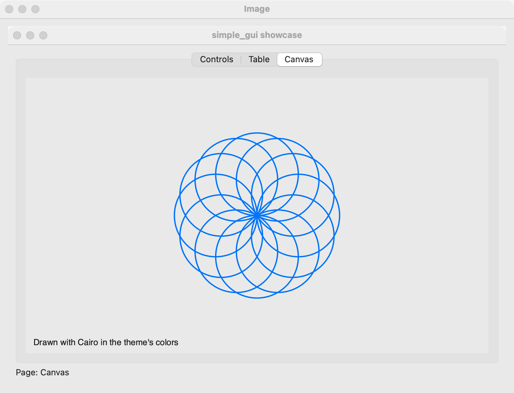

# Image

`GUI_IMAGE` shows a picture from a file or from PNG bytes in memory. Use it for logos, previews and icons that do not change while shown. For a picture the program draws itself, or one that changes often, use a [canvas](canvas.md).

## Example

```eiffel
class IMAGE_DEMO create make
feature
	app: GUI_APPLICATION
	image: GUI_IMAGE
	label: GUI_LABEL

	make
		local
			l_window: GUI_WINDOW
			l_stack: GUI_STACK
			l_button: GUI_BUTTON
		do
			create app.make ("Image demo", "org.simple-eiffel.image-demo")
			create l_window.make ("Image", 400, 320)
			create l_stack.make_vertical
			create image.make_from_file (create {PATH}.make_from_string ("logo.png"))
			image.set_accessible_label ("Simple Eiffel logo")
			create label.make ("Showing logo.png")
			create l_button.make ("Show photo.png")
			l_button.click_actions.extend (agent load_photo)
			l_stack.extend_stretching (image)
			l_stack.extend (label)
			l_stack.extend (l_button)
			l_window.set_content (l_stack)
			l_window.show
			app.run
		end

	load_photo
		do
			image.set_file (create {PATH}.make_from_string ("photo.png"))
			image.set_accessible_label ("A photo")
			if image.is_loaded then
				label.set_text ("Showing photo.png")
			else
				label.set_text ("photo.png is not a picture this platform reads")
			end
		end
end
```

## Try it

Put `logo.png` and `photo.png` in the folder you run the program from. The window shows the logo, scaled down to fit if it is larger than the space. Click **Show photo.png**: the image shows the photo, and the label says whether it loaded. An image has no events of its own.

## API

| Feature | What it does |
|---|---|
| `make_from_file (a_path)` | Makes an image showing the picture in the file `a_path`. |
| `make_from_png (a_bytes)` | Makes an image showing the PNG picture held in `a_bytes` (a `MANAGED_POINTER`). |
| `set_file (a_path)` | Shows the picture in `a_path` instead. |
| `set_png (a_bytes)` | Shows the PNG picture in `a_bytes` instead. |
| `is_loaded` | Did the last file or bytes hold a picture? When not, nothing is shown. |

Every creation procedure requires `is_gui_thread` and `has_application`; every command requires `is_gui_thread`. See also [common features](widget.md).

The picture is scaled down to fit the space it is given, keeping its proportions, and never enlarged past its natural size.

**Events:** none. Check `is_loaded` after each `make_from_file`, `set_file`, `make_from_png` or `set_png`.

**Accessibility:** the role is `img`. An image has no text of its own, so its accessible label is empty until you call `set_accessible_label` with what the picture shows. A purely decorative image needs no label.

## On each platform

| | Linux (GTK 4) | macOS (AppKit) | Windows (simple_widgets) |
|---|---|---|---|
| Native control | `GtkPicture`, scaled down to fit | `NSImageView`, scaled down proportionally | `SW_IMAGE` over a Cairo surface |
| Files it reads | the formats GDK's texture loader reads | PNG, JPEG, GIF, TIFF, HEIC, PDF and more | PNG only (Cairo reads PNG) |
| Looks or behaves differently | — | Gives way before other widgets when space is short. | — <!-- PROD: confirm --> |

## Design guidance

- Use PNG files. PNG is the one format every platform reads.
- Add a large image with `GUI_STACK.extend_stretching` so it gets the spare space; it shrinks to fit and never grows past its natural size.
- Give every image that carries meaning a `set_accessible_label` saying what it shows, not its file name.
- Check `is_loaded` and tell the user when a file could not be shown; the image itself stays blank.
- For charts, plots or anything drawn at run time, use a [canvas](canvas.md) instead.

## Gallery

| Linux | macOS | Windows |
|---|---|---|
| <!-- PROD: Linux picture --> |  | <!-- PROD: Windows picture --> |
