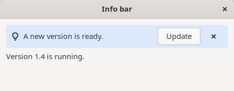
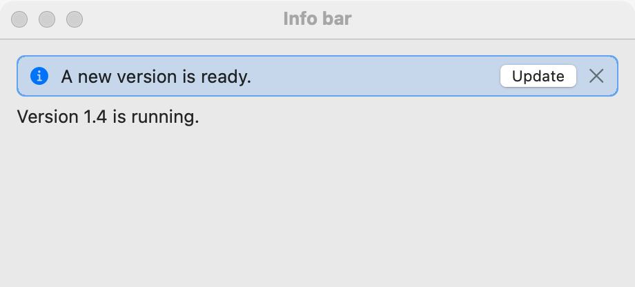
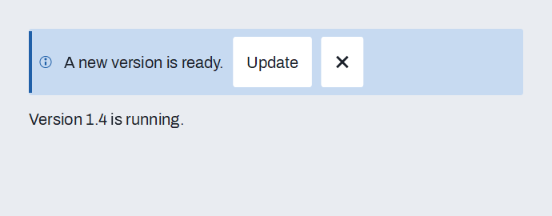

# Info bar

`GUI_INFO_BAR` is a banner inside a window: a message in the color of its kind (information, success, warning or error), with the kind's icon, optional action buttons and an optional close button. Put it at the top of a window's content, or above the part it is about. Use it for a message that stays until the user deals with it or closes it. For a short note that goes away by itself, use a [toast](toasts-and-notifications.md); for a message that stops everything until answered, use a [dialog](dialogs.md).

## Example

```eiffel
class INFO_BAR_DEMO create make
feature
	app: GUI_APPLICATION
	bar: GUI_INFO_BAR
	status: GUI_LABEL
	update_number: INTEGER

	make
		local
			l_window: GUI_WINDOW
			l_stack: GUI_STACK
		do
			create app.make ("Info bar demo", "org.simple-eiffel.info-bar-demo")
			create l_window.make ("Info bar", 460, 180)
			create l_stack.make_vertical
			create bar.make ({GUI_INFO_BAR}.Kind_info, "A new version is ready.")
			update_number := bar.add_action ("Update")
			bar.set_closable (True)
			bar.action_actions.extend (agent on_action)
			bar.closed_actions.extend (agent on_closed)
			create status.make ("Waiting.")
			l_stack.extend (bar)
			l_stack.extend (status)
			l_window.set_content (l_stack)
			l_window.show
			app.run
		end

	on_action (a_number: INTEGER)
		do
			if a_number = update_number then
				bar.set_kind ({GUI_INFO_BAR}.Kind_success)
				bar.set_message ("Updated.")
				status.set_text ("Update pressed.")
			end
		end

	on_closed
		do
			status.set_text ("The bar was closed.")
		end
end
```

## Try it

The window shows an information banner reading "A new version is ready." with an **Update** button and a close button, and the line "Waiting." under it. Press **Update**: `action_actions` runs with the action's number, the bar turns to the success kind reading "Updated.", and the line says "Update pressed." Press the close button: the bar hides and `closed_actions` runs, so the line says "The bar was closed."

## API

| Feature | What it does |
|---|---|
| `make (a_kind, a_message)` | Makes a bar of kind `a_kind` showing `a_message`. Requires `is_gui_thread`, `has_application` and `Kind_info <= a_kind <= Kind_error`. Ensures `kind` and `message` are as given, `action_count = 0` and `not is_closable`. |
| `kind`, `message` | The kind and the message now. |
| `Kind_info`, `Kind_success`, `Kind_warning`, `Kind_error` | The four kinds, numbered 1 to 4. The color and the icon follow the kind: information, check, warning or error. |
| `set_message (a_message)` | Changes the message. Ensures `message` is `a_message`. |
| `set_kind (a_kind)` | Changes the kind, and with it the color and icon. Requires `Kind_info <= a_kind <= Kind_error`. Ensures `kind = a_kind`. |
| `add_action (a_text)` | Adds a button `a_text` to the bar and returns its number, counting from 1. Requires a non-empty `a_text`. Ensures the result is `action_count`, which has grown by one. |
| `action_count` | How many actions were added; they are numbered 1 to `action_count`. |
| `set_closable (a_on)` | Shows or hides the close button. A new bar has none. Ensures `is_closable = a_on`. |
| `is_closable` | Does the bar show a close button? |
| `action_actions` | `GUI_ACTIONS [TUPLE [number: INTEGER]]`: run with the action's number when the user presses an action. |
| `closed_actions` | `GUI_ACTIONS [TUPLE]`: run when the user closes the bar. |

Every creation procedure requires `is_gui_thread` and `has_application`; every command requires `is_gui_thread`. Inherited: `show`, `hide`, `set_tooltip` and the rest of the [common features](widget.md).

**Events:** `action_actions` runs with the number `add_action` returned for the button the user pressed. `closed_actions` runs, with no arguments, when the user presses the close button; the bar hides itself first, so `is_shown` is false when your agent runs. Closing only hides the bar: it is not removed from its stack, and `show` brings it back. Code that changes the bar (`set_message`, `set_kind`, `add_action`, `set_closable`, `hide`) fires nothing.

**Accessibility:** the role is `alert`, which tells assistive tools the bar carries a message that needs notice. The message is the accessible label. Make each action's text a verb the user understands alone ("Update", "Retry", "Undo").

## On each platform

| | Linux (GTK 4) | macOS (AppKit) | Windows (simple_widgets) |
|---|---|---|---|
| Native control | A `GtkBox` with a CSS class for the kind (`GtkInfoBar` is deprecated), holding an icon, a label, the action buttons and a flat close button | A styled `NSView` | `SW_INFO_BAR`, with the kind's wash color, a glyph, a label, `SW_BUTTON` actions and a close glyph |
| Looks or behaves differently | The label does not shorten its text. The accessibility role is set to `alert` on the box. | The same banner, drawn from the kind's colors. | The action buttons are quiet buttons in a row, and the close button is hidden until `set_closable (True)`. |

The macOS column follows the design for that platform; the AppKit side is still to be written.

## Design guidance

- Match the kind to the message: information for news, success for a finished task, warning for something that may go wrong, error for something that did.
- Say what happened and what to do in one short sentence; put the doing in an action button rather than in the message.
- Make the bar closable unless the user cannot ignore the problem. A bar that cannot be closed must go away when its cause does: `hide` it from the code that fixes the cause.
- Put the bar at the top of the content, above what it is about. Keep to one bar for each cause; change its message with `set_message` rather than adding another.
- Do not use an info bar for something the user must answer at once; that is a [dialog](dialogs.md). Do not use it for a note that is gone in seconds; that is a [toast](toasts-and-notifications.md).

## Gallery

| Linux | macOS | Windows |
|---|---|---|
|  |  |  |
