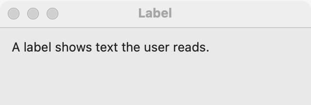

# Label

`GUI_LABEL` shows text the user reads but does not edit. Use it for captions, short messages and results. For text the user types, use a [text field](text-field.md) or a [text area](text-area.md). To show a lot of read-only text that the user can select and copy, use a read-only text area.

## Example

```eiffel
class LABEL_DEMO create make
feature
	app: GUI_APPLICATION
	label: GUI_LABEL

	make
		local
			l_window: GUI_WINDOW
			l_stack: GUI_STACK
			l_button: GUI_BUTTON
		do
			create app.make ("Label demo", "org.simple-eiffel.label-demo")
			create l_window.make ("Label", 360, 160)
			create l_stack.make_vertical
			create label.make ("Nothing has happened yet.")
			label.set_wrap_width (40)
			create l_button.make ("Change the text")
			l_button.click_actions.extend (agent change_text)
			l_stack.extend (label)
			l_stack.extend (l_button)
			l_window.set_content (l_stack)
			l_window.show
			app.run
		end

	change_text
		do
			label.set_text ("The button was clicked, so the program set a new text. This line wraps at about forty characters.")
		end
end
```

## Try it

The window shows the label "Nothing has happened yet." above a button. Click **Change the text**: the button's `click_actions` run `change_text`, and the label shows the longer text, wrapped onto several lines at about 40 characters. A label has no events of its own.

## API

| Feature | What it does |
|---|---|
| `make (a_text)` | Makes a label showing `a_text` on one line. |
| `make_number (a_text)` | Makes a label for a number or an expression. It is always left to right (`base_direction = Direction_left_to_right`), even in a right-to-left container, so a minus sign stays in front. |
| `text` | The text shown. |
| `set_text (a_text)` | Shows `a_text`. Ensures `text` is `a_text`. |
| `wrap_width` | About how many characters wide the label wraps; 0 means one line. |
| `set_wrap_width (a_characters)` | Wraps at about `a_characters` characters wide; 0 goes back to one line that ends in an ellipsis when cut. Requires `a_characters >= 0`. |
| `accessible_label` | The label's own text, unless the program set another with `set_accessible_label`. |

Every creation procedure requires `is_gui_thread` and `has_application`; every command requires `is_gui_thread`. For enabling, hiding, tooltips, size and direction, see [common features](widget.md).

**Events:** none. A label reports nothing.

**Accessibility:** the role is `label`. A screen reader reads its text, so you seldom need `set_accessible_label`. A label does not name the control beside it; give that control its own `set_accessible_label` with the same words.

## On each platform

| | Linux (GTK 4) | macOS (AppKit) | Windows (simple_widgets) |
|---|---|---|---|
| Native control | `GtkLabel`, aligned to the start | `NSTextField` made as a label | `SW_LABEL` |
| Looks or behaves differently | Wrapping uses the width as the label's natural width (`max_width_chars`) and breaks at words, or inside a word when one is too long. | Wrapping sets a fixed layout width from the font's average character width. A one-line label gives way first when space runs short and ends in "…". | Wrapping caps the width at the wrap width times the font's average character width, and breaks at words. A one-line label that does not fit gets no "…". |

## Design guidance

- Keep a label to one line unless it holds a sentence. Give a sentence a `set_wrap_width` (40 to 60 characters reads well) so it does not stretch the window.
- Use `make_number` for numbers, sums and expressions. In a right-to-left window, a plain label would let the bidirectional algorithm move a minus sign to the other end.
- In a right-to-left window a label aligns to the right, but English text inside it keeps its own reading order.
- Do not use a label as the only name of a field. Screen readers do not link the two; call `set_accessible_label` on the field.
- Do not use a label for text the user must copy. Use a read-only [text area](text-area.md).

## Gallery

| Linux | macOS | Windows |
|---|---|---|
| <!-- PROD: Linux picture --> |  | <!-- PROD: Windows picture --> |
