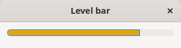
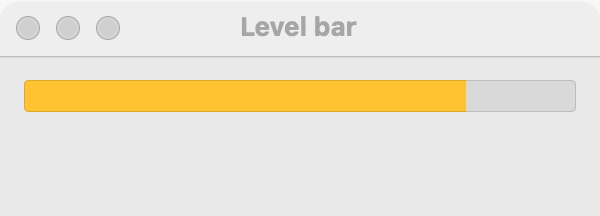
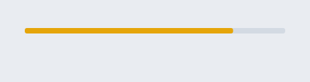

# Level bar

`GUI_LEVEL_BAR` is a meter: it shows how full something is, such as a disk, a battery or a signal, within a range you choose. It shows a warning color past one threshold and a critical color past another. It is not a progress bar: to show how far along a task is, use a [progress bar](progress-bar.md). For a value the user sets, use a [slider](slider.md).

## Example

```eiffel
class DISK create make
feature
	app: GUI_APPLICATION
	disk: GUI_LEVEL_BAR
	shown: GUI_LABEL

	make
		local
			l_window: GUI_WINDOW
			l_stack: GUI_STACK
			l_add: GUI_BUTTON
		do
			create app.make ("Disk", "org.example.disk")
			create l_window.make ("Disk", 340, 140)
			create l_stack.make_vertical
			create disk.make (0, 100)
			disk.set_accessible_label ("Disk used")
			disk.set_warning (70)
			disk.set_critical (90)
			disk.set_value (50)
			create shown.make ("50 GB of 100 GB used")
			create l_add.make ("Add 10 GB")
			l_add.click_actions.extend (agent add_file)
			l_stack.extend (disk)
			l_stack.extend (shown)
			l_stack.extend (l_add)
			l_window.set_content (l_stack)
			l_window.show
			app.run
		end

	add_file
		do
			disk.set_value ((disk.value + 10).min (disk.maximum))
			shown.set_text (disk.value.out + " GB of 100 GB used")
		end
end
```

## Try it

A window opens with a meter half full, the line "50 GB of 100 GB used" and a button. Each press of **Add 10 GB** raises the level and updates the line. Past 70 the meter shows the warning color, and past 90 the critical color.

## API

| Feature | What it does |
|---|---|
| `make (a_min, a_max)` | A level bar from `a_min` to `a_max`, at `a_min`. Requires `a_min < a_max`. Ensures `minimum = a_min`, `maximum = a_max` and `value = a_min`. |
| `minimum`, `maximum` | The range. |
| `value` | The level shown, from `minimum` to `maximum`. |
| `set_value (a_value)` | Shows `a_value`. Requires `minimum <= a_value <= maximum`. Ensures `value = a_value`. |
| `warning` | The value past which the warning color shows (0: none). |
| `set_warning (a_value)` | Sets the warning threshold. Requires `minimum <= a_value <= maximum`. Ensures `warning = a_value`. |
| `critical` | The value past which the critical color shows (0: none). |
| `set_critical (a_value)` | Sets the critical threshold. Requires `minimum <= a_value <= maximum`. Ensures `critical = a_value`. |

Inherited: `set_accessible_label`, `set_tooltip`, `show`, `hide` and the rest of the [common features](widget.md).

**Events:** none. The user cannot change a level bar.

**Accessibility:** the role is `meter`, and its value is the level. Give it `set_accessible_label` with what it measures ("Disk used", "Battery"); the bar has no text of its own.

**Thresholds.** A threshold of 0 is unset, so a new bar shows no warning or critical color. Either threshold may be set alone: with only a critical value, the bar turns to the critical color past it. On every platform the colors start past a threshold, not at it, so they suit a meter where more is worse, such as disk use.

## On each platform

| | Linux (GTK 4) | macOS (AppKit) | Windows (simple_widgets) |
|---|---|---|---|
| Native control | `GtkLevelBar` with offsets for the thresholds, amber and red | `NSLevelIndicator`, continuous capacity style, with warning and critical values | `GUI_SW_LEVEL_BAR`, drawn: the theme's accent, then amber and red |
| Looks or behaves differently | — | The warning color is yellow and the critical color red, as AppKit draws them. At least 100 pixels wide. | — |

## Design guidance

- Put a line of text with the numbers beside or under the bar ("50 GB of 100 GB used"): the color alone does not say how much, and some users cannot tell the colors apart.
- Choose `minimum` and `maximum` in the units you show (gigabytes, percent), so `value` needs no conversion.
- Because 0 means "unset", do not use 0 as a real threshold; pick ranges where the thresholds are above 0.
- Do not use a level bar for task progress; a [progress bar](progress-bar.md) tells the user that something is moving toward done.
- Give it an accessible label; a screen reader reads the role as a meter and the value as the level.

## Gallery

| Linux | macOS | Windows |
|---|---|---|
|  |  |  |
