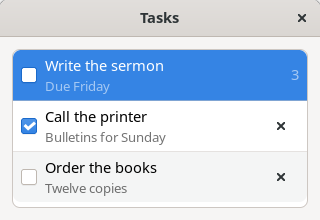
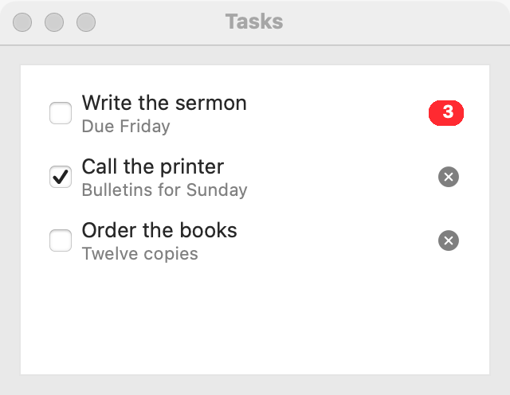
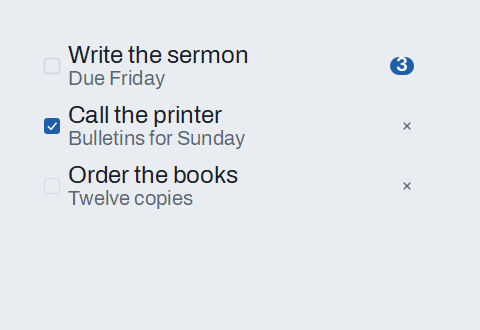

# List

`GUI_LIST` is a single column of text rows, from which the user selects one. Use it when the choices are many, or change while the program runs, and the user benefits from seeing several at once. For a few fixed choices in little room, use a [dropdown](dropdown.md) or a [radio group](radio-group.md); for rows with several columns, use a [table](table.md); for a hierarchy, use a [tree](tree.md).

## Example

```eiffel
class BOOKS create make
feature
	app: GUI_APPLICATION
	books: GUI_LIST
	shown: GUI_LABEL

	make
		local
			l_window: GUI_WINDOW
			l_stack: GUI_STACK
		do
			create app.make ("Books", "org.example.books")
			create l_window.make ("Books", 320, 260)
			create l_stack.make_vertical
			create books.make
			books.set_accessible_label ("Books")
			books.extend ("Genesis")
			books.extend ("Exodus")
			books.extend ("Leviticus")
			create shown.make ("Pick a book.")
			books.selection_actions.extend (agent on_book)
			l_stack.extend_stretching (books)
			l_stack.extend (shown)
			l_window.set_content (l_stack)
			l_window.show
			app.run
		end

	on_book (a_row: INTEGER)
		do
			if a_row > 0 then
				shown.set_text ({STRING_32} "You picked " + books.i_th (a_row))
			end
		end
end
```

## Try it

A window opens with a list of three books, none selected, and the line "Pick a book." under it. Click **Exodus**: `selection_actions` fires with 2, and the line says "You picked Exodus".

## API

| Feature | What it does |
|---|---|
| `make` | An empty list. Ensures `count = 0`. |
| `extend (a_text)` | Adds a row at the end. Ensures `count = old count + 1` and `i_th (count)` is `a_text`. |
| `wipe_out` | Removes every row. Ensures `count = 0` and `selected_index = 0`. |
| `count` | How many rows there are. |
| `i_th (i)` | The text of row `i`. Requires 1 <= `i` <= `count`. |
| `selected_index` | The selected row, or 0 when none is. |
| `scroll_to_row (i)` | Scrolls so row `i` is in view, with no event; the selection does not change. Requires 1 <= `i` <= `count`. |
| `select_row (i)` | Selects row `i`, with no event. Requires 1 <= `i` <= `count`. Ensures `selected_index = i`. |
| `clear_selection` | Selects nothing. Ensures `selected_index = 0`. |
| `selection_actions` | `GUI_ACTIONS [TUPLE [row: INTEGER]]`: run when the user selects a row. |
| `set_multiple_selection (a_on)` | Lets the user select several rows at once (Command or Control, and Shift, with a click), or goes back to one. Requires `is_gui_thread`. Ensures `is_multiple_selection = a_on`. |
| `is_multiple_selection` | May the user select several rows? |
| `selected_rows` | Every selected row, in order, as an `ARRAYED_LIST [INTEGER]`. Ensures every number is in 1 to `count`. |
| `set_reorderable (a_on)`, `is_reorderable`, `reorder_actions`, `move_row (a_from, a_to)` | Let the user move rows by dragging. See [Reordering](reordering.md). |
| `set_row_pebble_function (a_function)` | Lets each row carry a pebble for [pick and drop](pick-and-drop.md). A drop on the list sets `last_drop_row`. |
| `extend_rich (a_row)` | Adds a copy of a `GUI_LIST_ROW` at the end: a title, and optionally a dimmer second line, an icon, a count badge, a check box and a close button. Plain `extend` rows sit beside rich ones. Ensures `count = old count + 1`. |
| `row (i)` | Row `i`'s parts as a `GUI_LIST_ROW` (a plain row has only its title). `i_th (i)` is its title. |
| `remove_row (i)` | Takes row `i` out, with no event; the rows after it move up one. Ensures `count = old count - 1`. |
| `set_row_checked (i, a_on)`, `is_row_checked (i)` | Checks or unchecks row `i`'s box, with no event. Requires the row to be checkable. |
| `row_check_actions` | `GUI_ACTIONS [TUPLE [row: INTEGER; is_checked: BOOLEAN]]`: run when the user checks or unchecks a row (its box, or Space on the selected row). |
| `row_close_actions` | `GUI_ACTIONS [TUPLE [row: INTEGER; title: STRING_32]]`: run after the user closed a row (its close button, or Delete on the selected row). The row is already gone; the arguments say which it was. |
| `set_filter (a_text)`, `filter_text`, `shown_count` | Shows only the rows whose title contains `a_text`, ignoring case (empty: all). Row numbers stay the list's own. A selected row the filter hides is deselected, and `selection_actions` run with 0. |
| `filter_with (a_search)` | Filters by a [search field](search-field.md)'s text as the user types. |
| `sort (a_ascending)`, `is_in_order (a_ascending)` | Orders the rows by title, ignoring case; equal titles keep their order, and the selection stays with its row. No event. Ensures `is_in_order (a_ascending)`. |
| `set_sort_on_extend (a_on, a_ascending)` | Keeps the rows sorted as they are added (and sorts them now). |

Inherited: `set_accessible_label`, `set_context_menu`, `set_tooltip` and the rest of the [common features](widget.md).

**Events:** `selection_actions` fires with the row number when the user selects a row. Rows are 1-based; check for 0, which is sent when the user clears the selection (Linux and macOS; on Windows a click always selects a row). A list reports a selection only when it changes: choosing the row that is already selected sends nothing. `select_row` and `scroll_to_row` never fire it: its postcondition is `selection_actions.fire_count = old selection_actions.fire_count`.

**Several rows.** After `set_multiple_selection (True)` the user can select more than one row, with Command or Control and Shift. Read all of them with `selected_rows`, for example when the user presses a button such as **Delete**. `selection_actions` still run with one number: the first selected row, or 0 when none is. They run when the selection changes, so use them to learn that the selection changed and read `selected_rows` for what it is. `selected_index` is the single-selection feature; in this mode use `selected_rows`. On Linux, turning the mode on clears the selection.

**Moving rows, and pick and drop.** A list can let the user reorder its rows by dragging: see [Reordering](reordering.md). Its rows can also be sources and targets for [pick and drop](pick-and-drop.md), and a list can take files and text from other programs: see [Drag and drop between programs](drag-and-drop-between-programs.md).

**Rich rows.** A `GUI_LIST_ROW` describes a row before it goes in:

```eiffel
create l_row.make ("Write the sermon")
l_row.set_subtitle ("Due Friday")
l_row.set_icon_name ("document")
l_row.set_badge (3)
l_row.set_checkable (True)
l_row.set_closable (True)
tasks.extend_rich (l_row)
tasks.row_check_actions.extend (agent mark_done)       -- (row, is_checked)
tasks.row_close_actions.extend (agent forget_task)     -- (row it was, title)
```

The list keeps a copy, so change a row in the list through `set_row_checked`. A row with a subtitle is two lines tall; a list may make all its rows that tall. Space on the selected row toggles its check and Delete closes it (Command and Backspace on macOS), as a click on the box or the close button does.

**Filtering and sorting.** `set_filter` hides the rows that don't match and `filter_with` ties it to a search field. Hidden rows keep their numbers, so `selected_index`, `i_th` and every event still speak of the list's own rows; `shown_count` says how many show. `sort` reorders the rows themselves and keeps the selection with its row.

**Accessibility:** the role is `list`, and each row is a `list-item` read by its text. The list has no visible text of its own, so give it `set_accessible_label` with what the rows are ("Books", "Recent files").

## On each platform

| | Linux (GTK 4) | macOS (AppKit) | Windows (simple_widgets) |
|---|---|---|---|
| Native control | `GtkListBox` (single selection, `boxed-list` style) in a `GtkScrolledWindow` | `NSTableView` with one column and no header, inset style, in a bordered `NSScrollView` | `SW_TEXT_LIST`: a drawn list that names its rows for screen readers |
| Looks or behaves differently | At least 80 pixels tall. A cleared selection sends row 0. Rich rows are a box of `GtkCheckButton`, labels (the subtitle `dim-label`), an icon, a badge and a flat close button; GtkListBox's own filter hides rows. | A cleared selection sends row 0. Rich rows are table cell views; Command and Backspace closes a row. | Starts 120 pixels tall. A click always selects a row, so the user has no way to clear the selection and row 0 does not arrive. Rich rows are drawn; while any row has a subtitle, every row is two lines tall. |

## Design guidance

- A list scrolls on its own. Give it room with `extend_stretching`, and never put it in a [scroll area](scroll-area.md).
- Give it an accessible label, and a visible caption above it when the window has more than one list.
- To change the rows, call `wipe_out` and `extend` again; then `select_row` to restore a selection, without an event.
- After `select_row`, call `scroll_to_row` with the same row when a long list may have it out of view. It leaves the selection alone.
- Read `selected_index` when the user presses a button such as **Open**, rather than acting on every selection change.
- Add a [context menu](widget.md) for actions on a row (rename, delete) with `set_context_menu`.
- Turn on `set_multiple_selection` only when an action works on several rows (delete, move, export). Show the count of selected rows near the button that acts on them.
- Turn on `set_reorderable` only when the order is the user's to decide, and keep **Move up** and **Move down** buttons beside it (see [Reordering](reordering.md)).

## Gallery

| Linux | macOS | Windows |
|---|---|---|
|  |  |  |
|  |  |  |
