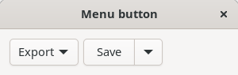
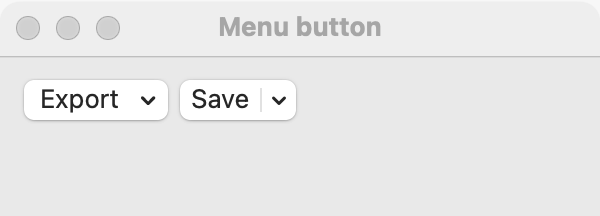
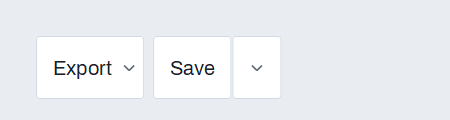

# Menu button

`GUI_MENU_BUTTON` is a button that opens a menu; a split menu button also has a main part that acts as a button of its own. Use it for a few related commands in the window, such as export formats, or for a main action with variants beside it ("Save", and "Save as PDF" under the arrow). For one command, use a plain [button](button.md); to pick a value that stays chosen, use a [dropdown](dropdown.md).

## Example

```eiffel
class
	EXPORTER

create
	make

feature {NONE} -- Initialization

	make
		local
			l_window: GUI_WINDOW
			l_stack: GUI_STACK
			l_save: GUI_MENU_BUTTON
			l_menu: GUI_MENU
		do
			create app.make ("Exporter", "org.example.exporter")
			create status.make ("Not saved yet.")
			create l_window.make ("Exporter", 360, 140)
			create l_stack.make_vertical
			l_menu := app.menu.new_context_menu
			l_menu.add_item ("Save as PDF", "", agent report ("Saved as PDF"))
			l_menu.add_item ("Save as HTML", "", agent report ("Saved as HTML"))
			create l_save.make_split ("Save")
			l_save.set_menu (l_menu)
			l_save.click_actions.extend (agent report ("Saved"))
			l_stack.extend (l_save)
			l_stack.extend (status)
			l_window.set_content (l_stack)
			l_window.show
			app.run
		end

feature -- Access

	app: GUI_APPLICATION

	status: GUI_LABEL

feature {NONE} -- Events

	report (a_text: STRING)
		do
			status.set_text (a_text)
		end

end
```

## Try it

The window shows a **Save** button with an arrow beside it, and the text "Not saved yet." Click **Save**: `click_actions` fire and the label reads "Saved". Click the arrow and choose **Save as PDF**: the item's agent runs and the label reads "Saved as PDF".

## API

| Feature | What it does |
|---|---|
| `make (a_text)` | A button titled `a_text` that opens its menu. Needs the application. Afterward `is_split` is false. |
| `make_split (a_text)` | A button titled `a_text` with an arrow beside it that opens its menu. Afterward `is_split` is true. |
| `text` | The title. |
| `is_split` | Was it made with `make_split`? |
| `set_menu (a_menu)` | Open `a_menu`, a `GUI_MENU`, from this button. |
| `menu` | The menu, or Void before `set_menu`. |
| `click_actions` | Agents run when the user clicks the main part of a split button. |

The rest are the [common features](widget.md). Make the menu with `app.menu.new_context_menu` and fill it with `add_item`, as in [menus](menus.md).

**Events:** the menu's items run their agents when chosen, as any menu's do. A split button's main part fires `click_actions` with no arguments. A plain menu button's click only opens the menu. Nothing fires from code.

**Accessibility:** the role is `button`, named by its text (GTK reports a button with a popup). Give the button a text that names the group of commands, such as "Export".

## On each platform

| | Linux (GTK 4) | macOS (AppKit) | Windows (simple_widgets) |
|---|---|---|---|
| Native control | `GtkMenuButton`; split: a linked `GtkButton` and `GtkMenuButton` | a pull-down `NSPopUpButton` whose first item is the title; split: `NSComboButton` (macOS 13 and later) | `GUI_SW_MENU_BUTTON`, an `SW_BUTTON` with a drawn chevron that opens an `SW_MENU` popup; split: `GUI_SW_SPLIT_BUTTON`, an `SW_BUTTON` beside an arrow menu button |
| Looks or behaves differently | — | `set_menu` gives the button a copy of the menu, so fill the menu first. | — |

## Design guidance

- Fill the menu before `set_menu`. On macOS the button takes a copy, so items added later do not show.
- Use `make_split` when one command is the usual choice; put that command's variants in the menu.
- Keep the menu short (two to six items). For more, use the menu bar.
- Use a context menu from `app.menu.new_context_menu`, not a menu from the menu bar.
- Place it with the content it acts on, at its natural width, not stretched across the window.

## Gallery

| Linux | macOS | Windows |
|---|---|---|
|  |  |  |
