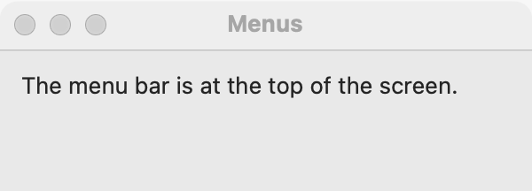

# Menus

`GUI_MENU_MODEL` holds the application's menus, and each `GUI_MENU` is one menu in the menu bar or one context menu a widget shows on a secondary click. Use the menu bar for every command the program has, with shortcuts for the frequent ones; use a context menu for commands on one widget. For a menu that opens from a button in the window, use a [menu button](menu-button.md); for a few frequent commands always in view, add a [toolbar](toolbar.md).

## Example

```eiffel
class
	MENUS_DEMO

create
	make

feature {NONE} -- Initialization

	make
		local
			l_window: GUI_WINDOW
			l_menu, l_context: GUI_MENU
		do
			create app.make ("Menus", "org.example.menus")
			create message.make ("Choose an item.")
			l_menu := app.menu.add_menu ("File")
			l_menu.add_item ("New Greeting", "primary+N", agent say ("Hello"))
			l_menu.add_separator
			l_menu.add_role_item (l_menu.Role_quit, "Quit", "primary+Q", agent app.quit)
			l_menu := app.menu.add_menu ("Edit")
			l_menu.add_standard_edit_items
			l_menu := app.menu.add_menu ("Help")
			l_menu.add_role_item (l_menu.Role_about, "About", "", agent about)
			create l_window.make ("Menus", 360, 160)
			l_context := app.menu.new_context_menu
			l_context.add_item ("Clear", "", agent say (""))
			message.set_context_menu (l_context)
			l_window.set_content (message)
			l_window.show
			app.run
		end

feature -- Access

	app: GUI_APPLICATION

	message: GUI_LABEL

feature {NONE} -- Events

	say (a_text: STRING)
		do
			message.set_text (a_text)
		end

	about
		do
			app.dialogs.show_about ("Menus", "1.0", "", "A menu demo.")
		end

end
```

## Try it

The program has File, Edit and Help menus. Choose **File > New Greeting**, or press Command-N on macOS or Ctrl+N on Linux and Windows: the item's agent runs and the label reads "Hello". Right-click the label (or Control-click, or tap with two fingers) and choose **Clear**: the context menu's agent empties the label. Choose **About** to see the About window.

On macOS, About and Quit are not in Help and File: they are at the top and bottom of the application menu, as "About Menus" and "Quit Menus". On Linux and Windows they stay where the program put them.

## API

**`GUI_MENU_MODEL`** (the application has one: `app.menu`)

| Feature | What it does |
|---|---|
| `add_menu (a_title)` | A new top-level menu titled `a_title`, at the end of the bar. `a_title` is not empty. |
| `new_context_menu` | A new context menu: not in the bar, for `GUI_WIDGET.set_context_menu`. Its items share the model's numbering. |
| `menus` | The top-level menus, in order. |
| `context_menus` | The context menus made so far. |
| `item_count` | How many items there are, across all menus; their ids are 1 to `item_count`. |
| `shortcut_spec` | Every shortcut, as `"id=shortcut;..."`. The window installs them on its first `show`. |

**`GUI_MENU`** (made only by the model)

| Feature | What it does |
|---|---|
| `add_item (a_text, a_shortcut, an_action)` | An item that runs `an_action`. `a_shortcut` is neutral, such as `"primary+O"`, or empty for none. `a_text` is not empty. Afterward `last_item_id` is the item's id. |
| `add_role_item (a_role, a_text, a_shortcut, an_action)` | An About, Settings or Quit item that runs `an_action`, placed where the platform expects. `a_role` is `Role_none`, `Role_about`, `Role_settings` or `Role_quit`; a context menu takes only `Role_none`. |
| `add_edit_item (a_role, a_text)` | An Edit item that acts on the focused text field through the toolkit's own action. `a_role` is one of `Role_undo`, `Role_redo`, `Role_cut`, `Role_copy`, `Role_paste`, `Role_select_all`. Its id is for relabeling only. |
| `add_standard_edit_items` | Undo, Redo, a separator, Cut, Copy, Paste and Select All. |
| `add_separator` | A line between groups of items. |
| `set_title (a_title)` | Relabel a top-level menu (for example on a change of language). Not for a context menu; `a_title` is not empty. |
| `title`, `shown_title` | The title given, and the title the toolkit shows now. |
| `set_item_text (an_item_id, a_text)` | Relabel item `an_item_id`, keeping its action and shortcut. `an_item_id` is between 1 and `model.item_count`. |
| `item_text (an_item_id)` | The label the toolkit shows now. On macOS, About and Quit read "About" or "Quit" followed by the application's name. |
| `last_item_id` | The id of the item added last. Keep it to relabel the item later. |
| `is_context` | Is this a context menu? |
| `model` | The model the menu belongs to. |

**On any widget** (see [common features](widget.md))

| Feature | What it does |
|---|---|
| `set_context_menu (a_menu)` | Show `a_menu` on a secondary click on this widget. `a_menu.is_context` must hold. |
| `context_menu` | The widget's context menu, or Void. |

**Shortcuts** are written the same way on every platform: modifiers and one key, joined by `+`. `primary` is Command on macOS and Ctrl on Linux and Windows; the others are `shift` and `alt`. The key is a letter or digit, `F1` to `F12`, `up`, `down`, `left`, `right`, `home`, `end`, `pageup`, `pagedown`, `insert`, `delete`, `backspace`, `escape`, `enter`, `tab`, `space`, `plus`, `minus`, `comma` or `period`. Examples: `"primary+S"`, `"primary+shift+Z"`, `"F5"`.

**Events:** choosing an item, by mouse, keyboard or its shortcut, runs its agent. Edit items run no agent: the toolkit cuts, copies or pastes in the focused field itself, and enables each Edit item only when the focused widget can do it. `set_title` and `set_item_text` fire nothing.

**Accessibility:** the bar is a `menu-bar`, each menu a `menu`, and each item a `menu-item`, named by its text. Write item texts that make sense on their own, and end an item that opens a dialog with "...".

## On each platform

| | Linux (GTK 4) | macOS (AppKit) | Windows (simple_widgets) |
|---|---|---|---|
| Native control | a `GMenu` model in a `GtkPopoverMenuBar` at the top of each window | `NSMenu`s in the screen's menu bar | `SW_MENU_BAR` and `SW_MENU` in each window |
| About, Settings, Quit | stay where the program put them | About moves to the top of the application menu, and the menu the program put it in becomes the Help menu (macOS adds its search field there). Settings goes above Services, with Command-comma unless you give a shortcut. Quit goes to the bottom of the application menu, always with Command-Q. | stay where the program put them |
| Edit items | act on the focused widget's text actions; no shortcut is shown, since text fields take Ctrl+Z, X, C, V and A themselves | go through the responder chain; an item without a shortcut gets the standard one (Command-Z, Shift-Command-Z, Command-X, C, V, A) | act on the focused widget |
| Menus the program does not add | none | the application menu (Services, Hide, Hide Others, Show All) and a Window menu (Minimize, Zoom, Enter Full Screen, Bring All to Front), which stays after the program's menus and before Help | none |
| Context menu | a `GtkPopoverMenu` where the secondary click lands | the view's `NSMenu`, on a right-click, a Control-click or a two-finger click | replaces the widget's own right-click menu |
| Looks or behaves differently | A separator starts a new section. The bar is hidden while there are no menus. | The menu bar belongs to the application, not a window. | Each window draws its own bar at the top, left out while there are no menus. A separator is a drawn line. An Edit item the focused widget cannot act on is grayed. |

## Design guidance

- Build the menus before the first window's `show`, which installs their shortcuts.
- Use the application's model, `app.menu`. Menu events go to it, so items in a model you create yourself do not run their agents.
- Always add a Quit item with `Role_quit`. On macOS, Command-Q works only through it.
- Use `add_standard_edit_items` in an Edit menu whenever the window has text fields. On macOS the Edit menu's shortcuts are what carry Command-C and Command-V to a text field.
- Use the conventional shortcuts (`primary+O` Open, `primary+S` Save, `primary+W` Close). Avoid `primary+H` and `primary+M`, which macOS uses for Hide and Minimize.
- A context menu repeats commands; it never holds the only way to do something, since keyboard users and screen reader users may not find it.

## Gallery

| Linux | macOS | Windows |
|---|---|---|
| <!-- PROD: Linux picture --> |  | <!-- PROD: Windows picture --> |
