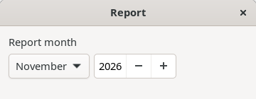
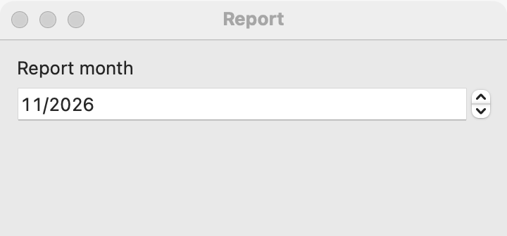
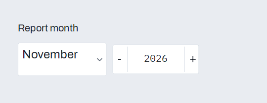

# Month picker

`GUI_MONTH_PICKER` chooses a month of a year, with no day: a billing month, a report period, a card's expiry. For a full date use a [date picker](date-picker.md); for a date and time use a [date and time picker](date-time-picker.md); to look at a month's days use a [calendar](calendar.md).

## Example

```eiffel
class REPORT_MONTH create make
feature
	app: GUI_APPLICATION
	month_picker: GUI_MONTH_PICKER
	shown: GUI_LABEL

	make
		local
			l_window: GUI_WINDOW
			l_stack: GUI_STACK
		do
			create app.make ("Month picker demo", "org.simple-eiffel.month-picker-demo")
			create l_window.make ("Report", 360, 140)
			create l_stack.make_vertical
			create month_picker.make
			month_picker.set_accessible_label ("Report month")
			month_picker.set_month (2027, 2)
			month_picker.change_actions.extend (agent on_change)
			create shown.make ("Report for 2027-2")
			l_stack.extend (month_picker)
			l_stack.extend (shown)
			l_window.set_content (l_stack)
			l_window.show
			app.run
		end

	on_change (a_year, a_month: INTEGER)
		do
			shown.set_text ({STRING_32} "Report for " + a_year.out + "-" + a_month.out)
		end
end
```

## Try it

The window shows February 2027 (`set_month` fired nothing; a new picker would show the current month) and the line "Report for 2027-2". Choose another month, or change the year: `change_actions` runs with the year and the month, and the line updates.

## API

| Feature | What it does |
|---|---|
| `make` | A picker showing the current month. Requires `is_gui_thread` and `has_application`. |
| `year` | The year shown. |
| `month` | The month shown, 1 (January) to 12. Ensures the result is in that range. |
| `set_month (a_year, a_month)` | Shows that month, without an event. Requires `is_gui_thread`, `1 <= a_year <= 9999` and `1 <= a_month <= 12`. Ensures `year = a_year`, `month = a_month` and `change_actions.fire_count = old change_actions.fire_count`. |
| `change_actions` | `GUI_ACTIONS [TUPLE [year, month: INTEGER]]`: run when the user commits another month. |

Inherited: the [common features](widget.md).

**Events:** `change_actions` runs with the year and the month when the user commits another month or year. `set_month` never fires it.

**Accessibility:** give the picker `set_accessible_label` ("Report month"). On Linux and Windows the two parts are labeled "Month" and "Year".

## On each platform

| | Linux (GTK 4) | macOS (AppKit) | Windows (simple_widgets) |
|---|---|---|---|
| Native control | A box with a `GtkDropDown` of the month names and a `GtkSpinButton` for the year (1 to 9999) | An `NSDatePicker` showing year and month only | A month dropdown and a year spin box in a row |
| Looks or behaves differently | The month names follow the locale. | The user types or steps each part. | The month names are in English. |

## Design guidance

- Use a month picker when the day does not matter; asking for a day that means nothing (a card that expires "on the 1st of 03/28") adds only noise.
- Give it an accessible label, and a visible caption before it.
- Read `year` and `month` when you need them; the event also carries them.
- Set it from saved data with `set_month`, which fires nothing.

## Gallery

| Linux | macOS | Windows |
|---|---|---|
|  |  |  |
