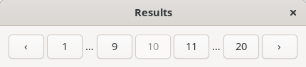
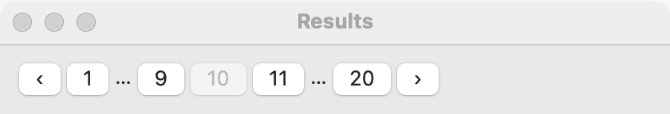
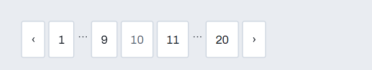

# Pagination

`GUI_PAGINATION` lets the user move through results shown a page at a time: **‹** (previous), page numbers, and **›** (next). The first and last pages, and the pages next to the current one, have buttons; the rest are gaps ("…"). The program shows the page the user chose. For a long list the user scrolls, use a [list](list.md) or a [table](table.md) with lazy rows instead.

## Example

```eiffel
class RESULTS create make
feature
	app: GUI_APPLICATION
	pages: GUI_PAGINATION
	shown: GUI_LABEL

	make
		local
			l_window: GUI_WINDOW
			l_stack: GUI_STACK
		do
			create app.make ("Results", "org.example.results")
			create l_window.make ("Results", 480, 160)
			create l_stack.make_vertical
			create shown.make ("Results 1 to 10 of 200")
			create pages.make
			pages.set_page_count (20)
			pages.page_actions.extend (agent show_page)
			l_stack.extend (shown)
			l_stack.extend (pages)
			l_window.set_content (l_stack)
			l_window.show
			app.run
		end

	show_page (p: INTEGER)
		do
			shown.set_text ("Results " + ((p - 1) * 10 + 1).out + " to " + (p * 10).out + " of 200")
		end
end
```

## Try it

The control shows **‹ 1 2 3 4 5 … 20 ›**, with 1 current and **‹** off. Press **3**: the label shows results 21 to 30, and the buttons become 1 2 3 4 5 … 20 with 3 current. Press **20**: the buttons become 1 … 16 17 18 19 20 and **›** is off. Press **‹** to go back one page.

## API

| Feature | What it does |
|---|---|
| `make` | Pagination with one page either side of the current one. Ensures `page_count = 0` and `page = 0`. |
| `make_with_siblings (k)` | The same with `k` pages either side (0 to 5). The buttons are made once, so this is fixed at creation. |
| `set_page_count (n)` | There are `n` pages; the current page stays where it can (page 1 when there was none). |
| `set_page (p)` | Makes `p` the current page, with no event. Requires 1 <= `p` <= `page_count`. |
| `page`, `page_count`, `siblings` | The current page (0 with no pages), how many there are, how many either side get buttons. |
| `shown_pages` | The items shown, in order: page numbers, and 0 for each gap. |
| `page_actions` | `GUI_ACTIONS [TUPLE [page: INTEGER]]`: run when the user chooses a page. |
| `button_for (p)`, `previous_button`, `next_button` | The buttons, for tests. `button_for` is Void when page `p` has none. |

**Events:** `page_actions` fires when the user presses a number, **‹** or **›**. `set_page` and `set_page_count` fire nothing.

**Accessibility:** the control is labeled "Page 3 of 20"; **‹** and **›** are "Previous page" and "Next page", and each number is "Page 4". The current page's button is disabled, as are **‹** on the first page and **›** on the last.

## On each platform

`GUI_PAGINATION` is a row of simple_gui's own [buttons](button.md) and [labels](label.md), so it looks native on each platform. The gaps are labels, not buttons.

## Design guidance

- Show what the page holds near the control ("Results 21 to 30 of 200").
- Keep the current page when the results change, if it still exists; `set_page_count` does that for you.
- Use `make_with_siblings (2)` when there is room and users jump around a lot.

## Gallery

| Linux | macOS | Windows |
|---|---|---|
|  |  |  |
