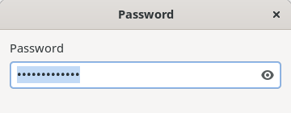
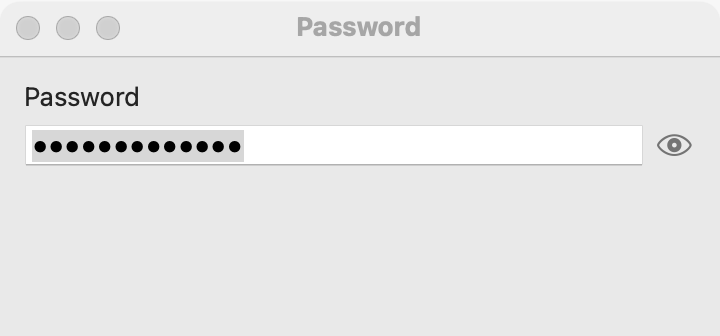
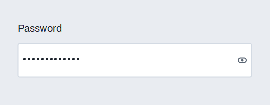

# Password field

`GUI_PASSWORD_FIELD` is a [text field](text-field.md) whose characters are hidden, with a button the user presses to show or hide them. Use it for passwords, keys and other secrets that someone may be watching over the user's shoulder. It has every feature of a text field, including [validation and suggestions](validation-and-suggestions.md), and adds the show-and-hide toggle and a caps lock query. For text that is not secret, use a plain text field.

## Example

```eiffel
class PASSWORD_DEMO create make
feature
	app: GUI_APPLICATION
	secret: GUI_PASSWORD_FIELD
	status: GUI_LABEL

	make
		local
			l_window: GUI_WINDOW
			l_stack: GUI_STACK
		do
			create app.make ("Password demo", "org.simple-eiffel.password-demo")
			create l_window.make ("Password", 360, 140)
			create l_stack.make_vertical
			create secret.make
			secret.set_accessible_label ("Password")
			secret.reveal_actions.extend (agent on_reveal)
			secret.activate_actions.extend (agent on_enter)
			create status.make ("Type a password and press Enter.")
			l_stack.extend (secret)
			l_stack.extend (status)
			l_window.set_content (l_stack)
			l_window.show
			app.run
		end

	on_reveal (a_is_revealed: BOOLEAN)
		do
			if a_is_revealed then
				status.set_text ("The password is showing.")
			else
				status.set_text ("The password is hidden.")
			end
		end

	on_enter
		do
			if secret.is_caps_lock_on then
				status.set_text ("Caps Lock is on.")
			else
				status.set_text ({STRING_32} "Length: " + secret.text.count.out)
			end
		end
end
```

## Try it

The window shows an empty field that hides what is typed, with a show-and-hide button, and the line "Type a password and press Enter." Type "hunter2": the characters appear as dots. Press the button: the characters show, `reveal_actions` runs with `True`, and the line says "The password is showing." Press it again to hide them: `reveal_actions` runs with `False`. Press Enter: `activate_actions` runs, and the line shows the length, or says "Caps Lock is on." when it is.

## API

| Feature | What it does |
|---|---|
| `make` | Makes an empty password field with the characters hidden. Ensures `not is_revealed`. |
| `is_revealed` | Are the characters shown? |
| `set_revealed (a_on)` | Shows or hides the characters from the program, without a reveal event. Requires `is_gui_thread`. Ensures `is_revealed = a_on` and `reveal_actions.fire_count = old reveal_actions.fire_count`. |
| `is_caps_lock_on` | Is Caps Lock on now? |
| `reveal_actions` | `GUI_ACTIONS [TUPLE [is_revealed: BOOLEAN]]`: run when the user shows or hides the characters, with the new state. |

Inherited from [text field](text-field.md): `text`, `set_text`, `placeholder`, `set_placeholder`, `change_actions`, `activate_actions`, `change_count`, and the validation and suggestion features. Also inherited: the [common features](widget.md). Every creation procedure requires `is_gui_thread` and `has_application`.

**Events:** `reveal_actions` runs when the user presses the show-and-hide button. `set_revealed` never fires it. The text field's events work as they do on a plain field: `change_actions` after each edit, `activate_actions` on Enter. `set_text` fires neither.

**Accessibility:** the role is that of a text field (`text-box`). A field has no visible text of its own, so give it `set_accessible_label` ("Password"). On macOS the show-and-hide button is described as "Show password" or "Hide password"; on Linux its tooltip says "Show the password" or "Hide the password".

## On each platform

| | Linux (GTK 4) | macOS (AppKit) | Windows (simple_widgets) |
|---|---|---|---|
| Native control | A `GtkEntry` with its text hidden and an eye icon at the trailing end; its input purpose is password | An `NSSecureTextField` and a plain text field holding the same text, swapped by an eye button | A masked `SW_TEXT_BOX` with its own reveal button |
| Looks or behaves differently | The icon changes between "view-reveal" and "view-conceal" as the state changes. | AppKit's secure field has no reveal of its own, so the plain field is swapped in when the user presses the button. AppKit shows its own caps lock symbol in the secure field. | `is_caps_lock_on` reads the keyboard state. |

## Design guidance

- Always give the field an accessible label, and a visible caption before it.
- Leave the toggle available. It lets the user check what they typed instead of retyping a long secret blind.
- Read `text` when the user presses a button such as **Sign in**, or in `activate_actions`. Do not keep a copy of the secret longer than the task needs.
- Use `is_caps_lock_on` to word a failure message ("The password did not match. Caps Lock is on."). The platforms also warn about it themselves in places.
- For a second field that confirms the first, use [validation](validation-and-suggestions.md) with `set_validator` to compare the two texts.

## Gallery

| Linux | macOS | Windows |
|---|---|---|
|  |  |  |
