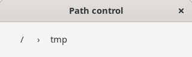
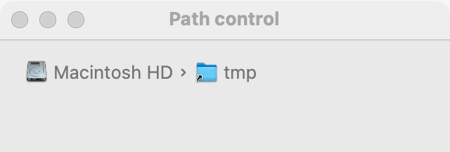
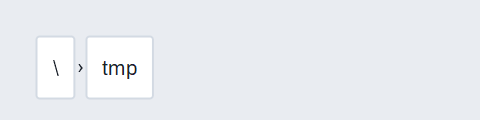
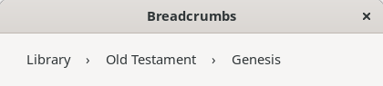
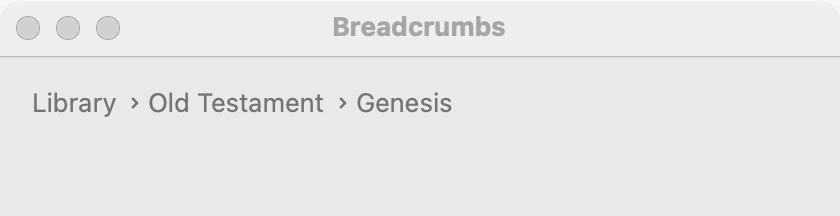

# Path control

`GUI_PATH_CONTROL` shows a file system path as a row of clickable parts, a breadcrumb, and reports which part the user clicked. Use it above a file or folder view, so the user sees where they are and can go up with one click. To ask for a file or folder, use [dialogs](dialogs.md); for a hierarchy that is not a path, use a [tree](tree.md).

## Example

```eiffel
class
	BREADCRUMB

create
	make

feature {NONE} -- Initialization

	make
		local
			l_window: GUI_WINDOW
			l_stack: GUI_STACK
		do
			create app.make ("Breadcrumb", "org.example.breadcrumb")
			create l_window.make ("Breadcrumb", 480, 120)
			create l_stack.make_vertical
			create crumbs.make
			crumbs.set_accessible_label ("Folder")
			crumbs.set_path ((create {EXECUTION_ENVIRONMENT}).current_working_path)
			create status.make ("Click a part of the path.")
			crumbs.selection_actions.extend (agent on_part)
			l_stack.extend (crumbs)
			l_stack.extend (status)
			l_window.set_content (l_stack)
			l_window.show
			app.run
		end

feature -- Access

	app: GUI_APPLICATION

	crumbs: GUI_PATH_CONTROL

	status: GUI_LABEL

feature {NONE} -- Events

	on_part (a_part: INTEGER)
		do
			status.set_text ({STRING_32} "You clicked " + crumbs.part (a_part))
		end

end
```

## Try it

The control shows the current folder as parts, from the root on. Click one of them, say the second: `selection_actions` fire with 2, and the label reads "You clicked" and that part's name. The path itself does not change; the program decides what a click means.

## API

| Feature | What it does |
|---|---|
| `make` | A path control with no path. Needs the application. Afterward `path` is Void. |
| `set_path (a_path)` | Show `a_path`, a `PATH`. Afterward `path` is `a_path`. Fires nothing. |
| `path` | The path shown, or Void. |
| `part_count` | How many parts are shown. The platform may add a part that names the root, as "Macintosh HD". |
| `part (i)` | Part `i`'s text, counting from the root; `1 <= i` and `i <= part_count`. |
| `selection_actions` | Agents run with `[part]` when the user clicks a part. |
| `set_parts (a_parts)` | Breadcrumbs for anything: shows `a_parts`, any texts, as they are ("Library", "Old Testament", "Genesis"). Afterward `path` is Void and `part_count = a_parts.count`. Fires nothing. |

The rest are the [common features](widget.md).

**Events:** `selection_actions` fire with the number of the part clicked (1 is the root). The control does not navigate: to go there, the program calls `set_path`, which fires nothing.

**Accessibility:** the role is `navigation`, and each part is a `link`. Give the control `set_accessible_label` ("Folder", "Location"), since it has no visible label.

## On each platform

| | Linux (GTK 4) | macOS (AppKit) | Windows (simple_widgets) |
|---|---|---|---|
| Native control | a `GtkBox` of frameless `GtkButton`s between "›" labels | `NSPathControl`, standard style, not editable | `GUI_SW_PATH_CONTROL`, an `SW_ROW` of `GUI_SW_LINK_BUTTON`s between "›" labels |
| Looks or behaves differently | An absolute path's first part is "/". | The parts are the names Finder shows, and the first may name the volume, as "Macintosh HD". | The first part is the root, "/" or a drive such as "C:". |

## Design guidance

- Place it across the top of the view it describes, stretched to the window's width.
- Use `part_count` and `part`, not the path's own components, to know what the user clicked: the platform may add a root part.
- To go up, rebuild the path from `path` and call `set_path`; then refresh the view below.
- Keep a text version of the location somewhere the user can copy it, such as a status bar; the parts are for clicking, not for reading the whole path.

## Gallery

| Linux | macOS | Windows |
|---|---|---|
|  |  |  |
|  |  |  |
