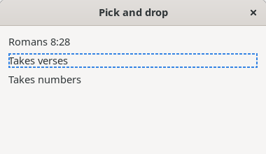
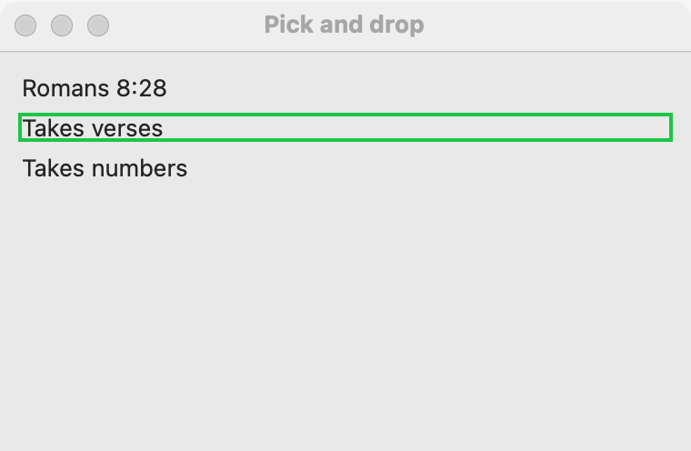
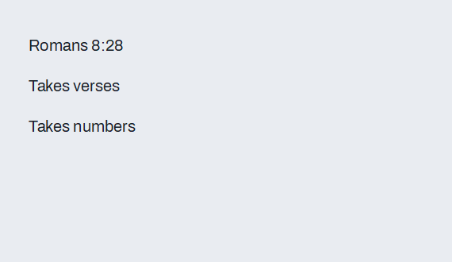

# Pick and drop

Pick and drop moves an object from one widget to another inside your program, in EiffelStudio's and Vision2's way. The user picks something up from a *source* and drops it on a *target*. What is carried is a *pebble*: any Eiffel object you choose, such as a note, a record or a row's text. A target takes only the pebbles its actions accept by type, so the user is never offered a drop that makes no sense. Use it to file a note under a heading, to send a record to a tool, or to link two parts of a window. To receive files or text dragged in from other programs, or to drag out to them, see [Drag and drop between programs](drag-and-drop-between-programs.md). To let the user reorder a list, a tree or tokens, see [Reordering](reordering.md), which is built on this page.

## Example

```eiffel
class PICK_DEMO create make
feature
	app: GUI_APPLICATION
	status: GUI_LABEL

	make
		local
			l_window: GUI_WINDOW
			l_stack: GUI_STACK
			l_source, l_texts, l_numbers: GUI_LABEL
		do
			create app.make ("Pick and drop demo", "org.simple-eiffel.pick-drop-demo")
			create l_window.make ("Pick and drop", 380, 220)
			create l_stack.make_vertical
			create l_source.make ("Romans 8:28")
			l_source.set_pebble ({STRING_32} "Romans 8:28")
			create l_texts.make ("Takes text")
			l_texts.set_accessible_label ("Text box")
			l_texts.drop_actions.extend (agent take_text (?))
			create l_numbers.make ("Takes numbers")
			l_numbers.set_accessible_label ("Number box")
			l_numbers.drop_actions.extend (agent take_number (?))
			create status.make ("Drag the verse onto a box.")
			l_stack.extend (l_source)
			l_stack.extend (l_texts)
			l_stack.extend (l_numbers)
			l_stack.extend (status)
			l_window.set_content (l_stack)
			l_window.show
			app.run
		end

	take_text (a_text: STRING_32)
		do
			status.set_text ({STRING_32} "Text received: " + a_text)
		end

	take_number (a_number: CELL [INTEGER])
		do
			status.set_text ({STRING_32} "Number received: " + a_number.item.out)
		end
end
```

## Try it

The window shows a source label "Romans 8:28", two target labels and the line "Drag the verse onto a box." Press on the source and move: a pick begins, and only the "Takes text" label lights as a place to drop, because its action takes a `STRING_32`. The "Takes numbers" label does not light: its action takes a `CELL [INTEGER]`, so a text can never reach it. Release over "Takes text": its action runs with the text and the line reads "Text received: Romans 8:28". Release anywhere else, or press Escape in the click mode: the pick is cancelled and nothing runs.

## API

**On every widget (`GUI_WIDGET`)**

| Feature | What it does |
|---|---|
| `set_pebble (a_pebble)` | Makes the widget a source that lifts `a_pebble`. `Void` makes it no source (unless its rows are; see below). Requires `is_gui_thread`. Ensures `pebble = a_pebble`. |
| `set_pebble_function (a_function)` | Makes the widget a source whose pebble is worked out by `a_function` when the pick starts, so it is always current. The function may answer `Void` to refuse a pick. Requires `is_gui_thread`. Ensures `pebble_function = a_function`. Replaces a pebble set before, and the reverse. |
| `pebble` | What a pick would lift now: the function's answer, or the pebble set. |
| `pebble_function` | The function set, or `Void`. |
| `is_pebble_source` | Can a pick start on this widget (a pebble, a function, or row pebbles)? |
| `set_pick_mode (a_mode)` | Chooses how the user picks from this widget. Requires `is_gui_thread` and `Pick_drag <= a_mode <= Pick_menu`. Ensures `pick_mode = a_mode`. |
| `pick_mode` | The mode now. `Pick_drag` unless set. |
| `Pick_drag`, `Pick_click`, `Pick_menu` | The three modes, numbered 1 to 3; see below. |
| `drop_actions` | A `GUI_DROP_ACTIONS`: what a drop on this widget runs. The first action added makes the widget a target. |
| `has_drop_actions` | Is the widget a target? |
| `last_drop_row` | The row the last drop landed on (0 when not on a row). Read it inside a drop action. |

**On `drop_actions` (`GUI_DROP_ACTIONS`)**

| Feature | What it does |
|---|---|
| `extend (an_action)` | Adds an action: a `PROCEDURE [TUPLE [ANY]]` that takes one argument, such as `agent take_text (?)`. It runs for pebbles that argument's type accepts. Requires `is_gui_thread`. Ensures `count = old count + 1`. |
| `extend_checked (an_action, a_check)` | As `extend`, and the action runs only for pebbles that `a_check` (a function from the pebble to `BOOLEAN`) also accepts. Requires `is_gui_thread`. Ensures `count = old count + 1`. |
| `set_veto (a_veto)` | A check for the whole target: a pebble it answers `False` for is refused, whatever its type. `Void` removes it. Ensures `veto = a_veto`. |
| `accepts (a_pebble)` | Would a drop of `a_pebble` run at least one action? Only the widgets that answer `True` light during a pick. |
| `count` | How many actions there are. |

**On lists, tables and trees (`GUI_ROW_SOURCE`)**

| Feature | What it does |
|---|---|
| `set_row_pebble_function (a_function)` | Lets each row carry the pebble that `a_function` answers for its row number (a tree passes its node number). `Void` means rows carry none. Requires `is_gui_thread`. Ensures `row_pebble_function = a_function`. |
| `row_pebble_function`, `has_row_pebbles` | The function, and whether one is set. |

**On the application (`GUI_APPLICATION`)**

| Feature | What it does |
|---|---|
| `pebble_in_flight` | The pebble the user has picked and not yet dropped, or `Void`. |
| `is_picking` | Is a pebble in flight? Useful in status lines and tests. |

Every setter fires nothing and changes only what the page says. Inherited: the [common features](widget.md).

## How a pick runs

1. The user starts a pick on a source, by gesture (see the modes below).
2. simple_gui asks the source for its pebble *now*. If it is `Void`, the pick is cancelled. Otherwise the application keeps the pebble as `pebble_in_flight`.
3. simple_gui asks every enabled widget with `drop_actions` whether it `accepts` the pebble. Those that do light as places to drop; the others do not, and cannot take a drop. A disabled widget is never offered.
4. The user drops on a lit target. The widget's `last_drop_row` is set, then every action whose argument takes the pebble (and whose check, if any, allows it) runs with it. The pebble is then forgotten.
5. A drop anywhere else, or a cancel, runs nothing, and the pebble is forgotten.

Nothing leaves your program: the platform carries only a token. The pebble stays an Eiffel object, so there is no conversion to text and back.

## The three modes

Each source has its own mode, set with `set_pick_mode`.

- `Pick_drag` (the default): press on the source, move, and release over a target.
- `Pick_click`: EiffelStudio's way. A secondary click (a right click) picks; a line follows the pointer from the source; a primary click on a target drops. Escape cancels, and so does a click that is not on a target.
- `Pick_menu`: a secondary click picks, and a menu opens listing the targets that accept the pebble, each by its accessible label. Choosing one drops there. Dismissing the menu cancels. This mode needs no aiming, so it suits small targets.

## Typed drops and checks

A target's action says what it takes by the type of its argument. A target with only `NOTE` actions never lights for a `STRING_32`, and a pebble that fits two actions runs both. When the type is not enough, add a check: `extend_checked` for one action, or `set_veto` for the whole target.

```eiffel
	target.drop_actions.extend_checked (agent file_note (?), agent is_filable (?))
	target.drop_actions.set_veto (agent is_open_task (?))
```

Here `is_filable` and `is_open_task` are your functions of one argument that answer `BOOLEAN`. The first limits one action; the second refuses the whole target for certain pebbles.

## Rows as sources and targets

A list, a table or a tree can give each row its own pebble:

```eiffel
	rows.set_row_pebble_function (agent (a_row: INTEGER): detachable ANY do Result := rows.i_th (a_row) end)
```

A pick that starts on a row lifts that row's pebble. A press outside the rows lifts the widget's own `pebble`, if it has one. A drop on a widget with rows tells the action which row it landed on in `last_drop_row`; 0 means empty space below the rows:

```eiffel
	take_text (a_text: STRING_32)
		do
			if rows.last_drop_row > 0 then
				-- dropped on that row of `rows'
			end
		end
```

For a tree, the row is the node number.

**Events:** `drop_actions` run when a pebble is dropped on a widget that accepts it, with the pebble as their argument. Nothing is reported when a pick is cancelled; read `app.is_picking` if you need to know that a pick is on. Code that changes a pebble, a mode or a target (`set_pebble`, `set_pick_mode`, `drop_actions.extend`) fires nothing.

**Accessibility:** picking is a pointer gesture. In `Pick_menu` mode a screen reader user chooses from a menu, and each entry is the target's accessible label, so give every target `set_accessible_label` in words that say what a drop does ("Trash", "Archive"). A target without a label is listed as "?" on Windows.

## On each platform

| | Linux (GTK 4) | macOS (AppKit) | Windows (simple_widgets) |
|---|---|---|---|
| Native machinery | `GtkDragSource` and `GtkDropTarget` for the drag mode; a secondary-click gesture and a line drawn over the window for the click mode; a popover of the targets for the menu mode | A local event monitor tracks the pick (a press that moves 4 points starts a drag); a line drawn in an overlay view for the click mode; a menu of the targets for the menu mode | simple_widgets' own pick gestures (a drag, or a secondary click for the other modes), with its line, and a menu opened at the pointer |
| Looks or behaves differently | A target that takes the drop gets a highlight (a CSS class). A drag that ends where no target takes it is a cancel. | The pointer is a copy pointer over an accepting target, and a "not allowed" pointer elsewhere. | Only the targets simple_gui named for this pick take the drop. |

## Design guidance

- Pick pebbles that are your own objects (a `NOTE`, a `TASK`), not plain strings. A string target takes every string in the program, while a `NOTE` target takes only notes.
- Let the target's type do the filtering, and use `set_veto` for rules the type cannot say ("not into a closed project"). A target that refuses is simply not offered, so the user never drops and then hears "no".
- Offer an alternative to dragging for important actions: set `Pick_menu` or `Pick_click` on the source, or give the action a button too. Aiming is hard for some users.
- Give each source and target an accessible label and a tooltip that says what happens on a drop.
- Use `set_pebble_function` when the pebble depends on state at the moment of the pick (the selected row, the text now in a field), so the pebble is never stale.
- Do the work in the drop action, then update your widgets there; every setter is silent, so the action will not trigger itself.

## Gallery

| Linux | macOS | Windows |
|---|---|---|
|  |  |  |
