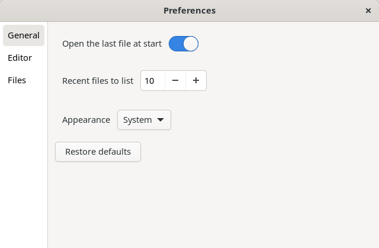
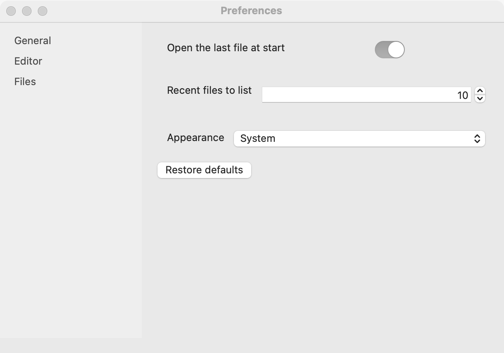
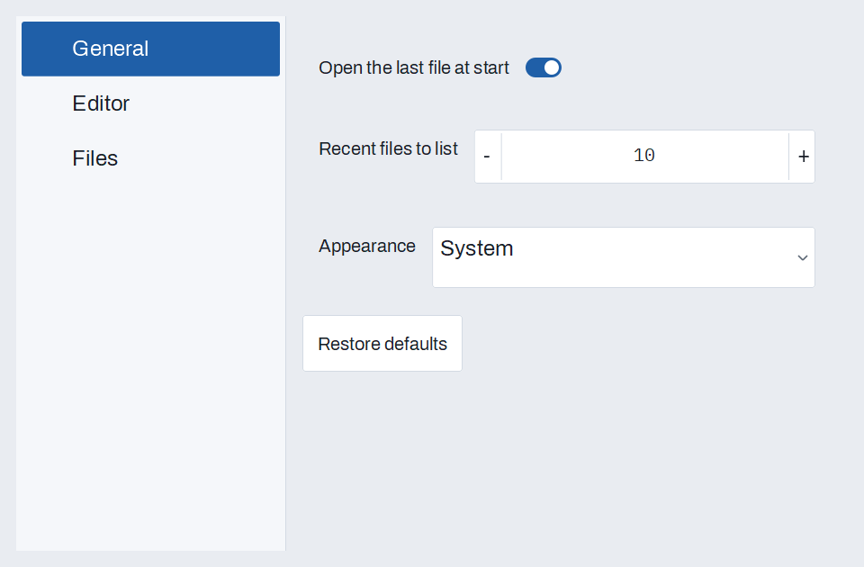

# Preferences

`GUI_PREFERENCES` keeps a program's settings: typed entries in sections, each with a key, a label and a default. Values are saved to a JSON file in the platform's settings folder on every change, and loaded when the preferences are made. `show_window` builds a ready preferences window from the entries, so a program describes its settings once and gets the window for free. Changes apply at once, with no OK button, as the macOS and GNOME guidelines ask.

## Example

```eiffel
class EDITOR create make
feature
	app: GUI_APPLICATION
	prefs: GUI_PREFERENCES

	make
		local
			l_window: GUI_WINDOW
			l_button: GUI_BUTTON
		do
			create app.make ("Editor", "org.example.editor")
			create prefs.make ("Editor")
			prefs.set_section ("General")
			prefs.add_boolean ("reopen", "Open the last file at start", True)
			prefs.add_integer ("recent", "Recent files to list", 10, 0, 30)
			prefs.add_choice ("theme", "Appearance", <<"System", "Light", "Dark">>, "System")
			prefs.set_section ("Editor")
			prefs.add_font ("font", "Font", create {GUI_FONT_CHOICE}.make ("Menlo", 12, False, False))
			prefs.add_color ("accent", "Highlight", 0xFFD54F)
			prefs.set_section ("Files")
			prefs.add_path ("projects", "Projects folder", Void)
			prefs.changed_actions.extend (agent (k: STRING_32) do print ("Changed " + k + "%N") end)
			create l_window.make ("Editor", 400, 200)
			create l_button.make ({STRING_32} "Preferences%/8230/")
			l_button.click_actions.extend (agent do prefs.show_window (Void) end)
			l_window.set_content (l_button)
			l_window.show
			app.run
		end
end
```

## Try it

Click **Preferences…**. A window opens with General, Editor and Files in a list on the left, and General's entries beside them: a switch for "Open the last file at start", a spin box at 10 and an Appearance dropdown on System. Turn the switch off: the program prints "Changed reopen" at once. Choose **Editor** for the font and color buttons, and **Files** for the folder field. Click **Restore defaults** to put the section's entries back. Close the window, quit, and start again: the values you chose are still there, read from `preferences.json`.

## API

| Feature | What it does |
|---|---|
| `make (a_name)` | Preferences kept in the platform's settings folder under `a_name`. Requires a name with no path separator. |
| `make_in_file (a_path)` | Preferences kept in the file at `a_path`, for tests or a portable install. |
| `set_section (a_name)`, `section`, `sections` | Entries added from now on go in section `a_name`; the sections in the order first used. |
| `add_boolean (a_key, a_label, a_default)` | A yes or no entry, shown as a switch. |
| `add_integer (a_key, a_label, a_default, a_min, a_max)` | A whole number in a range, shown as a spin box. |
| `add_text (a_key, a_label, a_default)` | A text, shown as a field. |
| `add_choice (a_key, a_label, a_choices, a_default)` | One of `a_choices`, shown as a dropdown. |
| `add_color (a_key, a_label, a_default)` | A color as 0xRRGGBB, shown as a color button. |
| `add_font (a_key, a_label, a_default)` | A `GUI_FONT_CHOICE`, shown as a font button. |
| `add_path (a_key, a_label, a_default)` | A file or folder, shown as a [file field](file-field.md). |
| `boolean_item`, `integer_item`, `text_item`, `color_item`, `font_item`, `path_item` | The value for a key. |
| `set_boolean`, `set_integer`, `set_text`, `set_color`, `set_font`, `set_path` | Sets the value for a key, saves it, and fires `changed_actions`. `set_integer` clamps into the range; `set_text` on a choice requires one of its choices. |
| `reset (a_key)`, `reset_section (a_name)`, `reset_all` | Back to the defaults. |
| `has (a_key)`, `count`, `label_of (a_key)`, `kind_of (a_key)`, `choices_of (a_key)` | What the entries are. |
| `file` | Where the values are kept. |
| `show_window (a_parent)`, `window` | Builds and shows the preferences window; the last one shown. |
| `changed_actions` | `GUI_ACTIONS [TUPLE [key: STRING_32]]`: run after a value changes, from code or the window. |

Every command requires `is_gui_thread`.

**Events:** `changed_actions` fires on every change, whether a `set_*` or `reset` call or the user in the window, so the program can apply settings in one place.

**The file:** values are saved as JSON on every change. Keys in the file that the program doesn't know are kept, so an older version doesn't lose a newer one's settings. A value of the wrong type, or out of its range, falls back to the default.

**Accessibility:** the window is a [sidebar](sidebar.md) of forms, so each control is labeled by its entry's label and the sections read as a list.

## On each platform

`GUI_PREFERENCES` is shared Eiffel: the window is made of the platform's own controls.

| | Linux (GTK 4) | macOS (AppKit) | Windows (simple_widgets) |
|---|---|---|---|
| Settings file | `$XDG_CONFIG_HOME/<name>/preferences.json`, or `~/.config/<name>/preferences.json` | `~/Library/Application Support/<name>/preferences.json` | `%APPDATA%\<name>\preferences.json` |
| Looks or behaves differently | The sections list is GTK's navigation sidebar. | Programs usually open it from the application menu's Settings… item, with Command+comma. | The sections list is a drawn SW_SIDEBAR; a number shows as a field with − and + buttons. |

## Design guidance

- Make the defaults right, so most people never open the window.
- Label entries as statements ("Open the last file at start"), not questions or bare nouns.
- Group entries in a few sections named for what they affect: General, Editor, Files.
- Apply each change as soon as `changed_actions` fires, so the user sees the effect while the window is open.

## Gallery

| Linux | macOS | Windows |
|---|---|---|
|  |  |  |
