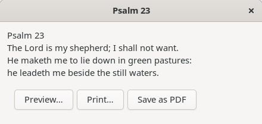
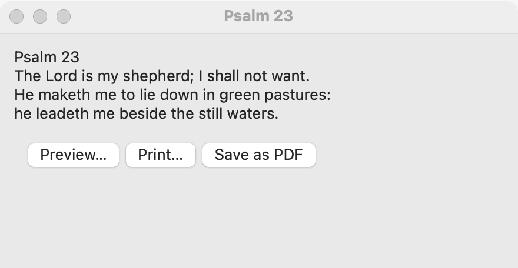
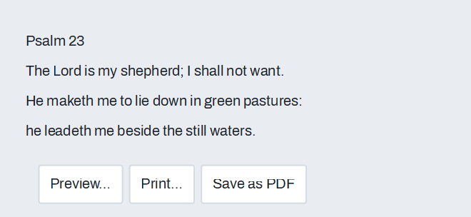
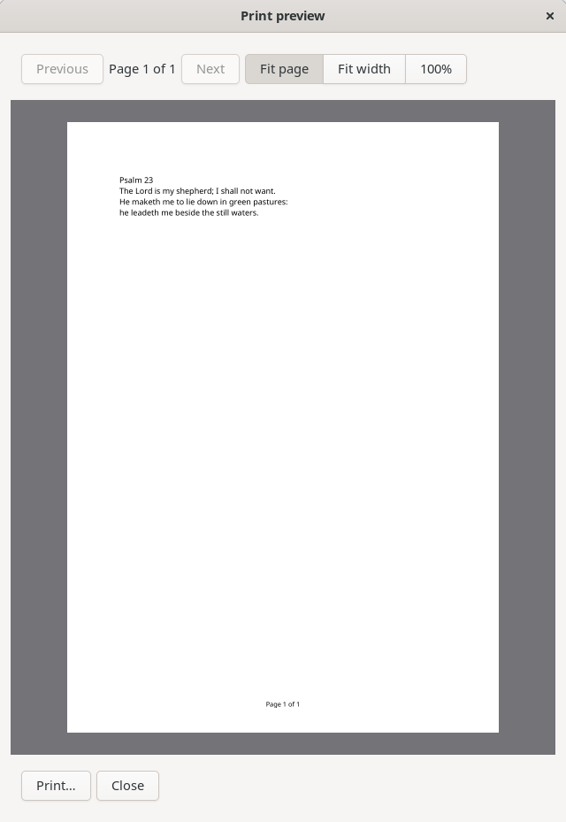
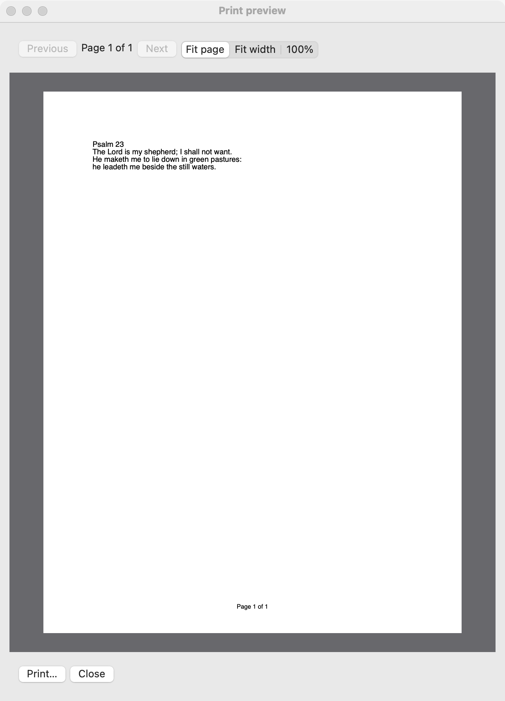
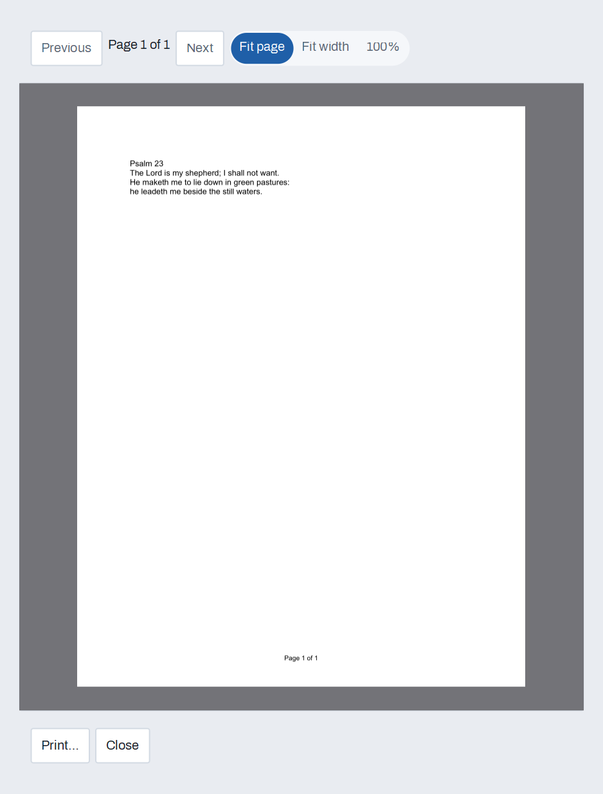

# Printing

`GUI_PRINT_JOB` prints pages you draw. You draw each page with [Cairo](canvas.md), in points, the same drawing API as the canvas; the job writes the pages into a PDF, then prints that PDF through the system's own print dialog, or saves it as a PDF file with no dialog. Text alone needs no drawing at all: `print_text` lays it out into pages with a page number in the footer.

Printing the PDF is simple_pdf's work (its print library, `simple_pdf_print`), so any program that has a PDF can print it the same way.

## Example

```eiffel
class
	PSALM_PRINTER

create
	make

feature {NONE} -- Initialization

	make
		local
			l_window: GUI_WINDOW
			l_stack, l_buttons: GUI_STACK
			l_preview, l_print, l_save: GUI_BUTTON
		do
			create app.make ("Psalm", "org.example.psalm")
			create l_window.make ("Psalm 23", 440, 200)
			create l_stack.make_vertical
			l_stack.extend (create {GUI_LABEL}.make (Psalm))
			create l_buttons.make_horizontal
			create l_preview.make ({STRING_32} "Preview%/8230/")
			l_preview.click_actions.extend (agent preview_psalm (l_window))
			create l_print.make ({STRING_32} "Print%/8230/")
			l_print.click_actions.extend (agent print_psalm (l_window))
			create l_save.make ("Save as PDF")
			l_save.click_actions.extend (agent save_psalm)
			l_buttons.extend (l_preview)
			l_buttons.extend (l_print)
			l_buttons.extend (l_save)
			l_stack.extend (l_buttons)
			l_window.set_content (l_stack)
			l_window.show
			app.run
		end

feature {NONE} -- Printing

	print_psalm (a_window: GUI_WINDOW)
		local
			l_job: GUI_PRINT_JOB
		do
			create l_job.make ("Psalm 23")
			l_job.print_text (Psalm)
			l_job.run_dialog (a_window)
			if l_job.last_outcome = l_job.Outcome_failed and then attached l_job.last_error as al_why then
				app.dialogs.inform ("Printing failed", al_why)
			end
		end

	preview_psalm (a_window: GUI_WINDOW)
			-- The pages as they will print; Print there goes on to the system's print dialog.
		local
			l_job: GUI_PRINT_JOB
		do
			create l_job.make ("Psalm 23")
			l_job.print_text (Psalm)
			l_job.run_preview (a_window)
			if l_job.last_outcome = l_job.Outcome_failed and then attached l_job.last_error as al_why then
				app.dialogs.inform ("Printing failed", al_why)
			end
		end

	save_psalm
			-- Ask where, as every program does, then save there. A cancelled dialog does nothing.
		local
			l_job: GUI_PRINT_JOB
		do
			if attached app.dialogs.save_file_named ("Save as PDF", <<"pdf">>, "psalm-23.pdf") as al_path then
				create l_job.make ("Psalm 23")
				l_job.print_text (Psalm)
				if not l_job.save_pdf (al_path.name) and then attached l_job.last_error as al_why then
					app.dialogs.inform ("Saving failed", al_why)
				end
			end
		end

	app: GUI_APPLICATION

	Psalm: STRING = "Psalm 23%NThe Lord is my shepherd; I shall not want.%NHe maketh me to lie down in green pastures:%Nhe leadeth me beside the still waters."

end
```

## Try it

Press **Preview…**: the psalm's page appears on gray, "Page 1 of 1", fitted; choose 100% and drag the page; press Close, and nothing prints. Press Preview… again and then its Print…: the system's print dialog opens. Press **Print…**: the system's print dialog opens over the window. Choose a printer and press Print: the psalm prints with "Page 1 of 1" in the footer, and `last_outcome` is `Outcome_printed`. Open it again and press Cancel: nothing prints and `last_outcome` is `Outcome_cancelled`. Press **Save as PDF**: the system's save dialog asks where, offering `psalm-23.pdf`; save, and open the file in any PDF reader. Cancel the save dialog and nothing is written. On a computer with no printer at all, Print… shows no dialog and `last_outcome` is `Outcome_no_printer`.

## API

| Feature | What it does |
|---|---|
| `make (a_title)` | A job called `a_title` (the name the print queue shows), portrait, on A4 where the system's default paper is A4 and on Letter otherwise, with nothing rendered. |
| `set_page_size (a_width, a_height)`, `paper_width`, `paper_height` | The paper, in points (72 to the inch). `Letter_width`, `Letter_height`, `A4_width` and `A4_height` are there for you. |
| `set_orientation (a_landscape)`, `is_landscape`, `page_width`, `page_height` | Portrait or landscape; `page_width` and `page_height` are the drawing area, turned with the orientation. |
| `print_text (a_text)` | Render `a_text` into pages: each line break starts a line, long lines wrap at spaces, one-inch margins, "Page N of M" in the footer. An empty text is one empty page. |
| `print_pages (a_count, a_draw)` | Render `a_count` pages, each drawn by `a_draw` (the page's number from 1, and a `CAIRO_CONTEXT` in points with the origin at the page's top left). |
| `page_count`, `last_error` | The pages rendered (0 before a rendering and after printing); why the last step failed, in a sentence you can show the user. |
| `last_error_detail` | For your log, not the user: what the platform's printing said behind `last_error` (on Windows, the print helper's exit code and output). Void when it said nothing. |
| `save_pdf (a_path)` | Write the rendered pages to `a_path` as a PDF, with no dialog: this is Save as PDF. False, with `last_error`, when the file can't be written. |
| `run_dialog (a_parent)` | The system's print dialog over window `a_parent`, then the rendered pages printed as the user chose. Afterwards `last_outcome` says how it ended, and the rendering is gone: render again to print or save again. |
| `run_preview (a_parent)` | A print preview of the rendered pages over `a_parent`, the same window on every platform: Previous and Next, "Page N of M", zoom (fit page, fit width, 100%), Print… and Close. Print… goes on to the system's print dialog (`run_dialog`); Close leaves `last_outcome` at `Outcome_cancelled` and keeps the rendering. Page Up and Page Down change pages, Home and End go to the first and last, the arrows or dragging move a page larger than the view, + and - step the zoom. |
| `last_outcome` | `Outcome_printed` (1: the job went to the system's print queue), `Outcome_cancelled` (0), `Outcome_failed` (-1, with `last_error`) or `Outcome_no_printer` (-2: no dialog was shown). The same values on every platform. |

To print a PDF you already have, without simple_gui, use simple_pdf's `SIMPLE_PDF_PRINTER` from `simple_pdf_print.ecf`: `print_file (a_path, a_title, a_parent_handle)` with the same four outcomes, `has_printer`, and the system's default paper.

## On each platform

Every platform shows its own print dialog and prints the same pages; the drawing is yours and identical everywhere.

- **Linux:** GTK's print dialog. The pages are drawn by Poppler, each sheet at the page's own size. Printers CUPS discovers on the network count as printers.
- **macOS:** the standard print panel, as a sheet on your window, with the system's own preview. Its paper size, orientation and scale start from your page and can be changed there, and its PDF menu offers Save as PDF. The pages are printed through PDFKit, macOS's own PDF library. Network printers CUPS discovers count as printers.
- **Windows:** the system's print dialog, owned by your window. The pages are printed by Poppler's `pdftocairo` (it ships in simple_pdf's `bin` folder). The dialog's printer, page range, copies, two-sided printing and paper tray are used. **Not applied on Windows:**
  - choices made under the printer's own **Preferences** button (color or black-and-white, print quality, stapling): the printer's defaults are used instead;
  - the dialog's paper size and orientation: each sheet takes the size and orientation of your page.

  Copies follow the dialog's collation: whole sets when it's on, and each page's copies together when it's off.

  Windows' print dialog itself shows no preview of a program's pages (macOS's panel has one of its own); `run_preview` is the preview on every platform.

  A printer that writes a file, such as Microsoft Print to PDF or the XPS writer, asks where to save it with the system's Save dialog, owned by your window. Cancelling there cancels the job, with no message.

  While a job goes to the printer, your windows are disabled, as they are under a dialog: they keep painting, but clicks and keys are ignored, and a request to close a window waits until the job has gone. A job that never finishes, such as a printer waiting on an answer nobody can give, is stopped after an hour and reported as failed. If your program ends during a job, the job ends with it.

  Printers whose names use characters outside plain ASCII can't be reached, and printing to them fails with a message. A PDF printed on Windows through a PDF printer carries its text as drawn shapes, so it can't be searched.

## Design guidance

- Lay pages out for paper, not for the screen: points, margins of about an inch, and type of 10 to 12 points.
- Offer **Preview…** beside **Print…**: `run_preview` shows the pages as they will print in the same window on every platform, and goes on to the print dialog when the user is ready.
- Offer **Save as PDF** beside **Print…**; it needs no printer, and it's how people send a page. Ask where with the system's save dialog (`app.dialogs.save_file_named`) and say nothing more on success: the file is where the user put it.
- For a character beyond ASCII in a label, such as the ellipsis in "Print…", write its code point: `{STRING_32} "Print%/8230/"`. The compiler reads a class file saved without a UTF-8 byte-order mark one character per byte, so an ellipsis typed into one shows as "Print…", even in a `STRING_32`; the escape is right in any file.
- Say what happened only when it failed. A cancelled dialog needs no message, and a printed job is the system's to report.
- Long jobs: render first, then call `run_dialog`. The dialog appears only once every page is ready.

## Gallery

| Linux | macOS | Windows |
|---|---|---|
|  |  |  |
|  |  |  |
