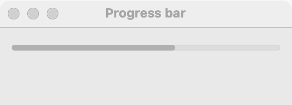

# Progress bar

`GUI_PROGRESS_BAR` shows how far along a task is, from 0 to 100 percent. Use it while the program copies, downloads, transcribes or computes something that takes more than a moment. It is not a meter: to show how full something is (a disk, a battery, a signal), use a [level bar](level-bar.md). The user cannot change it; for a value the user sets, use a [slider](slider.md).

## Example

```eiffel
class COPIER create make
feature
	app: GUI_APPLICATION
	progress: GUI_PROGRESS_BAR
	shown: GUI_LABEL

	make
		local
			l_window: GUI_WINDOW
			l_stack: GUI_STACK
			l_step: GUI_BUTTON
		do
			create app.make ("Copier", "org.example.copier")
			create l_window.make ("Copier", 340, 140)
			create l_stack.make_vertical
			create progress.make
			progress.set_accessible_label ("Copying")
			create shown.make ("0%% done")
			create l_step.make ("Copy the next file")
			l_step.click_actions.extend (agent copy_next)
			l_stack.extend (progress)
			l_stack.extend (shown)
			l_stack.extend (l_step)
			l_window.set_content (l_stack)
			l_window.show
			app.run
		end

	copy_next
		do
			progress.set_value ((progress.value + 10).min (100))
			shown.set_text (progress.value.out + "%% done")
		end
end
```

## Try it

A window opens with an empty progress bar, the line "0% done" and a button. Each press of **Copy the next file** moves the bar on by 10 percent and updates the line, up to 100%. In a real program, a worker does the task and reports through the application's mailbox, and the GUI calls `set_value` (see [Getting started](getting-started.md)).

## API

| Feature | What it does |
|---|---|
| `make` | A bar at 0. Ensures `value = 0`. |
| `value` | Percent done, 0 to 100. |
| `set_value (a_value)` | Shows `a_value` percent. Requires 0 <= `a_value` <= 100. Ensures `value = a_value`. |

Inherited: `set_accessible_label`, `set_tooltip`, `show`, `hide` and the rest of the [common features](widget.md).

**Events:** none. The user cannot change a progress bar.

**Accessibility:** the role is `progress-bar`, and its value is the percent. The bar has no text of its own, so give it `set_accessible_label` with the task ("Copying", "Transcribing").

## On each platform

| | Linux (GTK 4) | macOS (AppKit) | Windows (simple_widgets) |
|---|---|---|---|
| Native control | `GtkProgressBar`, expanding horizontally, centered vertically | `NSProgressIndicator`, bar style, determinate, 0 to 100 | `SW_PROGRESS`: a drawn track with the fill in the accent color |
| Looks or behaves differently | The percent is kept as given, so `value` reads back exactly. | At least 100 pixels wide, since a bar has no natural width of its own. | — <!-- PROD: confirm --> |

## Design guidance

- Put the bar where the user is looking: under the button that started the task, or at the bottom of the window's content.
- Pair it with a line of text saying what is happening ("Copying 3 of 10 files"); the bar shows how much, the text shows what.
- Update it from the GUI processor only. A worker sends its progress through `GUI_APPLICATION.mailbox` and wakes the loop; it never calls `set_value` itself.
- Hide the bar (`hide`) or reset it to 0 when the task ends, so an old 100% does not linger.
- Do not use it for a level that goes up and down; that is a [level bar](level-bar.md).

## Gallery

| Linux | macOS | Windows |
|---|---|---|
| <!-- PROD: Linux picture --> |  | <!-- PROD: Windows picture --> |
