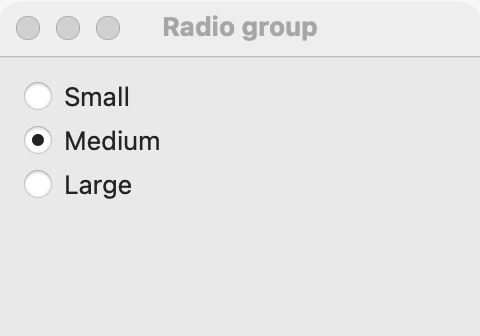

# Radio group

`GUI_RADIO_GROUP` is a set of radio buttons, of which exactly one is chosen. Pick a radio group for 2 to 5 choices that should all be visible, so the user can compare them before choosing. For 4 or more choices or little room, use a [dropdown](dropdown.md); for 2 to 5 short choices that switch a view, use a [segmented control](segmented.md); when the user may also type a value that is not in the list, use a [combo box](combo-box.md). For a single yes/no, use a [check box](check-box.md) or a [switch](switch.md).

## Example

```eiffel
class RADIO_GROUP_DEMO create make
feature
	app: GUI_APPLICATION
	radios: GUI_RADIO_GROUP
	label: GUI_LABEL

	make
		local
			l_window: GUI_WINDOW
			l_stack: GUI_STACK
		do
			create app.make ("Radio group demo", "org.simple-eiffel.radio-group-demo")
			create l_window.make ("Radio group", 320, 200)
			create l_stack.make_vertical
			create radios.make
			radios.set_accessible_label ("Size")
			radios.extend ("Small")
			radios.extend ("Medium")
			radios.extend ("Large")
			create label.make ("Size: Small")
			radios.selection_actions.extend (agent show_size)
			l_stack.extend (radios)
			l_stack.extend (label)
			l_window.set_content (l_stack)
			l_window.show
			app.run
		end

	show_size (a_row: INTEGER)
		do
			label.set_text ({STRING_32} "Size: " + radios.selected_text)
		end
end
```

## Try it

The window shows three radio buttons, one above the next, with "Small" chosen (the first `extend` chose it, without an event), and the label "Size: Small". Click "Large": `selection_actions` run with 3 and the label shows "Size: Large". Click "Large" again: nothing fires.

## API

| Feature | What it does |
|---|---|
| `make` | Makes an empty group whose radios stack one above the next. Ensures `count = 0` and `not is_horizontal`. |
| `make_horizontal` | Makes an empty group whose radios sit in a row. Ensures `count = 0` and `is_horizontal`. |
| `is_horizontal` | Are the radios in a row? |
| `extend (a_text)` | Adds a radio at the end. The first one added becomes the choice, without an event. Ensures `count = old count + 1`. |
| `count` | How many radios there are. |
| `i_th (i)` | The text of radio `i`. Requires `1 <= i and i <= count`. |
| `selected_index` | The chosen radio, 1-based, or 0 when there are none. |
| `selected_text` | The chosen radio's text, or empty when there are none. |
| `select_row (i)` | Chooses radio `i`, without an event. Requires `1 <= i and i <= count`; ensures `selected_index = i`. |
| `selection_actions` | Agents run when the user chooses another radio, with `row: INTEGER`. |

Every creation procedure requires `is_gui_thread` and `has_application`; every command requires `is_gui_thread`. A radio group has no `wipe_out`. See also [common features](widget.md).

**Events:** `selection_actions` run with the 1-based choice each time the user chooses a different radio. Choosing the one already chosen fires nothing. `extend` and `select_row` never fire `selection_actions`; their contracts ensure `selection_actions.fire_count = old selection_actions.fire_count`.

**Accessibility:** the group's role is `radio-group`, and each choice reads as `radio: <text>`. Give the group `set_accessible_label` naming the question ("Size").

## On each platform

| | Linux (GTK 4) | macOS (AppKit) | Windows (simple_widgets) |
|---|---|---|---|
| Native control | `GtkCheckButton`s joined in one group, in a box | `NSButton` radios in a stack view | `SW_RADIO_GROUP` |
| Looks or behaves differently | Aligned to the start. | Radios are 6 pixels apart in a column and 16 apart in a row. `disable` dims every radio. | — <!-- PROD: confirm --> |

## Design guidance

- Use a radio group for 2 to 5 choices the user should see side by side. Beyond that, a [dropdown](dropdown.md) takes less room.
- Stack radios vertically (`make`) unless the captions are a word or two each; then `make_horizontal` fits them in a row.
- Put a [label](label.md) above the group with the question, and give the group `set_accessible_label` with the same words.
- Choose a sensible first choice: the first `extend` is chosen from the start, so add the default first or call `select_row`.
- Use `disable` on the group to dim every radio at once when the question does not apply.

## Gallery

| Linux | macOS | Windows |
|---|---|---|
| <!-- PROD: Linux picture --> |  | <!-- PROD: Windows picture --> |
