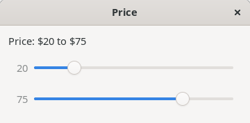
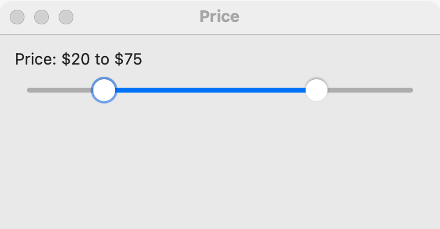
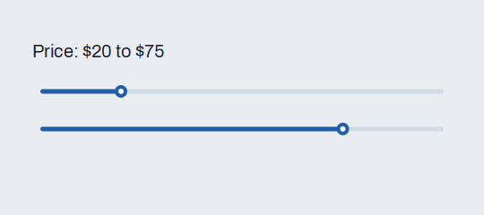

# Range slider

`GUI_RANGE_SLIDER` chooses two whole numbers at once: a low and a high, within a minimum and a maximum. Use it for a filter ("price from 20 to 80", "pages 10 to 40") where the user wants a span, not one value. For one number chosen by dragging, use a [slider](slider.md); for one exact number typed or stepped, use a [spin box](spin-box.md).

## Example

```eiffel
class PRICE_FILTER create make
feature
	app: GUI_APPLICATION
	price: GUI_RANGE_SLIDER
	shown: GUI_LABEL

	make
		local
			l_window: GUI_WINDOW
			l_stack: GUI_STACK
		do
			create app.make ("Range slider demo", "org.simple-eiffel.range-slider-demo")
			create l_window.make ("Price", 360, 160)
			create l_stack.make_vertical
			create price.make (0, 100)
			price.set_accessible_label ("Price range")
			price.set_step (5)
			price.set_range (20, 80)
			price.change_actions.extend (agent on_change)
			create shown.make ("Price: 20 to 80")
			l_stack.extend (price)
			l_stack.extend (shown)
			l_window.set_content (l_stack)
			l_window.show
			app.run
		end

	on_change (a_low, a_high: INTEGER)
		do
			shown.set_text ({STRING_32} "Price: " + a_low.out + " to " + a_high.out)
		end
end
```

## Try it

The window shows two thumbs on a scale from 0 to 100, set to 20 and 80 (`set_range` fired nothing), and the line "Price: 20 to 80". Drag the low thumb to 30: `change_actions` runs with 30 and 80, and the line updates. Drag the low thumb past the high one: it stops at the high thumb, so `low` never goes above `high`. The step (5 here) shapes the moves; the platform table says how.

## API

| Feature | What it does |
|---|---|
| `make (a_min, a_max)` | Makes a slider over `a_min` to `a_max` with the whole range selected and a step of 1. Requires `is_gui_thread`, `has_application` and `a_min < a_max`. Ensures `low = a_min` and `high = a_max`. |
| `minimum`, `maximum` | The ends of the scale. |
| `low`, `high` | The chosen span now. |
| `set_range (a_low, a_high)` | Chooses the span from the program, without an event. Requires `is_gui_thread` and `minimum <= a_low <= a_high <= maximum`. Ensures `low = a_low`, `high = a_high` and `change_actions.fire_count = old change_actions.fire_count`. |
| `step`, `set_step (a_step)` | The size of one step of a thumb (see the platform table). Requires `is_gui_thread` and `a_step > 0`. Ensures `step = a_step`. A new slider has step 1. |
| `change_actions` | `GUI_ACTIONS [TUPLE [low, high: INTEGER]]`: run when the user moves a thumb, with both values. |

The class invariant keeps `minimum < maximum` and `step > 0`. Inherited: the [common features](widget.md).

**Events:** `change_actions` runs with the new `low` and `high` when the user moves a thumb (by dragging or with the keys) and the span changes. `set_range` and `set_step` never fire it.

**Accessibility:** the group holds two sliders, named "Minimum" and "Maximum", which a screen reader reads with their values. Give the whole control `set_accessible_label` ("Price range").

## On each platform

| | Linux (GTK 4) | macOS (AppKit) | Windows (simple_widgets) |
|---|---|---|---|
| Native control | Two `GtkScale`s in a column, Minimum over Maximum, each showing its value | A custom control with two knobs on one track (AppKit has no two-thumb slider) | Two sliders in a column, Minimum over Maximum |
| Looks or behaves differently | A thumb moved by the user snaps to a multiple of the step counted from `minimum`. If one thumb crosses the other, it is held at the other's value. | The arrow keys move the focused knob by the step; Tab leaves the control. A knob cannot pass the other. | Each slider reports its own moves, and the pair is kept in order. |

## Design guidance

- Show the two values beside the slider (a label that you update in `change_actions`), so the user sees exact numbers.
- Choose `minimum` and `maximum` so that the whole range is a useful "no filter" state, and start with `set_range` at the whole range.
- Use `set_step` for values that only make sense in steps (5 dollars, 10 pages).
- A range of one value is allowed: `low` and `high` may be equal.
- When the user must type exact numbers, put two [spin boxes](spin-box.md) beside the slider and keep them in step with `set_range` and `set_value`, which fire nothing.

## Gallery

| Linux | macOS | Windows |
|---|---|---|
|  |  |  |
