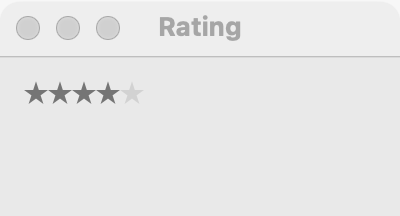

# Rating

`GUI_RATING` shows a row of stars, from none up to a maximum, that the user clicks to rate something. Use it for a personal score on an item (a song, a book, a photo). For a general number in a range, use a [slider](slider.md) or a [spin box](spin-box.md); to show a level the user does not set, use a [level bar](level-bar.md).

## Example

```eiffel
class
	REVIEW

create
	make

feature {NONE} -- Initialization

	make
		local
			l_window: GUI_WINDOW
			l_stack: GUI_STACK
		do
			create app.make ("Review", "org.example.review")
			create l_window.make ("Review", 280, 120)
			create l_stack.make_vertical
			create stars.make (5)
			stars.set_accessible_label ("Rating")
			create status.make ("Not rated yet.")
			stars.change_actions.extend (agent on_rate)
			l_stack.extend (stars)
			l_stack.extend (status)
			l_window.set_content (l_stack)
			l_window.show
			app.run
		end

feature -- Access

	app: GUI_APPLICATION

	stars: GUI_RATING

	status: GUI_LABEL

feature {NONE} -- Events

	on_rate (a_value: INTEGER)
		do
			status.set_text ("You gave " + a_value.out + " of " + stars.maximum.out + " stars.")
		end

end
```

## Try it

Five empty stars appear, with "Not rated yet." below them. Click the fourth star: `change_actions` fire with 4, four stars fill, and the label reads "You gave 4 of 5 stars."

## API

| Feature | What it does |
|---|---|
| `make (a_maximum)` | A rating of up to `a_maximum` stars, starting at none. Needs the application; `a_maximum >= 1`. |
| `value` | How many stars are filled, from 0 to `maximum`. |
| `maximum` | The number of stars. |
| `set_value (a_value)` | Fill `a_value` stars; `0 <= a_value` and `a_value <= maximum`. Fires nothing. |
| `change_actions` | Agents run with `[value]` when the user rates. |

The rest are the [common features](widget.md).

**Events:** `change_actions` fire with the new value when the user's click changes it; a click that leaves the value as it was fires nothing. `set_value` never fires them.

**Accessibility:** the role is `slider`, a value in a range. Give it `set_accessible_label` naming what is rated ("Rating", "Your rating of this book"), since the stars have no text.

## On each platform

| | Linux (GTK 4) | macOS (AppKit) | Windows (simple_widgets) |
|---|---|---|---|
| Native control | a `GtkBox` of frameless `GtkButton`s labeled ★ and ☆ | `NSLevelIndicator` in its rating style, editable | `SW_RATING` |
| Looks or behaves differently | — | — | Clicking the current rating again clears it to 0. |

## Design guidance

- Five stars is the convention; use `make (5)` unless the domain has its own scale.
- Put a label before it, or the item's name above it, so sighted users know what they rate.
- Show the user's own rating here. For an average of many ratings, show a number in a [label](label.md).
- Use `set_value` to show a saved rating; it fires nothing, so the program does not hear its own change.

## Gallery

| Linux | macOS | Windows |
|---|---|---|
| <!-- PROD: Linux picture --> |  | <!-- PROD: Windows picture --> |
