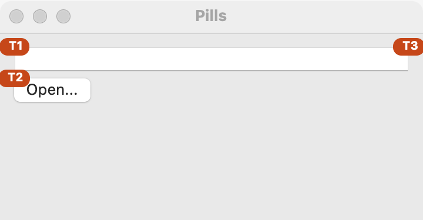

# Reference pills

A reference pill is a small colored tag with a short code, such as "C4", drawn on a part of a window. It does two jobs. It gives the part a name, so a person and a helper can talk about it ("press C4"). And it tells anyone who rests the pointer on it what the part is, what it does, where it fits in the window's operational flow, and how to reach it from the keyboard and the menus.

You define each pill once, in the application's list. Then you put it on any control or container with `set_pill`. The pills stay hidden until the program, or the user, shows them.

## Example

```eiffel
class PILLS_DEMO create make
feature
	app: GUI_APPLICATION

	make
		local
			l_window: GUI_WINDOW
			l_stack: GUI_STACK
			l_field: GUI_TEXT_FIELD
			l_button: GUI_BUTTON
			l_menu: GUI_MENU
		do
			create app.make ("Pills demo", "org.simple-eiffel.pills-demo")
			l_menu := app.menu.add_menu ("View")
			l_menu.add_pills_item
			l_menu := app.menu.add_menu ("Go")
			l_menu.add_item ("Open Notes...", "primary+shift+O", agent do end)
			app.pills.define ("T1", "Search box")
				.with_purpose ("Finds every note holding the words typed.")
				.with_flow ("Step 1: type here, then pick a result below.")
				.with_shortcut ("primary+F").do_nothing
			app.pills.define ("T2", "Open button")
				.with_purpose ("Opens a notes file.")
				.with_menu_item (l_menu, l_menu.last_item_id).do_nothing
			app.pills.define ("T3", "Search group")
				.with_purpose ("Everything for finding a note.").do_nothing
			create l_window.make ("Pills", 360, 160)
			create l_stack.make_vertical
			create l_field.make
			create l_button.make ("Open...")
			l_stack.extend (l_field)
			l_stack.extend (l_button)
			l_window.set_content (l_stack)
			l_field.set_pill ("T1")
			l_button.set_pill ("T2")
			l_stack.set_pill ("T3")
			l_stack.set_pill_corner (l_stack.Corner_top_right)
			l_window.show
			app.set_pills_shown (True)
			app.run
		end
end
```

## Try it

A window opens with a text field and an **Open...** button. Each of them wears a pill ("T1" and "T2"), and the whole column wears "T3" at its top right corner. Rest the pointer on "T1": the tip reads "T1: Search box", then what it does, its place in the flow, and "Keyboard: Ctrl+F" (Cmd+F on macOS). The tip on "T2" ends with "Menu: Go > Open Notes..." and "Keyboard: Ctrl+Shift+O", both taken from the menu item itself. Choose **View > Show Reference Pills**, or press Ctrl+Shift+P (Cmd+Shift+P on macOS), and the pills hide. Do it again and they come back.

## API

Defining, on `app.pills` (`GUI_PILLS`):

| Feature | What it does |
|---|---|
| `define (a_code, a_name)` | A new `GUI_PILL` coded `a_code` that names `a_name` ("Reference box"). Neither may be empty, and `a_code` must be new (`not has (a_code)`). |
| `has (a_code)` | Is a pill coded `a_code` defined? |
| `item (a_code)` | The pill coded `a_code`. Requires `has (a_code)`. |
| `count`, `definitions` | How many pills are defined, and the list of them in the order defined. |
| `as_markdown` | The pills as a Markdown table, for the program's documentation. See below. |

Filling a pill. Each of these returns the pill, so they chain. End a chain with `.do_nothing`.

| Feature | What it does |
|---|---|
| `with_purpose (a_text)` | What the part does. |
| `with_flow (a_text)` | Where it fits in the window's operational flow ("Step 1: ..."). |
| `with_shortcut (a_shortcut)` | Its keyboard shortcut, written neutrally: `"primary+L"`, `"primary+shift+P"`, `"F1"`. |
| `with_menu_path (a_path)` | Where it is in the menus, such as `"Go > Reference"`. |
| `with_menu_item (a_menu, an_item_id)` | Takes the menu path and the shortcut from item `an_item_id` of `a_menu`, so the pill and the menu never disagree. Requires `a_menu.has_item (an_item_id)`. |
| `tip` | The text the pointer reads on the pill. |

Attaching, on any widget (`GUI_WIDGET`):

| Feature | What it does |
|---|---|
| `set_pill (a_code)` | Names this widget, a control or a whole container, with the pill `a_code`. Requires `application.pills.has (a_code)`. |
| `set_pill_corner (a_corner)` | Where the pill sits: `Corner_top_left` (the default), `Corner_top_right`, `Corner_bottom_left` or `Corner_bottom_right`. |
| `clear_pill` | Takes the pill off. |
| `pill_code` | The code of the widget's pill, or Void. |
| `pill_corner` | The corner it sits in. |

Showing, on the application:

| Feature | What it does |
|---|---|
| `set_pills_shown (a_shown)` | Shows or hides every pill. Each shows its definition as it is now. |
| `toggle_pills` | Flips between shown and hidden. |
| `pills_shown` | Are the pills drawn? |
| `GUI_MENU.add_pills_item` | Adds the item "Show Reference Pills" with the shortcut `primary+shift+P`, which calls `toggle_pills`. Put it in a View or Help menu. Requires a menu in the menu bar, not a context menu. |

**The tip's layout.** The first line is the code and the name. Then come up to four lines, each only when it was given: "What it does:", "In the flow:", "Keyboard:" and "Menu:". The shortcut is shown as the platform writes it: Cmd, Shift and Option on macOS; Ctrl, Shift and Alt elsewhere.

**Documentation.** `app.pills.as_markdown` returns a table with the columns Code, Name, What it does, In the flow, Keyboard and Menu. Write it into the program's own documentation, and the pills and the documentation say the same thing.

**Events:** none. A pill is a label for people. Defining, attaching, showing and hiding fire nothing.

**Changing a definition.** A pill's tip is read when the pill is attached and when the pills are shown. After changing a definition while the pills are visible, call `set_pills_shown (True)` again.

**Accessibility:** a pill does not change the widget's accessible label or role, so set the accessible label on the widget as you always do.

## On each platform

| | Linux (GTK 4) | macOS (AppKit) | Windows (simple_widgets) |
|---|---|---|---|
| Native control | a `GtkLabel` in an overlay on the window, with the tip as its tooltip | an `NSTextField` label with a rounded orange background, placed over the window, with the tip as its tooltip | a reference mark of the window, drawn by simple_widgets; the backend keeps the pills and re-applies them each time one changes |
| Shortcut text | Ctrl, Shift, Alt | Cmd, Shift, Option | Ctrl, Shift, Alt |
| Looks or behaves differently | The pill is a label laid over the window. | A pill whose widget joins a window later is placed once the window has its content and is shown. | A pill shows only while its widget is in an open window. |

## Design guidance

- Give one pill to each meaningful part, and one to each group of parts, as the example does with "T3". Do not put a pill on every label and separator.
- Use codes that match the program's own documentation and the design board, so what people say ("C4") is what they find there.
- Define every pill before you attach or show it. `define` needs a new code, and `set_pill` needs a code that exists.
- Write the purpose as one short sentence about what the part does, and the flow as where it sits among the steps of the window.
- Take the menu path and the shortcut from the menu with `with_menu_item` whenever the part has a menu item, so they cannot drift apart.
- Add the menu item with `add_pills_item` so users can show and hide the pills themselves.
- Move a pill with `set_pill_corner` when it would cover something the user needs to read.

## Gallery

| Linux | macOS | Windows |
|---|---|---|
| <!-- PROD: Linux picture --> |  | <!-- PROD: Windows picture --> |
