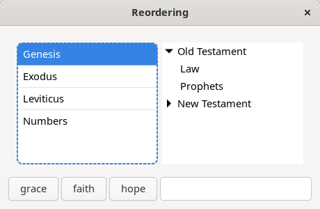
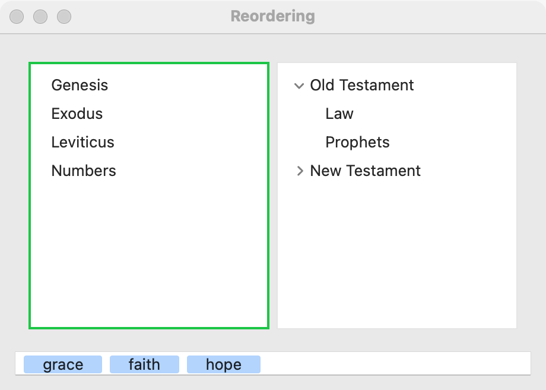
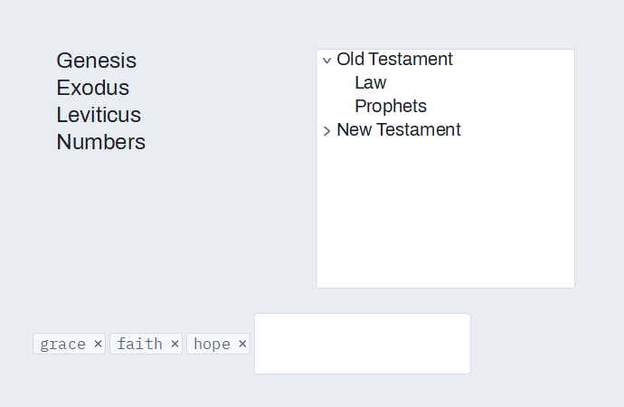

# Reordering

A [list](list.md), a [tree](tree.md) and a [token field](token-field.md) can let the user move their items by dragging: a list row to another place, a tree node under another node, a token to another place in its field or into another field. Use it when the order or the grouping is the user's to decide: a reading list, an outline, a set of tags. Reordering is built on [pick and drop](pick-and-drop.md): an item is picked up as a pebble that only its own widget (or, for tokens, any movable token field) takes. The widget moves the item itself and then tells you.

## Example

```eiffel
class REORDER_DEMO create make
feature
	app: GUI_APPLICATION
	books: GUI_LIST
	outline: GUI_TREE
	first_tags, second_tags: GUI_TOKEN_FIELD
	status: GUI_LABEL

	make
		local
			l_window: GUI_WINDOW
			l_stack: GUI_STACK
			l_law: INTEGER
		do
			create app.make ("Reordering demo", "org.simple-eiffel.reordering-demo")
			create l_window.make ("Reordering", 420, 460)
			create l_stack.make_vertical
			create books.make
			books.set_accessible_label ("Reading list")
			books.extend ("Genesis")
			books.extend ("Exodus")
			books.extend ("Leviticus")
			books.set_reorderable (True)
			books.reorder_actions.extend (agent on_reorder)
			create outline.make
			outline.set_accessible_label ("Outline")
			outline.add_root ("Law")
			l_law := outline.last_node
			outline.add_child (l_law, "Torah")
			outline.add_root ("Prophets")
			outline.expand (l_law)
			outline.set_reorderable (True)
			outline.move_actions.extend (agent on_move)
			create first_tags.make
			first_tags.set_accessible_label ("Tags to keep")
			first_tags.extend_token ("grace")
			first_tags.extend_token ("faith")
			first_tags.set_tokens_movable (True)
			first_tags.change_actions.extend (agent on_tokens)
			create second_tags.make
			second_tags.set_accessible_label ("Tags to review")
			second_tags.extend_token ("hope")
			second_tags.set_tokens_movable (True)
			second_tags.change_actions.extend (agent on_tokens)
			create status.make ("Drag a row, a node or a token.")
			l_stack.extend_stretching (books)
			l_stack.extend_stretching (outline)
			l_stack.extend (first_tags)
			l_stack.extend (second_tags)
			l_stack.extend (status)
			l_window.set_content (l_stack)
			l_window.show
			app.run
		end

	on_reorder (a_from, a_to: INTEGER)
		do
			status.set_text ({STRING_32} "Row " + a_from.out + " moved to place " + a_to.out)
		end

	on_move (a_node, a_parent, a_position: INTEGER)
		do
			status.set_text ({STRING_32} "Node " + a_node.out + " is now child " + a_position.out + " of " + a_parent.out)
		end

	on_tokens
		do
			status.set_text ({STRING_32} "Tags: " + first_tags.count.out + " and " + second_tags.count.out)
		end
end
```

## Try it

The window shows a list of three books, a two-level outline (Law with Torah under it, and Prophets), two token fields holding "grace" and "faith", and "hope", and the line "Drag a row, a node or a token." Drag "Genesis" onto "Leviticus": the list now reads Exodus, Leviticus, Genesis, "Genesis" is selected, and `reorder_actions` runs with 1 and 3. Drag it below the last row: it goes to the end. Drag "Torah" onto "Prophets": Torah, with everything under it, becomes Prophets' last child, and `move_actions` runs with the node, its new parent and its place. Drag a node onto empty space below the rows: it becomes the last top-level node. Drag "faith" onto the second token field: it leaves the first field and lands at the end of the second, and both fields run `change_actions`. Drag a token onto another token in the same field: it takes that token's place.

## API

**List (`GUI_LIST`)**

| Feature | What it does |
|---|---|
| `set_reorderable (a_on)` | Lets the user move rows, or stops it. Requires `is_gui_thread`. Ensures `is_reorderable = a_on`. |
| `is_reorderable` | May the user move rows? |
| `reorder_actions` | `GUI_ACTIONS [TUPLE [from_row, to_row: INTEGER]]`: run after the user moved row `from_row` to place `to_row`. |
| `move_row (a_from, a_to)` | Moves row `a_from` to place `a_to` and selects it there, without an event. Requires `is_gui_thread`, `1 <= a_from <= count` and `1 <= a_to <= count`. Ensures `count` is unchanged, `i_th (a_to) = old i_th (a_from)` and `selected_index = a_to`. |

**Tree (`GUI_TREE`)**

| Feature | What it does |
|---|---|
| `set_reorderable (a_on)` | Lets the user move nodes, or stops it. Requires `is_gui_thread`. Ensures `is_reorderable = a_on`. |
| `is_reorderable` | May the user move nodes? |
| `move_actions` | `GUI_ACTIONS [TUPLE [node, new_parent, position: INTEGER]]`: run after the user moved `node` under `new_parent` (0: the top level) as child number `position`. |
| `move_node (n, a_parent, a_position)` | Moves `n` with everything under it to be child number `a_position` of `a_parent` (0: the top level; `a_position` 0: last), without an event. Requires `is_gui_thread`, `is_node (n)`, `a_parent = 0` or a node, `a_parent /= n`, `a_parent` not below `n`, and `a_position >= 0`. Ensures `parent_of (n) = a_parent`, and it stands at `a_position` when that is within the siblings. |
| `children_of (n)` | A new list of `n`'s children in order; for 0, the top-level nodes. Requires `n = 0` or `is_node (n)`. |
| `is_ancestor (a, n)` | Is `a` above `n` (its parent, its parent's parent, and so on)? Requires `is_node (a)` and `is_node (n)`. |

**Token field (`GUI_TOKEN_FIELD`)**

| Feature | What it does |
|---|---|
| `set_tokens_movable (a_on)` | Lets the user move tokens, within this field and to and from other movable token fields, or stops it. Requires `is_gui_thread`. Ensures `are_tokens_movable = a_on`. |
| `are_tokens_movable` | May the user move tokens? |
| `put_token (a_text, i)` | Puts a token at place `i` (`count + 1`: the end), without an event. Requires `is_gui_thread`, a non-empty `a_text` and `1 <= i <= count + 1`. Ensures `count` has grown by one, `i_th (i)` is `a_text`, and `change_actions.fire_count` is unchanged. |
| `GUI_TOKEN_PEBBLE` | What a token carries: its `field`, its `index` there and its `text`. |

The rest of each control is described on its own page. Inherited: the [common features](widget.md).

**How the moves land**

- **List:** a row dropped on a row takes that row's place, and the rows between shift to make room. Dropped below the last row, it goes to the end. It is then selected. A row dropped on itself does not move and fires nothing.
- **Tree:** a node dropped on another node becomes that node's last child, bringing its subtree. Dropped on empty space below the rows, it becomes the last top-level node. A node never goes into itself or under one of its own children; such a drop does nothing. A node dropped where it already is (last child of the same parent) does nothing.
- **Tokens:** a token dropped on a token takes that token's place; dropped elsewhere on a field, it goes to the end. Between two fields, the token leaves one and joins the other. A field whose tokens are not movable neither gives tokens nor takes them.

Only the widget a row or node came from takes it back, so another reorderable list or tree never lights for it. If you set a row pebble function with `set_row_pebble_function` on a list or tree, its rows carry your pebbles instead and the widget no longer reorders by dragging.

**Events:** `reorder_actions`, `move_actions` and (for tokens) `change_actions` run after the widget has made the move, and only for moves the user makes. `move_row`, `move_node` and `put_token` move silently, so the program can change the order itself (a **Move up** button) without hearing itself. In a tree, the node number in an event is the number `add_root` and `add_child` gave it. A token move runs `change_actions` of each field it changes, so a move between two fields runs both.

**Accessibility:** the roles are the controls' own (`list`, `tree`, `text-box`). Dragging is a pointer gesture. Give the user another way to reorder: buttons **Move up** and **Move down** that call `move_row` or `move_node`, and update your own data in the same code.

## On each platform

| | Linux (GTK 4) | macOS (AppKit) | Windows (simple_widgets) |
|---|---|---|---|
| Native control | The control's own (`GtkListBox`, `GtkListView`, a box of tokens), with the pick and drop machinery on top | The control's own (`NSTableView`, `NSOutlineView`, `NSTokenField`), with the pick and drop machinery on top | The control's own (`SW_TEXT_LIST`, `SW_TREE`, chips in a row), with simple_widgets' pick gestures |
| Looks or behaves differently | A tree's parent that gets its first child must show an expander, so GTK makes that row again. | A tree move is made with the outline view's own item move, silently. | The tree finds the node under the pointer itself for real picks. |

A list move sends the rows to the control again, in their new order; no platform needs a special call. A tree move uses one backend call, `tree_move`, on all three platforms. A tree table cannot yet move its nodes. Because reordering rides on pick and drop, the widget's `pick_mode` applies to it as well.

## Design guidance

- Turn reordering on only where order carries meaning to the user. A list sorted by name should not invite dragging.
- Show the user that a row can move: say so in a tooltip or the surrounding text ("Drag to reorder").
- Handle `reorder_actions`, `move_actions` and `change_actions` by saving the new order. The widget has already moved the item, so do not move it again.
- Offer **Move up** and **Move down** buttons that call `move_row` or `move_node`. They serve keyboard and touch users, and they fire nothing.
- For tokens, make every field that should exchange tokens movable. A token goes only to a movable field.
- A tree moves a node as the last child of the node it lands on. For another position, call `move_node` from your own `move_actions` agent with the position you want, and read `children_of` to find where it stands.

## Gallery

| Linux | macOS | Windows |
|---|---|---|
|  |  |  |
