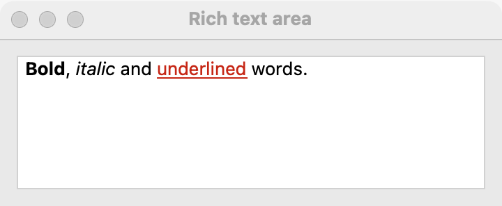

# Rich text area

`GUI_RICH_TEXT_AREA` is a multi-line text area whose ranges of text can be bold, italic, underlined, colored and sized. Use it for notes, messages and documents where the program or the user styles parts of the text. For plain text, use a [text area](text-area.md); for one line, a [text field](text-field.md).

## Example

```eiffel
class
	STYLER

create
	make

feature {NONE} -- Initialization

	make
		local
			l_window: GUI_WINDOW
			l_stack: GUI_STACK
			l_bold: GUI_BUTTON
		do
			create app.make ("Styler", "org.example.styler")
			create l_window.make ("Styler", 420, 240)
			create l_stack.make_vertical
			create status.make ("")
			create editor.make
			editor.set_accessible_label ("Note")
			editor.set_text ("Select some words, then click Bold.")
			editor.change_actions.extend (agent status.set_text ("Edited."))
			create l_bold.make ("Bold")
			l_bold.click_actions.extend (agent make_bold)
			l_stack.extend_stretching (editor)
			l_stack.extend (l_bold)
			l_stack.extend (status)
			l_window.set_content (l_stack)
			l_window.show
			app.run
		end

feature -- Access

	app: GUI_APPLICATION

	editor: GUI_RICH_TEXT_AREA

	status: GUI_LABEL

feature {NONE} -- Events

	make_bold
		do
			if editor.selection_start <= editor.selection_end then
				editor.set_bold (editor.selection_start, editor.selection_end, True)
			end
		end

end
```

## Try it

The area shows "Select some words, then click Bold." Select "some words" and click **Bold**: the program reads `selection_start` and `selection_end` and makes that range bold. Formatting from code fires nothing, so the label stays empty. Type a letter in the area: `change_actions` fire and the label reads "Edited."

## API

| Feature | What it does |
|---|---|
| `make` | An empty, editable rich text area. Needs the application. |
| `text`, `set_text (a_text)` | The text; `set_text` replaces it and fires nothing. |
| `count` | How many characters the text has. |
| `set_bold (a_start, an_end, a_on)` | Bold on or off for characters `a_start` to `an_end`. The range must be valid (`is_valid_range`). |
| `set_italic (a_start, an_end, a_on)` | Italic on or off for the range. |
| `set_underline (a_start, an_end, a_on)` | Underline on or off for the range. |
| `set_text_color (a_start, an_end, a_color)` | Color the range `a_color`, as 0xRRGGBB (`a_color <= 0xFFFFFF`). |
| `set_font_size (a_start, an_end, a_points)` | Size the range in points; `a_points > 0`. |
| `is_bold_at (i)`, `is_italic_at (i)`, `is_underlined_at (i)` | Is character `i` bold, italic, underlined? `i` must be a valid position (`is_valid_position`). |
| `has_text_color_at (i)` | Does character `i` have a color of its own, not the theme's text color? |
| `text_color_at (i)` | Character `i`'s color, 0xRRGGBB. Requires `has_text_color_at (i)`. |
| `font_size_at (i)` | Character `i`'s size in points. |
| `select_range (a_start, an_end)` | Select the range; an empty range puts the caret before `a_start`. |
| `selection_start` | The first selected character, or the caret's position when nothing is selected. |
| `selection_end` | The last selected character; `selection_start - 1` when nothing is selected. |
| `is_valid_position (i)` | `1 <= i` and `i <= count`. |
| `is_valid_range (a_start, an_end)` | `1 <= a_start`, `a_start <= an_end + 1` and `an_end <= count`. An empty range has `an_end = a_start - 1`. |
| `is_read_only`, `set_read_only (a_on)` | Read-only text can still be selected and copied. |
| `change_actions`, `change_count` | Agents run after each user edit, and how many times they have fired. |

Positions are 1-based characters, counted as `STRING_32` counts them, and a range `a_start` to `an_end` includes both ends. An emoji is one character. The rest are the [common features](widget.md).

**Events:** `change_actions` fire, with no arguments, after each edit the user makes, as in any [text area](text-area.md). `set_text`, the formatting features and `select_range` never fire them.

**Accessibility:** the role is `text-box`. Give it `set_accessible_label` naming what it holds ("Message", "Note"). Screen readers read the text; color and size alone do not carry meaning to them, so do not use color as the only sign of something.

## On each platform

| | Linux (GTK 4) | macOS (AppKit) | Windows (simple_widgets) |
|---|---|---|---|
| Native control | `GtkTextView` with tags, in a scrolled window | `NSTextView` with attributes, in a scroll view | `GUI_SW_RICH_TEXT_AREA`, an `SW_TEXT_BOX` with a style per character, drawn as `SW_MARK`s |
| Looks or behaves differently | — | The text view takes no pictures. | Keeps and reads back each range's point size, but does not draw it yet: the text shows at one size. |

## Design guidance

- Let it take the window's room: add it with `extend_stretching`, or make it the window's content.
- Act on the user's selection: read `selection_start` and `selection_end`, and check that the range is not empty (`selection_start <= selection_end`) before formatting.
- Put formatting commands in a Format [menu](menus.md) with shortcuts (`primary+B`, `primary+I`, `primary+U`) as well as in buttons or a [toolbar](toolbar.md).
- Call `set_text` first, then format: the positions refer to the text as it is when you format.
- For text the user only reads, call `set_read_only (True)`; it can still be selected and copied.

## Gallery

| Linux | macOS | Windows |
|---|---|---|
| <!-- PROD: Linux picture --> |  | <!-- PROD: Windows picture --> |
