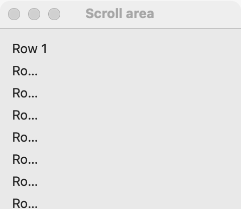

# Scroll area

`GUI_SCROLL_AREA` shows a part of a widget that is larger than the room it has, with scroll bars as needed. Use it for a long form, a tall column of options, or a large picture. [Lists](list.md), [tables](table.md), [trees](tree.md) and [text areas](text-area.md) already scroll on their own: do not put them in a scroll area.

## Example

```eiffel
class LONG_LIST create make
feature
	app: GUI_APPLICATION
	scroll: GUI_SCROLL_AREA

	make
		local
			l_window: GUI_WINDOW
			l_column, l_rows: GUI_STACK
			l_top: GUI_BUTTON
			i: INTEGER
		do
			create app.make ("Long list", "org.example.long-list")
			create l_window.make ("Long list", 320, 300)
			create l_column.make_vertical
			create scroll.make
			create l_rows.make_vertical
			from i := 1 until i > 60 loop
				l_rows.extend (create {GUI_CHECK_BOX}.make ("Option " + i.out))
				i := i + 1
			end
			scroll.set_content (l_rows)
			create l_top.make ("Back to the top")
			l_top.click_actions.extend (agent back_to_top)
			l_column.extend_stretching (scroll)
			l_column.extend (l_top)
			l_window.set_content (l_column)
			l_window.show
			app.run
		end

	back_to_top
		do
			scroll.scroll_to (0, 0)
		end
end
```

## Try it

A window opens with sixty check boxes in a scroll area and a **Back to the top** button under it. Only the first options fit, so a vertical scroll bar shows. Scroll down, then press the button: the area scrolls back so "Option 1" is at the top again.

## API

| Feature | What it does |
|---|---|
| `make` | An empty scroll area. Ensures `content = Void`. |
| `set_content (a_widget)` | Puts `a_widget` inside. Requires `content = Void` (one widget, once), `a_widget.parent = Void` and `a_widget /= Current`. Ensures `content = a_widget`. |
| `content` | The widget inside, once set. |
| `scroll_to (a_x, a_y)` | Brings the content's point (`a_x`, `a_y`) to the top left, as far as it goes. Requires `a_x >= 0` and `a_y >= 0`. |

Inherited: `set_base_direction`, `show`, `hide` and the rest of the [common features](widget.md).

**Events:** none. Scrolling, by the user or by `scroll_to`, fires nothing.

**Accessibility:** the role is `generic`, and its scroll bars are left out of `describe_accessibility`; a screen reader goes straight to the content. Label the controls inside.

**Sizes.** The content keeps its natural size and scrolls when it is larger than the area; when it is smaller, it fills the area. A scroll area has little natural size of its own, so give it room: `extend_stretching` in a stack, or make it the window's content.

## On each platform

| | Linux (GTK 4) | macOS (AppKit) | Windows (simple_widgets) |
|---|---|---|---|
| Native control | `GtkScrolledWindow`, set to expand both ways | `NSScrollView` without a background; scroll bars show when needed and hide when idle | `SW_SCROLL_AREA`: a viewport over the child, with a drawn scroll bar <!-- PROD: confirm the 300-pixel height it is made with --> |
| Looks or behaves differently | — <!-- PROD: confirm --> | The content sits in a flipped holder at least as large as the visible area. | The mouse wheel scrolls and the drawn thumb drags. |

## Design guidance

- Put a [stack](stack.md) or [grid](grid.md) inside, not single controls; the stack's margins keep the content off the edges.
- Give the scroll area the spare room with `extend_stretching`; keep buttons that act on the whole window outside it, so they never scroll away.
- Never put a list, table, tree or text area inside a scroll area: two scroll bars on one axis confuse users.
- When a form is so long it needs scrolling, consider splitting it into [tabs](tabs.md) or [expanders](expander.md) first.
- Use `scroll_to (0, 0)` after replacing what the content shows, so the user starts at the top.

## Gallery

| Linux | macOS | Windows |
|---|---|---|
| <!-- PROD: Linux picture --> |  | <!-- PROD: Windows picture --> |
