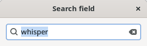
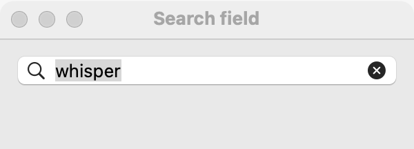
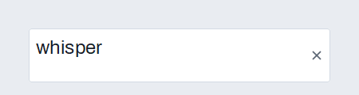

# Search field

`GUI_SEARCH_FIELD` is a [text field](text-field.md) with the platform's search look and a button that clears it. Use it to filter a list or table as the user types, or to start a search with Return. For other one-line entries, use a plain [text field](text-field.md).

## Example

```eiffel
class SEARCH_FIELD_DEMO create make
feature
	app: GUI_APPLICATION
	search: GUI_SEARCH_FIELD
	label: GUI_LABEL

	make
		local
			l_window: GUI_WINDOW
			l_stack: GUI_STACK
		do
			create app.make ("Search field demo", "org.simple-eiffel.search-field-demo")
			create l_window.make ("Search field", 360, 140)
			create l_stack.make_vertical
			create search.make
			search.set_accessible_label ("Search the books")
			search.set_placeholder ("Search")
			create label.make ("Type, then press Return")
			search.change_actions.extend (agent filter)
			search.search_actions.extend (agent run_search)
			l_stack.extend (search)
			l_stack.extend (label)
			l_window.set_content (l_stack)
			l_window.show
			app.run
		end

	filter
		do
			label.set_text ({STRING_32} "Filtering by: " + search.text)
		end

	run_search
		do
			label.set_text ({STRING_32} "Searching for: " + search.text)
		end
end
```

## Try it

The window shows a search field with the hint "Search". Type: `change_actions` run after each edit and the label shows "Filtering by: …". Press Return: `search_actions` run and the label shows "Searching for: …". Click the field's clear button: the text empties, `change_actions` run, and the label shows "Filtering by: " with nothing after it.

## API

`GUI_SEARCH_FIELD` inherits every feature of [`GUI_TEXT_FIELD`](text-field.md).

| Feature | What it does |
|---|---|
| `make` | Makes an empty search field. Ensures `text.is_empty`. |
| `text`, `set_text (a_text)` | The text, and replacing it without a change event. |
| `placeholder`, `set_placeholder (a_text)` | The hint shown while empty. |
| `set_numeric` | Always left to right. |
| `change_actions` | Agents run after each user edit, and when the clear button empties the field. |
| `search_actions` | Agents run when the user presses Return. These are the same agents as `activate_actions`. |
| `activate_actions` | The same collection as `search_actions`. |
| `change_count` | How many change events the field has received. |

Every creation procedure requires `is_gui_thread` and `has_application`; every command requires `is_gui_thread`. See also [common features](widget.md).

**Events:** typing and clearing fire `change_actions`, with no arguments. Return fires `search_actions` (that is, `activate_actions`), with no arguments. `set_text` never fires `change_actions`; its contract ensures `change_count = old change_count`.

**Accessibility:** the role is `search-box`. Give it `set_accessible_label` saying what it searches ("Search the books"); the placeholder is not a label.

## On each platform

| | Linux (GTK 4) | macOS (AppKit) | Windows (simple_widgets) |
|---|---|---|---|
| Native control | `GtkSearchEntry` | `NSSearchField` | `GUI_SW_SEARCH_FIELD`, an `SW_TEXT_BOX` with a clear button |
| Looks or behaves differently | Return fires `search_actions` even when the field is empty. | The search look and a clear button. Return with text fires `search_actions`; the clear button fires `change_actions`. | The hint is "Search" until `set_placeholder`; Return fires even when the field is empty. |

## Design guidance

- Put the search field above what it searches. In a horizontal row, add it with `GUI_STACK.extend_stretching` so it takes the spare width.
- Filter on `change_actions` when the search is fast (a list in memory); search on `search_actions` when it is slow (a file or a network).
- Give it `set_accessible_label` naming what is searched; a short placeholder such as "Search" is enough for sighted users.
- When the field is cleared, show everything again: the clear button fires `change_actions` with `text` empty.

## Gallery

| Linux | macOS | Windows |
|---|---|---|
|  |  |  |
