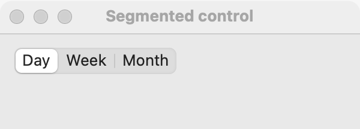

# Segmented control

`GUI_SEGMENTED` is a row of joined segments, one selected at a time. Pick a segmented control for 2 to 5 short choices that switch a view, such as Day, Week and Month in a calendar, or List and Grid. For 2 to 5 choices that set an option (rather than switch a view), use a [radio group](radio-group.md); for 4 or more choices or little room, use a [dropdown](dropdown.md); when the user may also type a value that is not in the list, use a [combo box](combo-box.md).

## Example

```eiffel
class SEGMENTED_DEMO create make
feature
	app: GUI_APPLICATION
	segments: GUI_SEGMENTED
	label: GUI_LABEL

	make
		local
			l_window: GUI_WINDOW
			l_stack: GUI_STACK
		do
			create app.make ("Segmented demo", "org.simple-eiffel.segmented-demo")
			create l_window.make ("Segmented control", 360, 140)
			create l_stack.make_vertical
			create segments.make
			segments.set_accessible_label ("View")
			segments.extend ("Day")
			segments.extend ("Week")
			segments.extend ("Month")
			create label.make ("Showing one day")
			segments.selection_actions.extend (agent switch_view)
			l_stack.extend (segments)
			l_stack.extend (label)
			l_window.set_content (l_stack)
			l_window.show
			app.run
		end

	switch_view (a_row: INTEGER)
		do
			inspect a_row
			when 1 then
				label.set_text ("Showing one day")
			when 2 then
				label.set_text ("Showing one week")
			else
				label.set_text ("Showing one month")
			end
		end
end
```

## Try it

The window shows three joined segments, Day, Week and Month, with Day selected (the first `extend` selected it, without an event), and the label "Showing one day". Click "Month": `selection_actions` run with 3 and the label shows "Showing one month". Click "Month" again: nothing fires.

## API

| Feature | What it does |
|---|---|
| `make` | Makes an empty segmented control. Ensures `count = 0`. |
| `extend (a_text)` | Adds a segment at the end. The first one added becomes the selection, without an event. Ensures `count = old count + 1`. |
| `count` | How many segments there are. |
| `i_th (i)` | The text of segment `i`. Requires `1 <= i and i <= count`. |
| `selected_index` | The selected segment, 1-based, or 0 when there are none. |
| `selected_text` | The selected segment's text, or empty when there are none. |
| `select_row (i)` | Selects segment `i`, without an event. Requires `1 <= i and i <= count`; ensures `selected_index = i`. |
| `selection_actions` | Agents run when the user selects another segment, with `row: INTEGER`. |

Every creation procedure requires `is_gui_thread` and `has_application`; every command requires `is_gui_thread`. A segmented control has no `wipe_out`. See also [common features](widget.md).

**Events:** `selection_actions` run with the 1-based segment each time the user selects a different one. Selecting the one already selected fires nothing. `extend` and `select_row` never fire `selection_actions`; their contracts ensure `selection_actions.fire_count = old selection_actions.fire_count`.

**Accessibility:** the role is `radio-group`, and each segment reads as `radio: <text>`, as a radio group's choices do. Give it `set_accessible_label` naming what it switches ("View").

## On each platform

| | Linux (GTK 4) | macOS (AppKit) | Windows (simple_widgets) |
|---|---|---|---|
| Native control | `GtkToggleButton`s joined in a box with the `linked` style | `NSSegmentedControl`, select one | `SW_SEGMENTED`, drawn |
| Looks or behaves differently | Aligned to the start. | Each segment is as wide as its text. | Each segment is as wide as its text plus 26 pixels, and the control is 32 pixels tall. |

## Design guidance

- Keep segment texts to one short word each; a segmented control is for quick switching, not for reading.
- Use it for 2 to 5 segments. More than that, use a [dropdown](dropdown.md).
- Place it above or at the top of the view it switches, at its natural width.
- Switch the view in `selection_actions` at once; a segmented control should never wait for an OK button.
- Give it `set_accessible_label`; screen readers read it as a radio group, so name the question it answers.

## Gallery

| Linux | macOS | Windows |
|---|---|---|
| <!-- PROD: Linux picture --> |  | <!-- PROD: Windows picture --> |
