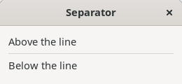
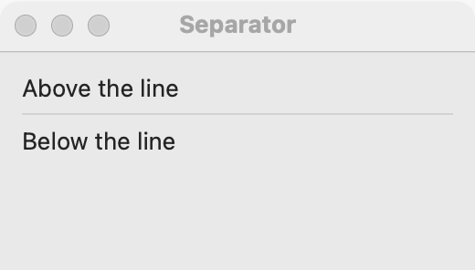
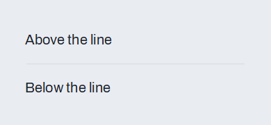

# Separator

`GUI_SEPARATOR` is a thin line between groups of widgets. Use it to split a long stack of controls into groups. When a group needs a title, use a [group box](group-box.md) instead; when the space between groups is enough, use a stack's spacing and no line at all.

## Example

```eiffel
class SEPARATOR_DEMO create make
feature
	app: GUI_APPLICATION
	label: GUI_LABEL

	make
		local
			l_window: GUI_WINDOW
			l_stack: GUI_STACK
			l_line: GUI_SEPARATOR
			l_button: GUI_BUTTON
		do
			create app.make ("Separator demo", "org.simple-eiffel.separator-demo")
			create l_window.make ("Separator", 320, 160)
			create l_stack.make_vertical
			create label.make ("Above the line")
			create l_line.make_horizontal
			create l_button.make ("Below the line")
			l_button.click_actions.extend (agent clicked)
			l_stack.extend (label)
			l_stack.extend (l_line)
			l_stack.extend (l_button)
			l_window.set_content (l_stack)
			l_window.show
			app.run
		end

	clicked
		do
			label.set_text ("The button below the line was clicked")
		end
end
```

## Try it

The window shows a label, a thin horizontal line, and a button. A separator has no events; clicking the button below it changes the label above it.

## API

| Feature | What it does |
|---|---|
| `make_horizontal` | Makes a line across, for a vertical stack. Ensures `not is_vertical`. |
| `make_vertical` | Makes a line down, for a horizontal stack. Ensures `is_vertical`. |
| `is_vertical` | Does the line run down? |

Every creation procedure requires `is_gui_thread` and `has_application`. See also [common features](widget.md).

**Events:** none.

**Accessibility:** the role is `separator`. Screen readers pass over it, and `describe_accessibility` leaves it out. It needs no label.

## On each platform

| | Linux (GTK 4) | macOS (AppKit) | Windows (simple_widgets) |
|---|---|---|---|
| Native control | `GtkSeparator` | `NSBox`, separator type, 1 pixel thick | `SW_SEPARATOR`, an etched line |
| Looks or behaves differently | — | — | The line sits in a slot 9 pixels thick. |

## Design guidance

- Use `make_horizontal` in a vertical stack and `make_vertical` in a horizontal one.
- Use separators sparingly. One line between two groups helps; a line between every row is noise.
- When the groups need names, a [group box](group-box.md) with a title says more than a line.
- A separator is decoration only. Do not use it to carry meaning a screen reader user would miss.

## Gallery

| Linux | macOS | Windows |
|---|---|---|
|  |  |  |
