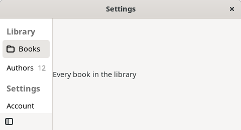
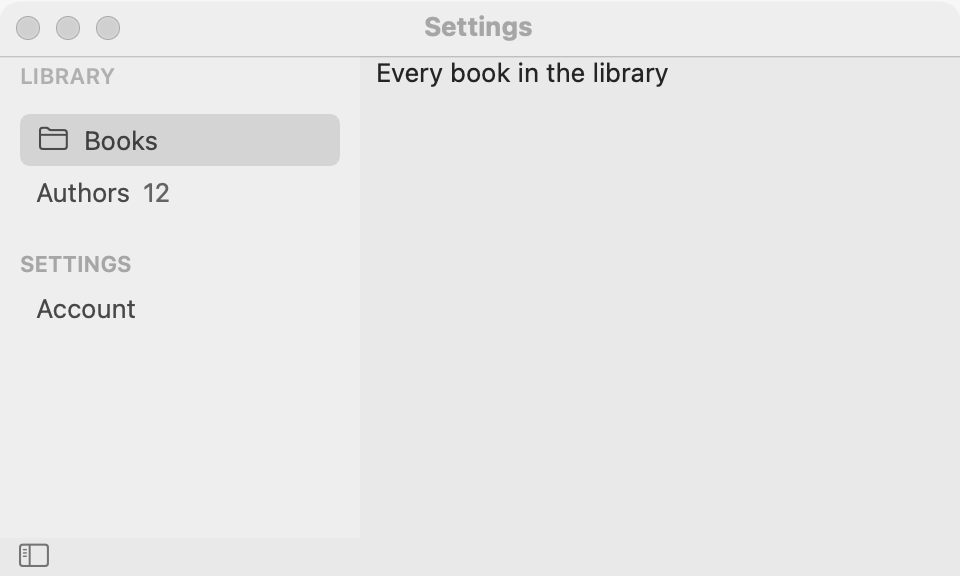
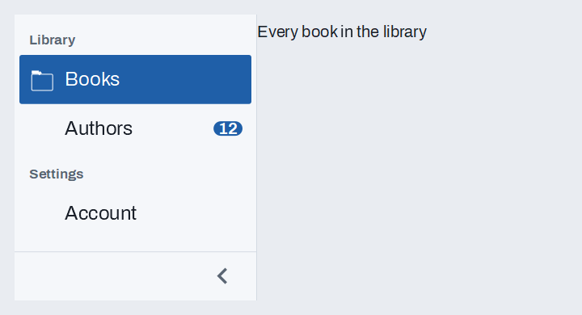

# Sidebar

`GUI_SIDEBAR` shows one page at a time beside a list of the pages' titles, as the settings windows of macOS, GNOME and Windows do. Rows can have an icon and a badge, headings group them, and the list can collapse to icons only to give the page more room. For a few pages under a row of titles, use [tabs](tabs.md); for steps the user must take in order, use a [wizard](wizard.md).

## Example

```eiffel
class SETTINGS create make
feature
	app: GUI_APPLICATION
	side: GUI_SIDEBAR
	shown: GUI_LABEL

	make
		local
			l_window: GUI_WINDOW
		do
			create app.make ("Settings", "org.example.settings")
			create l_window.make ("Settings", 640, 400)
			create side.make
			side.add_heading ("Library")
			side.extend (create {GUI_LABEL}.make ("Every book in the library"), "Books")
			side.extend (create {GUI_LABEL}.make ("Everyone who wrote them"), "Authors")
			side.add_heading ("Settings")
			side.extend (create {GUI_LABEL}.make ("Your name and email"), "Account")
			side.set_page_icon (1, "folder")
			side.set_page_badge (2, "12")
			side.set_collapsible (True)
			side.page_changed_actions.extend (agent (p: INTEGER) do print ("Page " + p.out + "%N") end)
			l_window.set_content (side)
			l_window.show
			app.run
		end
end
```

## Try it

The window shows Books, Authors and Account in a list on the left, under the headings Library and Settings, with Books' page beside them. Click **Authors**: its page shows and the program prints "Page 2". Use Up and Down to move through the pages (the headings are skipped). Press the collapse button at the list's foot: the list narrows to icons, and Authors and Account, which have none, show their first letters in circles. Rest the pointer on one to see its title.

## API

| Feature | What it does |
|---|---|
| `make` | A sidebar with no pages. Ensures `count = 0` and `not is_collapsed`. |
| `extend (a_page, a_title)` | Adds `a_page` as the last page, its title in the list. Requires `a_page.parent = Void` and a non-empty title. The first page added is shown. |
| `add_heading (a_text)` | A group heading in the list before the next page. It is not a page: page numbers skip it. |
| `set_page_icon (i, a_name)` | An icon before page `i`'s title, from `GUI_ICON`. See [Icons and badges](icons-and-badges.md). |
| `set_page_badge (i, a_text)` | A badge after page `i`'s title (empty: none). Requires `a_text.count <= 8`. |
| `select_page (i)`, `selected_index` | Shows page `i`, with no event; the page shown. |
| `page_count`, `page_title (i)` | How many pages, and their titles. |
| `set_collapsible (a_on)`, `is_collapsible` | Puts a collapse button at the list's foot, or not. |
| `collapse`, `expand`, `is_collapsed` | Icons only (titles as tooltips; headings hidden), or titles again, with no event. |
| `page_changed_actions` | `GUI_ACTIONS [TUPLE [page: INTEGER]]`: run when the user chooses a page. |
| `collapse_actions` | `GUI_ACTIONS [TUPLE [is_collapsed: BOOLEAN]]`: run when the user presses the collapse button. |

Every command requires `is_gui_thread`.

**Events:** `page_changed_actions` fires when the user clicks a page's row, or chooses it with the keys. `collapse_actions` fires when the user presses the collapse button. `select_page`, `collapse` and `expand` fire nothing.

**Accessibility:** the list reads as a list of the pages, named by their titles, with the shown one selected. Collapsed, a page without an icon shows its title's first letter in a circle, so it can still be found and clicked, and its title is its tooltip.

## On each platform

| | Linux (GTK 4) | macOS (AppKit) | Windows (simple_widgets) |
|---|---|---|---|
| Native control | A `GtkListBox` in the `navigation-sidebar` style over a collapse button, beside a `GtkStack` | A source-list `NSTableView` (headings are group rows) beside a tabless `NSTabView`; the collapse button is `sidebar.left` | `SW_SIDEBAR`: a drawn navigation list beside the page area |
| Looks or behaves differently | Up and Down move the selection, which shows the page. | Collapsed, the list is about 44 points wide. | Up and Down move a cursor; Return or Space shows the page. |

## Design guidance

- Use a sidebar for five or more sections, or sections the user moves between often. For two to four, [tabs](tabs.md) take less room.
- Group long lists with headings, and give every page an icon when the list can collapse, so the collapsed list reads well.
- Keep titles to one or two words. Put counts ("12 new") in badges, not titles.
- Remember the page the user was on, and `select_page` it when the window opens again.

## Gallery

| Linux | macOS | Windows |
|---|---|---|
|  |  |  |
