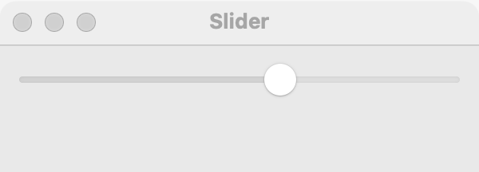

# Slider

`GUI_SLIDER` holds a whole number in a range, which the user chooses by dragging a knob. Use a slider when an approximate value is fine and the user judges it by watching the effect, such as volume, zoom or brightness. When the exact value matters, use a [spin box](spin-box.md).

## Example

```eiffel
class SLIDER_DEMO create make
feature
	app: GUI_APPLICATION
	label: GUI_LABEL

	make
		local
			l_window: GUI_WINDOW
			l_stack: GUI_STACK
			l_slider: GUI_SLIDER
		do
			create app.make ("Slider demo", "org.simple-eiffel.slider-demo")
			create l_window.make ("Slider", 360, 140)
			create l_stack.make_vertical
			create l_slider.make (0, 100)
			l_slider.set_value (50)
			l_slider.set_accessible_label ("Volume")
			create label.make ("Volume: 50")
			l_slider.change_actions.extend (agent show_volume)
			l_stack.extend (l_slider)
			l_stack.extend (label)
			l_window.set_content (l_stack)
			l_window.show
			app.run
		end

	show_volume (a_value: INTEGER)
		do
			label.set_text ("Volume: " + a_value.out)
		end
end
```

## Try it

The window shows a horizontal slider with its knob in the middle and the label "Volume: 50". Drag the knob: `change_actions` run on every step while you drag, and the label follows.

## API

| Feature | What it does |
|---|---|
| `make (a_min, a_max)` | Makes a horizontal slider from `a_min` to `a_max`, at `a_min`, with a step of 1. Requires `a_min <= a_max`. |
| `make_vertical (a_min, a_max)` | Makes a vertical slider, at `a_min`. Requires `a_min <= a_max`. |
| `value` | The knob's value. Always `minimum <= value and value <= maximum`. |
| `set_value (a_value)` | Moves the knob to `a_value`, without a change event. Requires `minimum <= a_value and a_value <= maximum`. |
| `minimum` | The lowest value. |
| `maximum` | The highest value. |
| `step` | The knob stops every `step` (1: on every whole number). |
| `set_step (a_step)` | Sets the step. Requires `a_step > 0`. |
| `is_vertical` | Does the slider run up and down? |
| `change_actions` | Agents run when the user moves the knob to another value, with `value: INTEGER`. |

Every creation procedure requires `is_gui_thread` and `has_application`; every command requires `is_gui_thread`. See also [common features](widget.md).

**Events:** `change_actions` run with the new value on every step while the user drags, not only when they let go. `set_value` never fires `change_actions`; its contract ensures `change_actions.fire_count = old change_actions.fire_count`.

**Accessibility:** the role is `slider`. Give it `set_accessible_label`; it has no visible text that names it.

## On each platform

| | Linux (GTK 4) | macOS (AppKit) | Windows (simple_widgets) |
|---|---|---|---|
| Native control | `GtkScale` | `NSSlider`, continuous | `SW_SLIDER` |
| Looks or behaves differently | Shows the value beside the knob. Takes the spare width (or, vertical, the spare height). `set_step` sets the arrow-key step, and Page Up and Page Down move ten steps. The user's moves land on a step from the minimum; a value set from code is kept exactly. | At least 100 pixels long. With a step, tick marks are drawn and the knob stops on them, when the range has at most 100 steps. | A vertical slider is drawn vertically, with the minimum at the bottom. The user's moves land on a step from the minimum; a value set from code is kept exactly. Arrow keys move one step, Page Up and Page Down ten, and Home and End go to the ends. |

## Design guidance

- Put a [label](label.md) before or above the slider and give the slider `set_accessible_label` with the same words. When the number matters, show it in a label that `change_actions` update.
- Give a horizontal slider room: in a horizontal row, add it with `GUI_STACK.extend_stretching`.
- Keep the work in `change_actions` light, since it runs on every step of a drag.
- For exact values, or ranges too wide to drag precisely, use a [spin box](spin-box.md).

## Gallery

| Linux | macOS | Windows |
|---|---|---|
| <!-- PROD: Linux picture --> |  | <!-- PROD: Windows picture --> |
