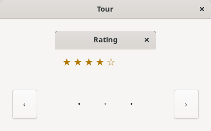
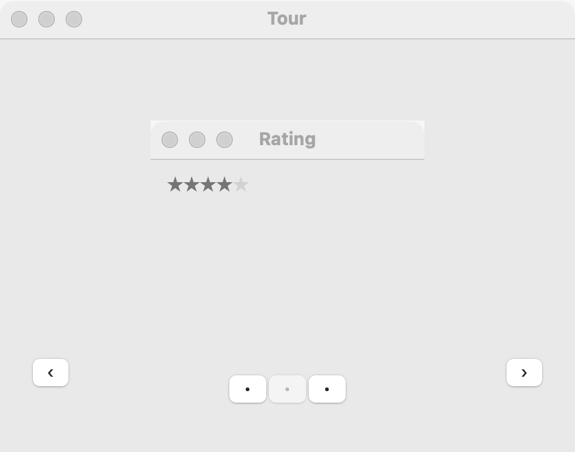
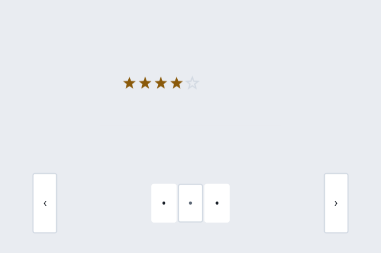

# Slideshow

`GUI_SLIDESHOW` shows one item at a time, with previous and next buttons and a row of dots for the position, as a carousel or a welcome tour does. Any widget can be an item: a picture, a page of text, a form. It can wrap around, and it can play by itself, pausing while the pointer is over it. For pages the user chooses by name, use [tabs](tabs.md); for steps in order, use a [wizard](wizard.md).

## Example

```eiffel
class TOUR create make
feature
	app: GUI_APPLICATION
	show: GUI_SLIDESHOW

	make
		local
			l_window: GUI_WINDOW
		do
			create app.make ("Tour", "org.example.tour")
			create l_window.make ("Welcome", 420, 300)
			create show.make
			show.extend_item (create {GUI_IMAGE}.make_from_file (create {PATH}.make_from_string ("tour/1.png")))
			show.extend_item (create {GUI_IMAGE}.make_from_file (create {PATH}.make_from_string ("tour/2.png")))
			show.extend_item (create {GUI_LABEL}.make ("That's it. Have fun!"))
			show.set_wraps (True)
			show.set_interval (4000)
			show.item_changed_actions.extend (agent (i: INTEGER) do print ("Item " + i.out + "%N") end)
			l_window.set_content (show)
			l_window.show
			app.run
		end
end
```

## Try it

The window shows the first picture, with ‹ and › buttons at its sides and three dots below. The dot for the item shown is dimmed. Every four seconds the next item shows and the program prints "Item 2", then "Item 3". Rest the pointer over the slideshow and it stops moving on; move the pointer away and it goes on. Click › to move on at once. Click the first dot to go back to the start. Because it wraps, › on the last item goes to the first.

## API

| Feature | What it does |
|---|---|
| `make` | An empty slideshow. Ensures `count_items = 0`. |
| `extend_item (a_widget)` | Adds `a_widget` as the last item. Requires `a_widget.parent = Void`. The first item added is shown. |
| `show_item (i)`, `item_index` | Shows item `i`, with no event; the item shown (0 for none). |
| `count_items` | How many items. |
| `go_next`, `go_previous` | As the user's › and ‹: moves on or back, and fires `item_changed_actions`. Bind them to keys if your program wants Left and Right. |
| `set_wraps (a_on)`, `wraps` | Whether › on the last item goes to the first, and ‹ on the first goes to the last. |
| `set_interval (a_ms)`, `interval` | Moves on by itself every `a_ms` milliseconds; 0 stops. At the end it goes back to the first, even without `wraps`. |
| `set_paused (a_on)`, `is_paused` | Holds autoplay, as the pointer over the slideshow does, or lets it go on. |
| `item_changed_actions` | `GUI_ACTIONS [TUPLE [index: INTEGER]]`: run when the user or autoplay shows another item. |

Every command requires `is_gui_thread`.

**Events:** `item_changed_actions` fires for the user's buttons and dots, and for autoplay. `show_item` fires nothing.

**Accessibility:** the buttons are named "Previous" and "Next", and each dot is named "Item n". All of them take the keyboard focus like any button. Autoplay pauses while the pointer is over it. Programs should also offer a way to stop it, since moving content distracts some people.

## On each platform

The slideshow is shared: a tabless [tabs](tabs.md) control and native [buttons](button.md), so each part is the platform's own.

| | Linux (GTK 4) | macOS (AppKit) | Windows (simple_widgets) |
|---|---|---|---|
| Native control | A `GtkNotebook` without tabs, with `GtkButton`s | A tabless `NSTabView` with `NSButton`s | `SW_TABS` without tabs, with simple_widgets buttons |
| Looks or behaves differently | — | — | — |

## Design guidance

- Keep it to a few items, about seven at most. People rarely look at more.
- Let autoplay be slow, four seconds or more, and leave it off when the items have text to read.
- Don't hide anything important in a later item. Many people never move on.
- For a picture viewer the user drives, set no interval and let ‹, › and the keys do the work.

## Gallery

| Linux | macOS | Windows |
|---|---|---|
|  |  |  |
